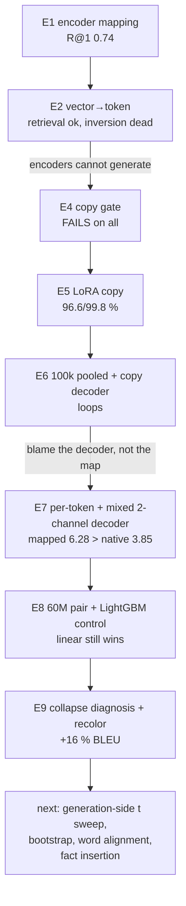

# CURRENT-PROGRESS — the whole project in one file

*Consolidated 2026-11-19 from every README / REPORT / HANDOFF / LEARNING_NOTE / results file in the
repo. Nothing here is new measurement: every number is copied from a committed artefact, and each
claim names the file it came from. If a number here disagrees with a results file, the results file
wins — except for the stale artefacts listed in §10.*

**Scope of this file:** origin → what was tried → what it measured → what it means → what is still
open. It is a *progress* document, not a paper draft (drafts: `research-phase01-ver02/paper.md`,
`research-phase01-1.2/*-intro.md`).

---

## 0. State of play (one screen)

| question | answer today | evidence |
|---|---|---|
| Can a linear map carry a sentence between two frozen monolingual models? | **Yes, geometrically.** Token cosine 0.44–0.48, sentence cosine 0.75–0.81, retrieval@1 8.8–48.8 % against identity ≈ 0. | ver02 Tab. 3/7, phase01 §4 |
| Can a decoder render text from mapped vectors? | **Yes, weakly.** Best channel 3.17 BLEU / 20.28 chrF / NLL 3.29 (vi→en, n=1,000) — and it beats the decoder's *own* encoder channel on chrF/COMET/NLL. | 1.2 `GEN_VARIANTS.md` |
| Is it a translation system? | **No.** A 77 M `opus-mt-vi-en` gets 22.27 BLEU / 0.752 COMET on the same data (phase01). The decoder (60 M, 1 epoch, 60–100 k pairs) is the binding constraint. | phase01 §5 |
| Is the ANN/MLP needed? | **No — repeatedly falsified** (ridge ≥ MLP at 9 k, 100 k, 9.28 M token pairs; 512 LightGBM wins in-sample, loses held-out). | small-experiment §3, ver02 §3.4 |
| What is the map's real defect? | **Collapse toward the target mean**, not "strangeness". 0.000 anomaly rate, ‖z‖ 6.31 vs 22.77 for genuine states. | 1.2 `ANOMALY.md` |
| Best cheap improvement found | **ridge + partial recolor (t=0.1)**: +16 % BLEU, +2.8 % chrF, zero training cost, one 512×512 matrix. | 1.2 `GEN_VARIANTS.md` |
| Does the project's *title* layer (dynamic fact insertion) exist in the pipeline? | **No.** Only a 15-sentence Ollama pilot (2026-10-31) + a fact database. No RAG-over-mapped-translation run yet. | §11 |
| Paper status | Two drafts exist as md: translation (ver02 `paper.md` + 1.2 intro) and neural-mining (`neuralMining.md` + 1.2 intro). PRISMA workbooks complete. | §12 |

**Most defensible one-sentence contribution today:**

> A 263 k-parameter (512-d pair) / 590 k-parameter (768-d pair) linear map between two frozen
> monolingual models (60 M–220 M) produces *significantly better English* than letting the target
> model read the source language itself (chrF/COMET/NLL, both directions), while every cheaper proxy
> for that quality — token cosine, retrieval@1, anomaly scores, R² — either fails to rank the mappers
> correctly or actively inverts the ranking. What actually tracks generation is the *scale* of the
> mapped cloud relative to the decoder's own states.

---

## 1. What the project is trying to prove — and how the claim evolved

The project name is *Culinary CSI Translation Through Dynamic Fact Insertion*: translate food/culture
content, and insert verified facts where a reader would otherwise lose the meaning (e.g. *bánh chưng*).
That decomposes into three layers that have moved at very different speeds:

| layer | what it is | status |
|---|---|---|
| **A. Representation bridge** (core technical claim) | EN/VI model → hidden states → map → other model's space → its decoder | heavily measured, 6 experiment rounds |
| **B. Readout** (can a decoder use an injected vector at all?) | copy gate + LoRA readout + channel training | measured; naive version falsified, trained version works weakly |
| **C. Fact insertion** (the title's differentiator) | retrieve an atomic fact, decide whether to insert, insert | **only a 15-sentence pilot; no experiment inside the bridge** |
| D. Culture/familiarity survey | separate research direction | not started, deliberately separated |

**The core idea was originally "ANN". It became "linear".** This is the single biggest conceptual
shift in the project, and it happened on evidence, not taste:

| when | document | mapping hypothesis |
|---|---|---|
| 2026-10-21 | `paperOverview.md` | "ANN mapping" is the core; linear is one option. Architecture/style/losses all open. |
| 2026-10-21/22 | `small-experiment`, `small-experiment-02` | ridge > MLP at 10 k pairs, both at retrieval and token level → first crack |
| 2026-11-11 | `paperOverview02.md` | ANN and linear are **co-equal candidates** (§2.4: projection vs `z=σ(W₁h+b₁)`); contribution #1 still says "ANN-based framework". No model names, no numbers. |
| 2026-11-13 | `research-scale-100k` | ridge at 100 k: λ=0 wins, relation looks linear |
| 2026-11-14 | `research-phase01/mission14Nov.md` | **decision: "we follow linear mapping, not ANN"**, justified by `References/2024 - Concept Space Alignment in Multilingual LLMs.pdf` |
| 2026-11-15 | `research-phase01-ver02` | 512 LightGBM regressions as the *falsification test* of linearity → still linear |
| 2026-11-18 | `research-phase01-1.2` | the question is no longer "which map class" but "**which map is a usable channel**" |

---

## 2. Timeline

```mermaid
flowchart LR
  A["10-21<br/>repo +<br/>small-experiment"] --> B["10-22<br/>small-exp-02<br/>vector→token"]
  B --> C["10-24<br/>PROJECT_WORKFLOW<br/>+ talk"]
  C --> D["10-31<br/>onboarding +<br/>fact-insertion pilot"]
  D --> E["11-12<br/>copy gate FAILS<br/>+ LoRA copy"]
  E --> F["11-13<br/>100k pooled map<br/>generation collapses"]
  F --> G["11-14<br/>phase01: 3.46M<br/>per-token + mixed decoder"]
  G --> H["11-15<br/>ver02: 60M pair,<br/>LightGBM, paper"]
  H --> I["11-18<br/>1.2: literature,<br/>collapse, +16% BLEU"]
  I --> J["11-19<br/>this file"]
```

### 2026-10-20 → 10-21 — Setup and the first real experiment

- Repo, `.gitignore`, `agents.md` (agent rules: project-local venv, GPU first, reproducibility,
  one heavy job at a time), `paperOverview.md` (the research spec, still the canonical statement of
  the *intent*; §3.3 leaves "which representation to map" deliberately open).
- **`small-experiment/` — mapping + probing (run 2026-10-21, ~31 min end-to-end).**
  - 12,000 pairs from one MTet shard (`train-00008`), seed 42, frozen to parquet + SHA-256;
    72,000 vectors in **MySQL 9.4 in Docker** (`VECTOR(768)`), 3 poolings; encoders
    `BAAI/bge-base-en-v1.5` + `bkai/vietnamese-bi-encoder` (both 768-d, frozen, encoder-only).
  - Result: paired cosine **−0.012** (spaces orthogonal), identity R@1 ≈ chance (0.001),
    **ridge R@1 0.741 / 0.760 (α=100)**, MLP 0.660 → 0.727 after tuning, never ≥ ridge.
  - Probe food/non-food: acc 0.9927, AUC 0.9997 — **saturated**; controlled variant (lowercase,
    length-banded) did not move it → the signal is lexical.
  - Commit `5b63331`; follow-up fixed a unit bug (quantisation error 0.03 → 3.1e-8, commit `3b1f4f1`).

### 2026-10-22 — `small-experiment-02/`: can a mapped vector be *read* back?

- Same 12,000 pairs (not resampled), fp32 re-encode, ridge α=100 + MLP 768→2048→768, five arms
  (`roundtrip` oracle, `identity`, `ridge`, `ann`, `shuffled`).
- Retrieval readout (gallery = 10 k train sentences), BLEU en→vi: oracle **5.10**, ridge **3.27**,
  ann 3.29, identity 0.09, **shuffled 0.24** → ridge is 13.7× the wrong-vector control; keeps 64 %
  of the oracle's BLEU but **87 % of its chrF** = "loses words, keeps meaning".
- **Negative result:** embedding inversion (optimise tokens against the vector) is
  indistinguishable across arms (0.03–0.07 overlap), identity is even best in vi→en; 4.2 s/item →
  18.7 h for the full run. Abandoned, not scaled.
- **Correction found here:** the English space is strongly anisotropic (‖μ‖ = 10.8); the
  "vi→en cosine 0.80" from experiment 01 was inflated — centred it is 0.52, so the two directions
  are symmetric. First appearance of the *metric-inflation* theme that later becomes central.

### 2026-10-24 — `PROJECT_WORKFLOW.md` + the 24-Oct talk

- Written in Vietnamese, states the project "as it is, not as it wants to be", with mermaid
  diagrams, an explicit **claim boundary** ("allowed to say / not allowed to say") and a decision
  gate: *if all arms look alike, the bottleneck is the channel, not the map*. That gate is still
  the right frame.
- `present-Saturday-24th Oct/content.md`: a 10-minute talk — cultural translation problem →
  ICOCO (paper 1, 304-D food representation) → representation bridge → probe 99.27 % → fact
  insertion by perplexity → mapping R@1 0.74 → "not full dataset yet: 8M pairs".

### 2026-10-31 — Orientation material + a fact-insertion pilot

- `onboarding/` (self-contained HTML + PDF): internal explainer of paper 1 (ICOCO) and paper 2,
  with a status taxonomy (proven / conditional / proposal / unproven) and a list of 9 numbers that
  must be checked before publication.
- **`pilot-fact-insertion/` — the only fact-insertion experiment that exists.**
  15 Vietnamese sentences, 20 facts (15 true + 5 distractors), `qwen2.5:1.5b` via Ollama
  (102.9 tok/s, 0.53 s/sentence), two arms: lexical retrieval + direct prompt vs char-3-gram
  "embedding proxy" + task prompt.
  - Retrieval top-1: 93.3 % both arms, **failing on different sentences** (bánh mì→bò kho;
    hủ tiếu→bánh xèo). Arm A: 86.7 % fact pass, 93.3 % judged faithful; Arm B: 80.0 %.
  - Lesson recorded: retrieval is bottleneck #1, and *fluent + unfaithful* is the dangerous failure.
  - Caveat kept: Arm B is not a neural embedding, so it cannot refute the original idea.

### 2026-11-11 — `paperOverview02.md` (formal draft, still ANN-era)

English, math-heavy, no numbers, no model names, both models assumed < 1 B; ANN and linear as
co-equal; layer-pair grid producing BLEU matrices; perturbation ΔBLEU; perplexity as the insertion
signal. Superseded but it is where the RQ structure (RQ1–RQ6) comes from.

### 2026-11-12 — `research-prototype/` (the copy gate) and `finetune-and-lora/` (LoRA)

- **The gate question:** can ViT5 / Flan-T5 repeat a sentence at all? Encoder-only bi-encoders from
  Oct 21–22 *cannot generate*, so decoder checkpoints were downloaded (ViT5 base/large,
  Flan-T5 base/large, ~7.6 GB) and tested with a copy prompt on 2,000 MTet sentences.
  - `vit5-base` 0.0 % exact, `flan-t5-base` 2.9 %, `vit5-large` 0.0 % with **30.9 % empty outputs**
    (3.6 words vs 26.6 reference) → the gate **fails on every model measured**.
  - Perplexity: Vietnamese dish tokens are **+14.5 nats harder** (CI [+12.9, +16.2], mean rank
    1,148 vs 27); English transliterations are *easier* (rank 1.0) → "food is hard" is a
    **tokeniser/language property, not a food property**.
  - 17 % of sentences had been mis-language-tagged until a six-template + diacritic cross-check was
    added — a fabricated result avoided.
- **LoRA copy fine-tuning** (r=16, q,v, 50 k pairs, 1 epoch):
  | model | exact before → after | n | wall clock | VRAM |
  |---|---|---|---|---|
  | `vit5-base` | 0.0 % → **96.6 %** | 736 of 2,000 | 20.9 min | 1,817 MB |
  | `flan-t5-base` | 2.9 % → **99.8 %** | full 2,000 | 26.6 min | 4,021 MB |
  - Lesson: **1 MB of trainable weights (0.78 %) flips a 227 M model** → the copy circuit exists,
    it just needs routing. The 4.9 sent/s "slow model" was GPU contention: 31.4 sent/s alone.
  - Not measured: catastrophic forgetting (never evaluated on MTet).

### 2026-11-13 — `research-scale-100k/`: the first end-to-end generation, and it collapses

- 99,743 pairs (97,743/1,000/1,000), **pooled** encoder states, closed-form ridge both directions,
  big gallery (97,743).
- Geometry: cosine **0.853 / 0.858**, retrieval@1 **0.514 / 0.506**; identity 0.008 / 0.001;
  **mean predictor 0.703 cosine but 0.000 retrieval** (the "cosine is earnable for free" trap,
  first formal sighting).
- Generation vi→en (n=1,000): mapped **0.141** BLEU (71.6 % degenerate loops), flan-encoder control
  3.115 BLEU but **23.9 % Vietnamese left in the output** (it was echoing — the decoder carried the
  copy adapter), zero-shot ViT5 0.240 BLEU (80.9 % degenerate, repeats its own prompt).
- Conclusion written into the report: *the map cannot be blamed or exonerated at this
  configuration; the decoder was a copy machine by construction.* **This is the run that forced
  every later design.**
- Adapter-free control: geometry only (cosine 0.804, retrieval@1 0.584 — *better* into the clean
  space), generation lost when the user stopped the session at 10:30.

### 2026-11-14 — `research-phase01/`: the biggest single session (14:41 → 19:40)

Mission (`mission14Nov.md`): "do the entire research" — database + mapping over ~8 M + MT metrics +
COMET feasibility + food probing + decision model, budget $2 + $1, deadline 19:00.

- **Corpus truth found first:** 8,327,706 rows → 7,228,344 after length filter →
  **3,618,468 distinct Vietnamese sentences (2.0× duplicated)** → **3,456,741** after excluding
  every text touched by earlier experiments (297,409). Split by `ORDER BY md5(vi)` (no RNG).
  "8M sentences" would have been a false claim; dedup is a **leak control**.
- **Method shift 1: per-token instead of pooled** ((T,768) sequences, character-span alignment,
  13.7 % of source positions fall back to nearest target token).
- **Method shift 2: a decoder trained on two channels with one adapter** — `native` (flant5's own
  encoder reads Vietnamese) and `mapped` (vit5 + W), plus `identity` control and an `opus-mt` baseline.
- Geometry (test 2,000): token cos 0.4515, sentence cos **0.751**, retrieval@1 **48.75 %**
  (identity 0.10 %, mean predictor 0.05 %); λ = 0 across 7 orders of magnitude at 85 M token pairs.
- **Generation (2,000 pairs, paired bootstrap 1,000×):**

  | channel | BLEU [95 % CI] | chrF | COMET | degenerate | VI words left |
  |---|---|---|---|---|---|
  | **mapped** | **6.28 [5.86, 6.73]** | **28.15** | **0.600** | 14.4 % | 0.00 % |
  | native | 3.85 [3.43, 4.34] | 18.72 | 0.443 | 21.6 % | 0.10 % |
  | identity | 0.01 | 10.99 | 0.288 | 3.0 % | 3.62 % |
  | *opus-mt-vi-en (77 M)* | *22.27 [21.39, 23.25]* | *45.31* | *0.752* | 0.2 % | — |

  `native − mapped = −2.44 [−3.03, −1.82]`, P = 1.000 → **the Vietnamese-aware encoder + a 590 k-param
  map beats letting the English model read Vietnamese**, significantly, in the first real MT-style
  evaluation of the project.
- **Two negative results kept:** the logistic probe is a **domain classifier** (AUC 0.99999997
  because recipes are ingredient lists and negatives are news prose); probe vs decision model agree
  98.5 % with **κ = 0.00** (they agree only by both saying "no", both at chance against a lexicon).
  Sentence-level "is this food?" is the wrong instrument → needs span-level detection.
- **Data track M1 delivered:** 586 PDF pages OCR'd page-by-page with `qwen/qwen3.7-flash` vision at
  180 DPI for **$0.0667**; structured into **1,402 Vietnamese recipes** (RecipeNLG schema) and
  **1,544 atomic culture facts** (7 relations, page provenance, 100 % quote-verified), total data
  spend **$0.277 of $1.00**. Caveats: the three "American" PDFs are Bookey study guides / a blurb,
  not the books; 57 % of cookbook titles were reconstructed where the encoding was damaged.
- Same evening: `technicalSummary.md` (raw VN notes + a GPT review + a Claude review),
  `polishedTechnicalSummary.md` (polished spec that ignores both reviews), and on 11-14/15
  `gpt-neural-linear-feedback.md` + `REPORT-gpt.md` (see §8.4 "why linear wins" framing).

### 2026-11-15 — `research-phase01-ver02/`: small models, a nonlinear control, and a paper

Re-tested the same claim on **2 × 60 M T5** (`t5-small` / `t5-small-vietnamese`, 512-d) so generation
is cheap enough for 5 channels × 2 directions × 3,000 sentences.

- Corpus: per-shard dedup → **6,668,910 pairs**; coreset selection (K=4 KMeans on 700 k centred
  embeddings) → **the shards are exchangeable** (all metrics differ in the 3rd decimal; composite
  score SD ±0.46 on a 1.31 range; K=4 picks `00008`, K=32 picks `00007`) → any choice is unbiased.
- **Copy gate result is asymmetric and is itself a finding:** `t5-small` 9.6 % → **85.9 %** (LoRA,
  200 steps); `t5-small-vietnamese` **0.0 % → 13.5 %** (15 k examples, copy loss 0.39 vs 0.02) —
  the Vietnamese decoder learns *when to stop*, not *what to emit*. → en→vi has no copy channel.
- **512 LightGBM regressions vs one ridge solve on identical tokens:** trees win in-sample
  (+0.024 R², 512/512 dims improved, all 150 rounds used, 457/512 features) and **lose on held-out
  sentences** (cos 0.4388 vs 0.4429, retrieval@1 0.0556 vs 0.0884) and on text (−0.51 BLEU).
  → the nonlinearity is **sentence-specific noise**, and *token-level validation splits leak
  sentence identity*.
- **Five-channel generation (n=3,000 BLEU/chrF, 1,000 COMET):**

  | channel | BLEU | chrF | COMET | ref NLL | degenerate |
  |---|---|---|---|---|---|
  | mapped (ridge) | 2.84 | **19.96** | **0.4816** | **3.20** | 14.2 % |
  | lgbm | 2.32 | 16.11 | 0.4590 | 3.38 | 5.9 % |
  | native | **4.17** | 15.35 | 0.3787 | 3.37 | **31.6 %** |
  | identity | 0.03 | 6.09 | 0.3360 | 4.62 | 15.6 % |
  | copy readout | 0.37 | 1.50 | 0.2755 | 10.52 | **95.1 %** |

  **Four metrics put mapped first; only BLEU prefers native, and native's advantage is token loops.**
  en→vi reproduces it with a different decoder and tokeniser (mapped 3.00/15.66/0.4660 vs identity
  0.07/8.69/0.2905).
- **The naive vector-injection story is falsified:** an adapter that copies 85.9 % of sentences from
  its own encoder emits punctuation from mapped vectors (0.37 BLEU, 95 % degenerate).
- `paper.md` written (problem definition with the surrogate-loss bound (3)⇒(5), methodology,
  7 tables, 7 figures) and `neuralMining.md` (M1–M5). Artefacts: 4 LoRA adapters (~4 MB each),
  maps (~1 MB each) committed; 716 MB coreset embeddings + 42 MB LightGBM pushed to GitHub release
  `ver02-artifacts` and deleted locally.

### 2026-11-18 — `research-phase01-1.2/`: literature, the diagnosis, and a free win

Mission: rename PDFs, do PRISMA, extract the papers, implement something that *reduces ambiguity*,
run one-class anomaly detection, write two introductions. Budget $3 + $1.

- **Literature infrastructure:** 87 PDFs renamed to `<year> - <title>`, all text-extracted
  (5.12 M chars, page-tagged, $0 for extraction itself); PRISMA: **67 identified → 65 dedup →
  63 full text → 36 included** (17 translation, 19 neural-mining); 25 PDFs deliberately excluded as
  background. The key external anchors: *Zhou et al. 2026* (monolingual models align up to a
  rotation: CKA 0.86 vs 0.24 shuffled; Procrustes P@1 88.7 % vs identity 0.2 %; Procrustes beats
  affine/MLP on retrieval while losing on MSE/CKA), *Veitsman et al. 2026* (better alignment ≠ better
  transfer), *Peng & Søgaard 2024*, *Huh et al. 2024*, *Zhao & Gilman 2020*.
- **Mission 5 — anomaly detection falsified, and the real defect found.** Fitting three one-class
  detectors (Isolation Forest, GMM, Autoencoder) on 90 % of genuine target states:

  | detector | held-out genuine | **mapped** | identity |
  |---|---|---|---|
  | Isolation Forest | 0.099 | **0.000** | 0.846 |
  | GMM (8 comp) | 0.103 | **0.000** | 1.000 |
  | Autoencoder | 0.102 | **0.000** | 1.000 |

  Mapped vectors are **not** out of distribution; they are **collapsed onto the mean**
  (median ‖z‖ 6.31, p05 0.99, vs genuine 22.77 [16.65, 27.46]). A **constant vector reproduces 80 %
  of the reported token cosine**. This is ridge shrinkage, and it *predicts* the 31.6 % token loops:
  a decoder fed a nearly constant conditioning vector produces fluent generic text.
  *Correction history:* the first run used `X @ W.T + b` and gave the opposite conclusion; the tell
  was a constant vector beating the map on cosine.
- **Mission 4 diagnostics (`MAP_REPAIRS.md`):** with `cos_abs` / `cos_centre` / `const_cos` /
  `zdist_med` / `ret@1` side by side, the reported "token cosine" is shown **gameable**: constant
  0.3541 > Procrustes 0.2279. Full recolor (`Σ_Y^½ Σ_M^{-½}`) over-corrects (‖z‖ 6.31 → 61.59,
  retrieval drops). Procrustes wins retrieval (+22 %) with a healthy spread. Partial blend
  `M_t = (1−t)M + t·recolor(M)` sweep → best retrieval: ridge+t=0.1 (0.0915) and
  procrustes+t=0.3 (0.0955).
- **Mission 4 generation (`GEN_VARIANTS.md`, n=1,000, same adapter/metrics as ver02):**

  | channel | BLEU | chrF | NLL | degen |
  |---|---|---|---|---|
  | native | 4.20 | 14.82 | 3.413 | 0.325 |
  | identity | 0.04 | 6.04 | 4.615 | 0.156 |
  | ridge (ver02) | 2.73 | 19.73 | **3.228** | **0.149** |
  | **ridge + recolor(t=0.1)** | **3.17** | **20.28** | 3.290 | 0.162 |
  | procrustes | **0.48** | 8.88 | 5.168 | **0.695** |
  | procrustes + recolor(t=0.3) | 0.70 | 10.65 | 4.844 | 0.596 |

  Two results: (a) **+16 % BLEU / +2.8 % chrF for zero training cost**; (b) **every token diagnostic
  ranked Procrustes first and it is 5.7× worse at generation** — because an orthogonal map preserves
  source norms (~2.5× the target's), which the decoder cannot tolerate. Metric hierarchy established:
  generation > `zdist_med` ≈ 22.8 > `cos_centre` > **retrieval@1 (actively misleading)**.
- **Two introductions written** (`translation-intro.md`, `neural-mining-intro.md`) with
  provenance tables and three figures; the neural-mining intro narrows to **Q3: does the advantage
  of a constrained map survive as parallel supervision shrinks?**
- Budget: `paperExtraction` $0.34/$1, `coding` $0.

### 2026-11-19/20 — `autonomous-research-experiment/` (E10): the frozen-model ceiling and where BLEU actually comes from

Eight hours, no human in the loop, two frozen 77 M Marian models, one question the project had never
asked directly: **is latent agreement a usable reference-free quality signal?**

- **Calibration first:** greedy on the historical 2 k core reproduces **22.29 BLEU / 0.7522 COMET**
  against the published **22.27 / 0.752** — the instrument is anchored.
- **Test set enlarged** to 10 k (md5-ranked; the historical 2 k are its first 2 000), so ±0.3 BLEU is
  resolvable; val 10 k; train 3.44 M.
- **Beam-8 instead of greedy = +1.01 BLEU [+0.84, +1.17]** — every phase of this project used
  `num_beams=1`, so its absolute numbers understate the models by about one BLEU.
- **Oracle over the frozen model's own 8-best pool = 26.23 BLEU (+3.38)** and COMET 0.7923 (+0.031):
  the answer is already in the pool; selection is the whole game.
- **Nine reference-free selection rules** (chrF-MBR, string round-trip, latent round-trip, centred
  latent, length-ratio, two tiny COMET-trained MLPs, …): best is chrF-MBR at **23.04 (+0.19)**, i.e.
  **6 % of the oracle headroom**; every round-trip arm *loses* ~0.55 BLEU to plain beam.
- **Latent vs string, the actual question:** latent token-level agreement in one frozen encoder space
  is a **significantly better scorer** (ρ +0.478 vs +0.394; Δρ **+0.083 [+0.075, +0.092]**,
  sentence-level bootstrap) and an **equally poor selector** (top-1 0.370 vs 0.356; BLEU 22.31 vs
  22.29). Adding latent features lifts a 3 k-param ranker to ρ 0.557 and still loses 0.70 BLEU to beam.
  This is "similarity ≠ usability" measured at hypothesis level, with the mechanism visible in
  `results/EXAMPLES.md` (format/number matching inherited from the back-translator).
- **Two hypotheses tested and rejected in minutes:** decode-time length penalty (lp 1.2/1.5:
  +0.11/+0.06 BLEU, CI straddles 0) and "adaptation + MBR compose" (MBR on the adapted pool **−0.69**
  BLEU).
- **Labelled control, not a claim:** LoRA r=16 on q/k/v/out, **1 179 648 params (1.5 %)**, 60 k pairs,
  **7.5 min** → **26.50 BLEU / 0.7839 COMET**, i.e. **+3.65 BLEU**, more than the entire
  reference-based headroom and 19× the best reference-free rule.

Artefacts: `autonomous-research-experiment/{REPORT,HYPOTHESES,PROGRESS,HANDOFF,LEARNING_NOTE}.md`,
`results/{pool_*,sel_*,feat_*,comet_*,metrics_*,rank_diag.json,insights.json,EXAMPLES.md,TABLES.md}`,
`NOTEBOOK.ipynb`. Budget: **$0.25 of $3.00** (`coding` key), local GPU only.

### 2026-11-19 — consolidation

This file. Nothing else changed. Working tree at that moment: one uncommitted one-line fix in
`research-phase01-1.2/src/anomaly.py` (`X @ W.T` → `X @ W`, see §10).

---

## 3. Experiment ledger

| # | folder | date | models | data | tested | verdict |
|---|---|---|---|---|---|---|
| E1 | `small-experiment` | 10-21 | bge-base-en / bkai-vi (encoder-only, 768) | 12 k pairs (1 shard), MySQL 9 | linear vs MLP mapping + food probe | linear wins at 10 k; probe saturated |
| E2 | `small-experiment-02` | 10-22 | same | same 12 k | can a mapped vector be read back | retrieval yes (13.7× shuffle), inversion no |
| E3 | `pilot-fact-insertion` | 10-31 | qwen2.5:1.5b (Ollama) | 15 sentences, 20 facts | insert a retrieved fact | pipeline works; retrieval is the bottleneck |
| E4 | `research-prototype` | 11-12 | ViT5 / Flan-T5 base+large | 2,000 MTet + 100 hand dishes | copy gate, dish perplexity | gate fails everywhere |
| E5 | `finetune-and-lora` | 11-12/13 | ViT5-base, Flan-base | 50 k copy + 2 k eval | LoRA copy | 96.6 % / 99.8 % exact |
| E6 | `research-scale-100k` | 11-13 | ViT5-base → Flan+LoRA(768) | 99,743 pairs, **pooled** | map + generation | generation collapses (copy decoder) |
| E7 | `research-phase01` | 11-14 | ViT5-base → Flan-base (768) | 3.46 M pairs, **per-token** | 4 channels + metrics + M1 data | mapped 6.28 vs native 3.85 vs opus 22.27 |
| E8 | `research-phase01-ver02` | 11-15 | t5-small-vi → t5-small (512) | 6.67 M pairs, 1 shard, 80/10/10 | 5 channels, LightGBM, coreset, copy gate | mapped best on 3/4 metrics; nonlinearity = noise |
| E9 | `research-phase01-1.2` | 11-18 | same as E8 | same | anomaly, map repairs, generation variants | collapse diagnosed; +16 % BLEU for free |
| E10 | `autonomous-research-experiment` | 11-19/20 | opus-mt-vi-en + opus-mt-en-vi (77 M each, **frozen**) | MTet, 10 k test / 10 k val / 3.44 M train | 9 reference-free selectors + tiny rankers + LoRA control | latent agreement is the better *scorer* (Δρ +0.083) and not a better *selector*; beam +1.01; oracle +3.38; LoRA +3.65 |

---

## 4. The numbers that matter, in one place

**Not comparable across phases** — different models, different decoding budgets, different test sets.
Only *within* a phase are channels comparable; only the *ordering and gaps* are meaningful.

### 4.1 Geometry ladder (map quality)

| phase | representation | token cos | sent cos | retrieval@1 | identity control | mean control |
|---|---|---|---|---|---|---|
| E1 | pooled, 768 | — | — | 0.741 | 0.001 | n/a |
| E8 | per-token, 512 | 0.4429 | 0.7641 | 0.0884 | 0.0040 | 0.0002 |
| E7 | per-token, 768 | 0.4515 | 0.7510 | 0.4875* | 0.0010 | 0.0005 |

\* different gallery (2,000 test sentences) and far more training data than E8's single shard.

### 4.2 Generation ladder (vi→en unless noted)

| phase | channel | BLEU | chrF | COMET | reference NLL | degenerate |
|---|---|---|---|---|---|---|
| E7 (n=2,000) | mapped | 6.28 | 28.15 | 0.600 | — | 14.4 % |
| E7 | native | 3.85 | 18.72 | 0.443 | — | 21.6 % |
| E7 | identity | 0.01 | 10.99 | 0.288 | — | 3.0 % |
| E7 | opus-mt-vi-en | 22.27 | 45.31 | 0.752 | — | 0.2 % |
| E8 (n=3,000) | mapped | 2.84 | 19.96 | 0.4816 | 3.20 | 14.2 % |
| E8 | native | 4.17 | 15.35 | 0.3787 | 3.37 | 31.6 % |
| E8 | lgbm | 2.32 | 16.11 | 0.4590 | 3.38 | 5.9 % |
| E8 | copy readout | 0.37 | 1.50 | 0.2755 | 10.52 | 95.1 % |
| E9 (n=1,000) | ridge | 2.73 | 19.73 | — | 3.228 | 14.9 % |
| E9 | **ridge+recolor(0.1)** | **3.17** | **20.28** | — | 3.290 | 16.2 % |
| E9 | procrustes | 0.48 | 8.88 | — | 5.168 | 69.5 % |

### 4.3 Map-quality diagnostics and what they predict

| diagnostic | ridge | procrustes | constant | predicts generation? |
|---|---|---|---|---|
| `cos_abs` (the "token cosine" papers report) | 0.4433 | 0.2279 | **0.3541** | no — constant beats procrustes |
| `cos_centre` | 0.2703 | 0.1465 | 0.0001 | partly (right order, wrong magnitude) |
| `ret@1` (4,000-vector bank) | 0.0770 | **0.0938** | 0.0003 | **inverted** (best retrieval, worst text) |
| `zdist_med` (genuine = 22.77) | **6.31** | 34.88 | 0.00 | **yes** — survivable scale vs degenerate |
| per-dim R² (in-sample, LightGBM) | 0.0918 | — | — | no (higher R², worse text) |
| Pearson(cos, decoder NLL) | +0.012 | — | — | flat by construction |

### 4.4 Cost of every stage (this laptop: i5-12500H, 7.7 GB RAM, RTX 3050 4 GB)

| stage | measured |
|---|---|
| encode 12 k pairs (768-d bi-encoders) | minutes |
| per-token moments, 60 M pair | ~1,700 pairs/s steady state (≈10,000 token pairs/s) |
| ridge fit from moments | seconds (one 512² or 768² solve) |
| 512 LightGBM boosters | ~15–38 min CPU (bin once, swap label: 39.7 s → 16.5 s/dim) |
| decoder LoRA, 60 k pairs, 1 epoch | ~8.5–9 min, ~117 pairs/s |
| copy LoRA | ~29 sent/s |
| greedy generation, batch 64, 48 new tokens | ~17 sent/s |
| OCR 586 PDF pages | 572 s, $0.0667 |

---

## 5. What is established (defensible sentences)

1. **Two independently trained monolingual spaces are near-orthogonal** (cosine −0.012 / 0.004 /
   0.09 depending on the pair) and **a linear map closes most of it**: retrieval@1 44–49 % at scale
   against ≈ 0.1 % identity. The bridge premise is real.
2. **A linear map is enough to drive a decoder.** Removing it collapses BLEU 6.28 → 0.01 (E7) and
   2.84 → 0.03 (E8); identity output is literal token salad.
3. **The mapped channel beats the target model's own encoder reading the source language** on
   chrF / COMET / NLL in both directions and at both model scales. A Vietnamese-aware encoder plus a
   small linear map is a *better interface* than an English-centric encoder attempting Vietnamese.
4. **Linearity is not a limitation of fit; it is a limitation of supervision.** Trees improve every
   dimension in-sample and lose on new sentences (E8, M1/M5); with 85 M aligned tokens λ → 0.
5. **The copy/readout hypothesis fails in its strong form.** Passing the copy gate does not imply
   the decoder can read *predicted* vectors (85.9 % copy → 0.37 BLEU).
6. **Representation metrics are not proxies for translation.** Cosine, R², retrieval@1, and
   one-class anomaly scores each fail (or invert) the ranking that the decoder gives.
7. **The mapped cloud is collapsed, not out-of-distribution**, and partially undoing the collapse
   isotropically helps (+16 % BLEU) while fully undoing it (whitening) destroys retrieval.
8. **Corpus hygiene was load-bearing**: the MTet corpus is 2.0× duplicated; without dedup the test
   split leaks into training and retrieval@1 inflates silently.
9. **Food is hard for the model only in Vietnamese** — ViT5 dish tokens are +14.5 nats harder than
   the rest of the sentence; the English transliteration is trivially easy. Any "food is hard"
   claim must be language-specific.
10. **The instruments for "is this about food" are wrong at sentence level**: a recipe-trained
    linear probe is a domain classifier (AUC ≈ 1); a sentence-level LLM decision answers "no" to
    98.5 % of MTet (κ = 0.00 against the probe). Span-level detection is required.

---

## 6. Falsified / negative results (keep these visible)

| hypothesis | phase | how it failed |
|---|---|---|
| ANN/MLP beats linear | E1, E2, E6–E8 | never, at 9 k / 10 k / 100 k / 9.28 M token pairs |
| nonlinearity explains the residual | E8 M1 | +0.024 R² in-sample, reversed on held-out sentences, −0.51 BLEU |
| "predict the translation's vector, then copy it out" | E8 | 0.37 BLEU, 95.1 % degenerate from a 85.9 %-copy adapter |
| embedding inversion recovers the sentence | E2 | all arms within noise; identity best in vi→en |
| mapped vectors are out-of-distribution | E9 | 0.000 anomaly rate; they are *inside* the densest core |
| matching the target covariance repairs the map | E9 | over-corrects (‖z‖ 61.6), retrieval falls 0.077 → 0.048 |
| Procrustes is the better map (literature prior) | E9 | best retrieval@1, **5.7× worse BLEU**, 4× degeneration |
| BLEU ranks translation systems here | E7, E8 | native wins BLEU purely through token loops |
| logistic probe detects food mentions | E7 | it detects recipe-vs-news style (AUC ≈ 1.0) |
| sentence-level LM decision detects food | E7 | 98.5 % agreement, κ = 0.00, at chance vs lexicon |
| ViT5-large is "the same failure, bigger" | E4 | 30.9 % empty outputs, different failure mode |
| the "copy" prompt is a usable probe of copying | E4 | 17 % of eval sentences were language-mislabelled; six templates |
| one shard is more "representative" | E8 | shards are exchangeable; K=4 and K=32 pick different winners |

---

## 7. What is **not** established (bounded claims)

- **Not competitive MT.** The best pipeline is 2.8–6.3 BLEU vs 22.3 for a 77 M dedicated model.
  The gap is attributed to decoder budget (60–250 M, 1 epoch, 60–100 k pairs), but no run *proves*
  that attribution — the missing baseline is a small end-to-end translator trained on the same pairs.
- **One map class, one alignment method.** Character-span alignment (13.7–14 % fallback) is the
  weakest link; no word/OT alignment exists yet.
- **No human evaluation**, no bootstrap on the E9 numbers (n=1,000, one seed).
- **en→vi** exists for E7 geometry and E8 generation; E9's repairs were vi→en only.
- **Culinary domain**: every MT number comes from MTet (law/religion/news/medical). The 1,402
  recipes + 1,544 facts are prepared but **never used inside the translation pipeline**.
- **Culture**: nothing measured; the survey direction stays separate by design.
- **Vietnamese literature gap**: no corpus paper studies vi→en representation mapping; every
  Vietnamese number in this project is our own.

---

## 8. Insights (the "why", grouped by theme)

### 8.1 The map is not the bottleneck; the channel is
Repeated three times (E2 oracle 5.10 BLEU, E6 pooled loops, E7/E8 decoder-bound absolutes). A single
pooled vector gives the decoder one token of context; per-token gives (T, d) but each token is still
~0.44 cosine away. The design lever that has moved the number is not a better mapper — it is *what
crosses the boundary* (per-token vs pooled, scale of the cloud, which channel the decoder was trained
to read).

### 8.2 Only the last encoder layer contains target-compatible information (E8 M4)
Token cosine to the target's final state by source layer: **L0 0.024, L1 0.041, L2 0.076, L3 0.097,
L4 0.108, L5 0.089, L6 0.443** (vi→en; en→vi: 0.053 → 0.479). The curve is flat L1–L5 and jumps at
the last layer. For 6-layer T5 the "which layer to map" question has a degenerate answer: the last
one, or none. (Contrast with Zhou et al. 2026 who find mid-stack layers best for *retrieval* in
12-layer models — a different task, a different depth.)

### 8.3 The decoder tolerates *scale* far better than it tolerates *error direction*
- Procrustes: healthy spread (‖z‖ 34.9), good retrieval, catastrophic generation → the decoder
  received vectors at 1.5× the norm it ever saw.
- Ridge: collapsed (‖z‖ 6.3), mediocre retrieval, *survives* → vectors sit within the region the
  cross-attention can still use.
- Identity: far outside (‖z‖ 37.9) → nothing.
  The practical rule: **match the marginal scale of the target distribution, but preserve the joint
  direction structure** — which is exactly what the `t=0.1` blend does and what full whitening
  destroys.

### 8.4 Why linear mapping keeps winning (the neural-mining answer)
1. The nonlinear part is real but *sentence-specific*: trees fit it, then fail to transfer.
2. 88 % of per-dimension variance is unexplained by **either** mapper → irreducible cross-lingual
   variance (two models never trained to agree).
3. The metric mismatch: a mapper can lower ‖ε‖ while moving error *into* the directions the decoder
   reads (this is why LightGBM is "better at vectors, worse at text").
4. Corollary for the field: any claim "mapper A aligns better than mapper B" needs a decoder-side or
   at least a *sentence-held-out* retrieval number. Token-level splits leak sentence identity.

### 8.5 Degeneration is a diagnosis, not a mystery
`the sex of the sex of the sex of …` is what a decoder does when the conditioning vector barely
varies. Three independent observations agree: collapse (‖z‖ 6.3), constant vector reproduces 80 % of
the reported cosine, and the loop rate (31.6 %) is highest exactly where the conditioning is weakest.
Conversely, high degeneration in `native` (32.5 %) is the decoder's *own* failure to read a
foreign language — the two failure modes look identical in BLEU and are completely different.

### 8.6 Representation similarity ≠ usability (three separate studies agree)
Zhou et al. 2026 (Procrustes wins retrieval, loses MSE/CKA ordering), Veitsman et al. 2026
(alignment ≠ transfer), and our E9 (retrieval@1 best → BLEU worst). The project's own measurement
pearson(cos, NLL) = +0.012 says it a fourth time. **This is probably the paper's strongest
methodological contribution.**

### 8.7 The readout is distribution-specific, so the copy gate is necessary but not sufficient
A decoder trained on its own encoder's distribution does not generalise to a predicted distribution
even when the prediction carries the topic. What works is a decoder trained *on the injected channel*
(E7/E8's `mapped` channel, trained jointly with `native` under shared weights so the gap is
attributable to the map).

### 8.8 Data reality has repeatedly changed the conclusion
- 2.0× duplication in MTet → dedup before split, or retrieval inflates.
- "8M sentences" is a *row* count; the honest number is 3.46 M unique pairs.
- 17 % of eval sentences were language-mislabelled → a false "ViT5 copies worse" result was avoided.
- Recipe fields vs news prose → a "99.999 % food probe" that is really a style detector.
- MTet contains misaligned pairs (1 in 12 inspected) → BLEU is depressed for every channel, so
  channel *gaps* survive but absolute values are bounded.

---

## 9. Traps paid for in time (reusable checklist)

**Engineering**

| trap | cost | rule |
|---|---|---|
| two GPU jobs on a 4 GB card | ~25 min stall, WDDM thrash (not OOM) | one GPU job at a time |
| `pip install unbabel-comet` pins numpy<2 → breaks pyarrow | ~25 min | restore numpy 2.5.4; keep `setuptools<81` |
| profiler without `torch.cuda.synchronize()` | 2.5× slow pipeline believed "optimal" | sync before timing; encoders were 100 % of it |
| `snapshot_download` symlinks on Windows (`WinError 1314`) | blocked | `local_dir=` |
| sentencepiece vs protobuf 4.25.9 | slow tokenizers crash | use `T5TokenizerFast(tokenizer_file=...)` |
| loading 6.67 M strings at once | 2.4 GB RAM, 0.8 GB free | stream `iter_batches`, materialise the chosen shard |
| first-line throughput from a smoke test | misleading (warm-up) | read the **last** line of the log |
| piping a long run through `Select-Object` | swallowed progress, 30-min timeout | redirect to a log file |
| nbconvert console encoding (cp1252) | valid UTF-8 reported as mojibake | byte-dump before declaring data lost |
| `bleu.py` skipping existing outputs | re-scored a 40-row smoke file as if full | overwrite what you regenerated |
| writing a `gen_*.jsonl` before generation finishes | lost generations, "partial run" | write-then-rename |
| peft `PeftModelForSeq2SeqLM` has no `.encoder` | silent wrapper | `merge_and_unload()` |
| two packages both called `src` (ver02, 1.2) | `ModuleNotFoundError` | import the old one via `importlib` alias |
| reasoning-token models returning empty content with small `max_tokens` | 30 min | `max_tokens ≥ 3000` for structured JSON |
| matrix convention `X @ W` vs `X @ W.T` | **opposite scientific conclusion** | check against the original caller; the tell was a constant vector beating the map |

**Scientific**

| trap | rule |
|---|---|
| uncentred cosine | always report `cos_centre` + `const_cos` next to it; a map that does not beat the constant has not transferred |
| closed-set / small gallery retrieval | retrieval@1 is bounded by the gallery and is **not** a proxy for text quality |
| token-level validation split | hold out **sentences**, not tokens |
| selecting λ by MSE while reporting retrieval | +0.02 R@1 lost; select on the metric you report |
| one mixed adapter for two channels | shared capacity confounds channel differences (open in E7/E8) |
| copy task with `T_out = T_in` | invites a positional identity shortcut; BLEU on it is a diagnostic only |
| "8M sentences" | count *distinct* texts before writing a number in an abstract |

---

## 10. Stale or conflicting artefacts (do not quote these by accident)

| artefact | problem | what to use instead |
|---|---|---|
| `research-phase01-1.2/results/anomaly_shrinkage.json` | numbers from the **pre-correction `X @ W.T` run** (mapped median ‖z‖ 25.67, var ratio 0.296) — no script writes it any more | `results/anomaly_detection.json` + `ANOMALY.md` (mapped 0.000 flags, median 6.31) |
| `research-phase01-1.2/src/anomaly.py` at HEAD | still contains `X @ W.T + b`; the working tree has the one-line fix **uncommitted** | commit the fix before re-running |
| `research-phase01-1.2/HANDOFF.md` header | says "Mission 4 specified but not run" while §"Mission 4" below reports both diagnostics and generation as done | trust `results/MAP_REPAIRS.md` + `results/GEN_VARIANTS.md` + commits `761a435`, `f5db46f` |
| `research-phase01-ver02/missions.md`, `neuralMining.md`, `research-phase01/mission14Nov.md` timestamps | show 2026-11-18 (touched during reference renaming) | their content dates from 11-14/15 |
| `paperOverview.md` / `paperOverview02.md` | still describe ANN as core; `paperOverview02` has no model names or numbers | `research-phase01-ver02/paper.md` is current |
| `polishedTechnicalSummary.md` | polished *before* the GPT/Claude reviews were appended to `technicalSummary.md`, so it keeps MSE-only loss, raw PPL and the "insertion ≤ food-name length" heuristic that the reviews rejected | treat as historical spec |
| `research-prototype/REPORT.md` §4 | `flan-t5-large: 0/2000 not run` | the number is absent, not zero |
| `research-phase01/REPORT.md` §4 | "fitted on 3,452,741 pairs" vs "3,456,741 pairs" | both correct: 3,456,741 total = 3,452,741 train + 2,000 val + 2,000 test |
| `technicalSummary.md` | mixed Vietnamese raw notes + two appended AI reviews; model params flagged "cần check" | its copy numbers are superseded by `finetune-and-lora/prototype/REPORT.md` |

---

## 11. Open questions, ranked by value per hour

1. **Bootstrap the +16 % (E9) on ≥3,000 pairs, then sweep `t` on *generation*** — currently `t=0.1`
   was chosen on diagnostics. Cheapest path to a publishable table. (~1 h GPU + scoring)
2. **Word/OT-level alignment** instead of character-span overlap (13.7 % of source tokens are
   guesses). The corpus already contains the candidate method
   (`2026 - Cross-Lingual Representation Alignment by Token-Level Optimal Transport`). This attacks
   the shrinkage at its source: wrong alignment targets force the map toward the mean.
3. **Train the translation adapter longer** (loss still falling at step 1,876; 1 epoch / 60 k pairs).
   This is the binding constraint on every absolute number.
4. **Fact insertion, the project's title.** With 1,402 recipes + 1,544 facts on disk, the cheapest
   honest experiment is: map a Vietnamese food sentence, translate, and measure whether an inserted
   verified fact improves comprehension/quality — with a *decision* rule (perplexity vs classifier)
   and a faithfulness metric, not just keyword coverage (the Oct-31 pilot's lesson:
   *fluent + unfaithful* is the failure mode).
5. **A small end-to-end MT baseline trained on the same pairs** — the missing "is this architecture
   worth it" control.
6. **Two adapters instead of one mixed adapter**; **fit the map on all 13 shards**; **en→vi recolor**.
7. **Span-level food detection** (replacing the sentence-level probe and the LLM decision), which
   also unlocks 8.
8. **Q3 of the neural-mining intro**: how much parallel supervision does the constrained map need
   before a nonlinear map catches up (n ∈ {128, 512, 2k, 8k, 32k}, 5 seeds, Procrustes vs ridge vs MLP).

---

## 12. Paper status

| item | state | file |
|---|---|---|
| Translation paper (ver02 draft, full: abstract → discussion, 7 tables, 7 figures) | written 11-15 | `research-phase01-ver02/paper.md` |
| Translation paper — introduction with cited literature + Figure 1 | written 11-18 | `research-phase01-1.2/translation-intro.md` |
| Neural-mining paper — analysis M1–M5 | written 11-15 | `research-phase01-ver02/neuralMining.md` |
| Neural-mining paper — introduction, Q3 framing, Figures 1–2 | written 11-18 | `research-phase01-1.2/neural-mining-intro.md` |
| PRISMA workbooks | complete (67→65→63→36) | `draft/translation/PRISMA.xlsx`, `draft/neural-mining/PRISMA.xlsx` |
| Reference corpus (87 PDFs → text) | complete, $0 extract | `References/`, `agent-work/research/text/` |
| Search strategy | written | `draft/*/keywords.md` |
| Figures | 7 (paper) + 3 (intros) | `research-phase01-ver02/results/figures/`, `research-phase01-1.2/figures/` |

Caveats carried by the intros: every claim has an inline citation, but a human pass over citations is
required; `pdf_index.json` `first_author` is wrong on ~12 of 87 rows (titles/years reliable).

---

## 13. Data assets (what exists, cannot be regenerated for free)

| asset | size / count | where | caveat |
|---|---|---|---|
| MTet corpus | 8,327,706 rows / 4.4 GB | `data/data/*.parquet` (gitignored) | 2.0× duplicated; 3,618,468 distinct |
| 12 k frozen pairs (E1/E2) | 12 k | `small-experiment/artifacts/sample_pairs.parquet` | general domain |
| 99,743-pair file (E6) | 10.9 MB | `research-scale-100k/data/pairs_100k.parquet` | excluded from all later training |
| 6.67 M-pair file (E8) | 370 MB | `research-phase01-ver02/data/pairs.parquet` | ids by `md5(vi)`; sha in manifest |
| chosen shard (E8) | 479,394 rows | `research-phase01-ver02/data/chosen.parquet` | 383,516/47,939/47,939 |
| Vietnamese recipes | 1,402 (2.1 MB) | `research-phase01/data-work/recipes_vn_all.csv` | 57 % titles reconstructed |
| Atomic culture facts | 1,544 (566 KB jsonl + SQLite) | `research-phase01/data-work/structured/` | US sources are study guides |
| OCR pages | 586 PNG + 586 md | `research-phase01/data-work/` (`pages/`, `ocr/`, `markdown/`) | 1 page recovered via bbox crop |
| LoRA adapters | 4 × ~4 MB (ver02) + 2 base (E5) | `research-phase01-ver02/adapters/`, `finetune-and-lora/adapters/` | copy VI adapter fails (13.5 %) |
| maps | 512² and 768² `.npz` | both research folders | 263 k / 590 k params |
| coreset embeddings, LightGBM | 716 MB, 42 MB | GitHub release `ver02-artifacts` | deleted locally by design |

Git policy in force (`.gitignore`): personal/machine material (`ClineClean/`, `Local_LLM_runable/`),
internal-only (`previous-proposal/`), scratch (`agent-work/`), envs, raw corpus `/data/`, model
weights, and reference PDFs are excluded; **results, adapters, maps, manifests and notebooks are
committed** so any number can be traced.

---

## 14. File map — what to read for what

| I want… | read |
|---|---|
| the intent / original spec | `paperOverview.md` (§3.3 is the open design space) |
| project rules for agents | `agents.md` |
| what was true at 2026-10-24 (VN, with diagrams) | `PROJECT_WORKFLOW.md` |
| the current scientific claim, full | `research-phase01-ver02/paper.md` |
| why linear wins, all measurements | `research-phase01-ver02/neuralMining.md` |
| **the newest substantive finding** (collapse + recolor) | `research-phase01-1.2/results/ANOMALY.md`, `MAP_REPAIRS.md`, `GEN_VARIANTS.md` |
| biggest-generation numbers (768-d) | `research-phase01/REPORT.md`, `results/metrics.json` |
| engineering lessons & traps | `research-phase01-ver02/LEARNING_NOTE.md`, `research-phase01/LEARNING_NOTE.md`, this file §9 |
| state for the next agent, per folder | `*/AGENT_HANDOFF.md`, `research-phase01-1.2/HANDOFF.md` |
| reproductions | `*/README.md` (commands), `*/REPRODUCE.md` (E1/E2), `ARTIFACTS.md` (ver02 storage) |
| literature grounding | `research-phase01-1.2/*-intro.md`, `agent-work/research/text/index.json` |
| the author's own long reasoning | `technicalSummary.md` (raw + GPT + Claude reviews), `polishedTechnicalSummary.md`, `gpt-neural-linear-feedback.md`, `research-phase01/REPORT-gpt.md` |
| student-facing overview (VN, HTML) | `onboarding/index.html` |

---

## 15. Environment as measured (all phases consistent)

- Laptop: i5-12500H, **7.7 GB RAM**, **RTX 3050 Laptop 4 GB**, Windows, D: drive only (C: avoided).
- Three venvs exist; in practice one is shared: `research-scale-100k/.venv` (torch 2.7.1+cu128,
  transformers 4.57.6, peft 0.21.2, lightgbm 4.6.0, numpy 2.5.4, setuptools 80.10.2 <81,
  sacrebleu 2.5.1, unbabel-comet 2.2.7, sklearn 1.9.1, pymupdf 1.28.6). `research-prototype/.venv`
  came first; `finetune-and-lora/.venv` and `research-scale-100k/.venv` were seeded by **copying** its
  `site-packages`. `research-phase01`, `-ver02` and `-1.2` reuse the `research-scale-100k` venv.
- Shared HF cache: `research-prototype/models/hf` (7.6 GB incl. ViT5 base/large, Flan base/large,
  t5-small + t5-small-vietnamese in `local/`, COMET 1.4 GB).
- Practical ceilings: 4 GB VRAM → ~4,000 MiB used by a T5-base LoRA; RAM is the harder limit
  (≈1.1–1.85 GB free with browsers open) → close Zalo / browsers / VS Code before training.

---

## 16. Budget and spend

| key | cap | spent | what for |
|---|---|---|---|
| `DataWorker` (phase01) | $1.00 | **$0.277** | 586-page vision OCR ($0.067) + structuring ($0.086 + $0.125) |
| `paperExtraction` (1.2) | $1.00 | **$0.34** | 87-PDF text extraction |
| `SAD-score` (1.2, separate project) | $0.50 | $0.178 | — |
| `coding` (all phases) | $2–3 each | **≈ $0** | sub-agents + local work |

---

## 17. Vocabulary used across the notes

| term | meaning here |
|---|---|
| **native channel** | the target model's own encoder reads the source language |
| **mapped channel** | source model encodes, then `xW + b` per token feeds the target decoder |
| **identity channel** | same as mapped but `W = I` (control; out-of-distribution for the decoder) |
| **shuffled channel** | vector taken from another sentence (control for "plausible but wrong") |
| **copy gate** | can the target decoder reproduce a sentence from its *own* encoder states? |
| **copy readout** | feeding *mapped* vectors to the copy adapter (the naive injection hypothesis) |
| **collapse / shrinkage** | mapped vectors cluster near the target mean (‖z‖ 6.3 vs 22.8) |
| **recolor** | `Σ_Y^{½} Σ_M^{-½}` rescaling of mapped vectors; partial blend `t` used in practice |
| **degenerate** | hypothesis with unique/total token ratio ≤ 0.5 (token loops) |
| **coreset** | per-shard representativeness scoring used to pick *which* MTet shard to work on |

---

*If you only read three things after this file: `research-phase01-ver02/paper.md` (what we claim),
`research-phase01-1.2/results/GEN_VARIANTS.md` (what changed last) and `research-phase01-1.2/HANDOFF.md`
(what is next).*
