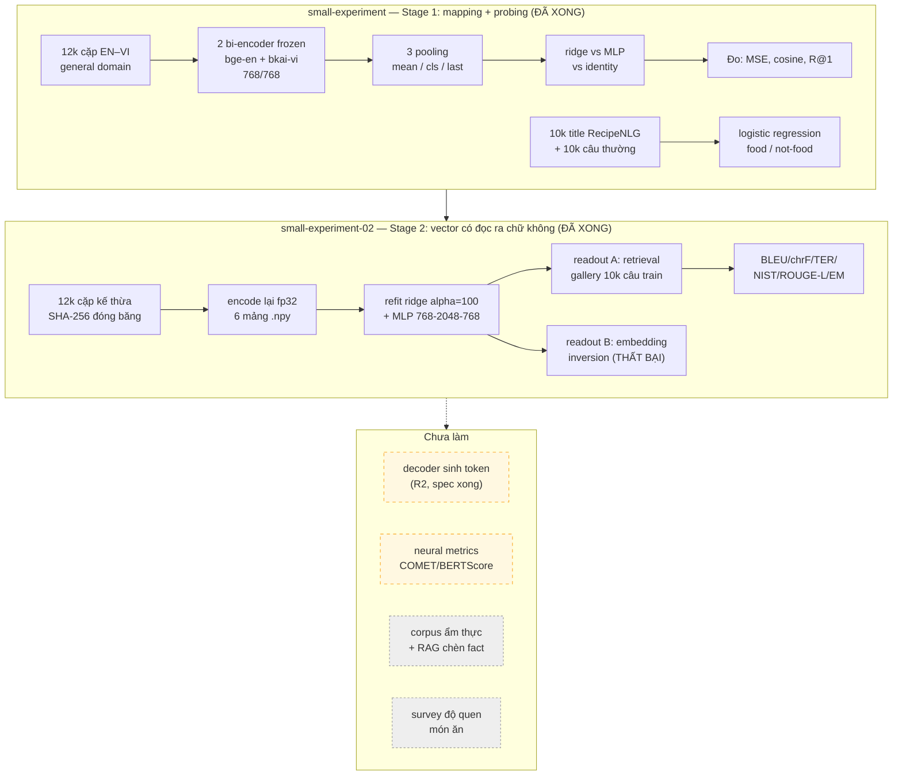
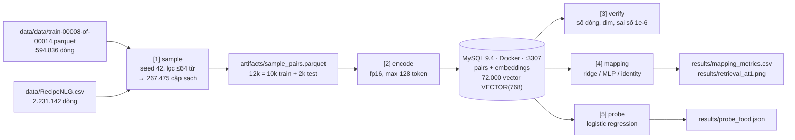
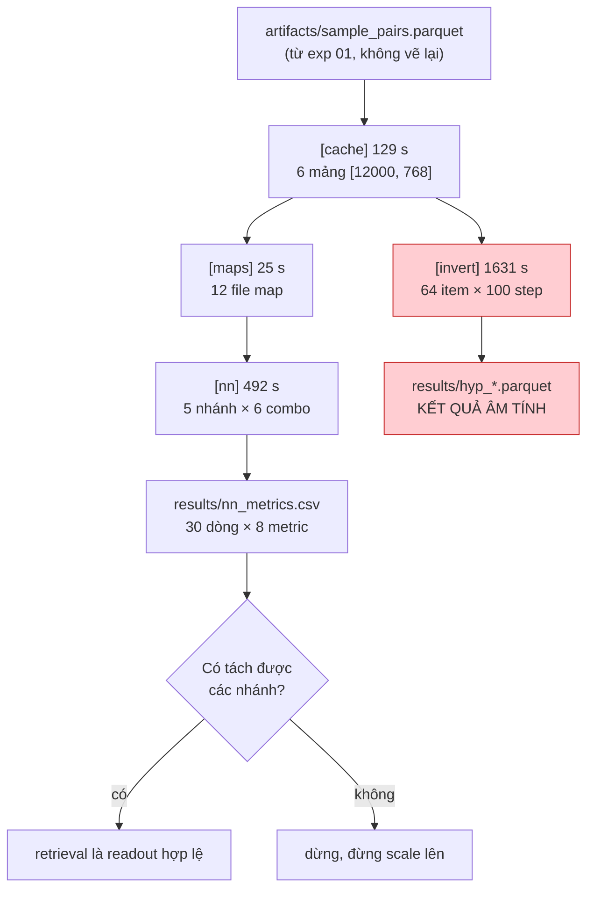
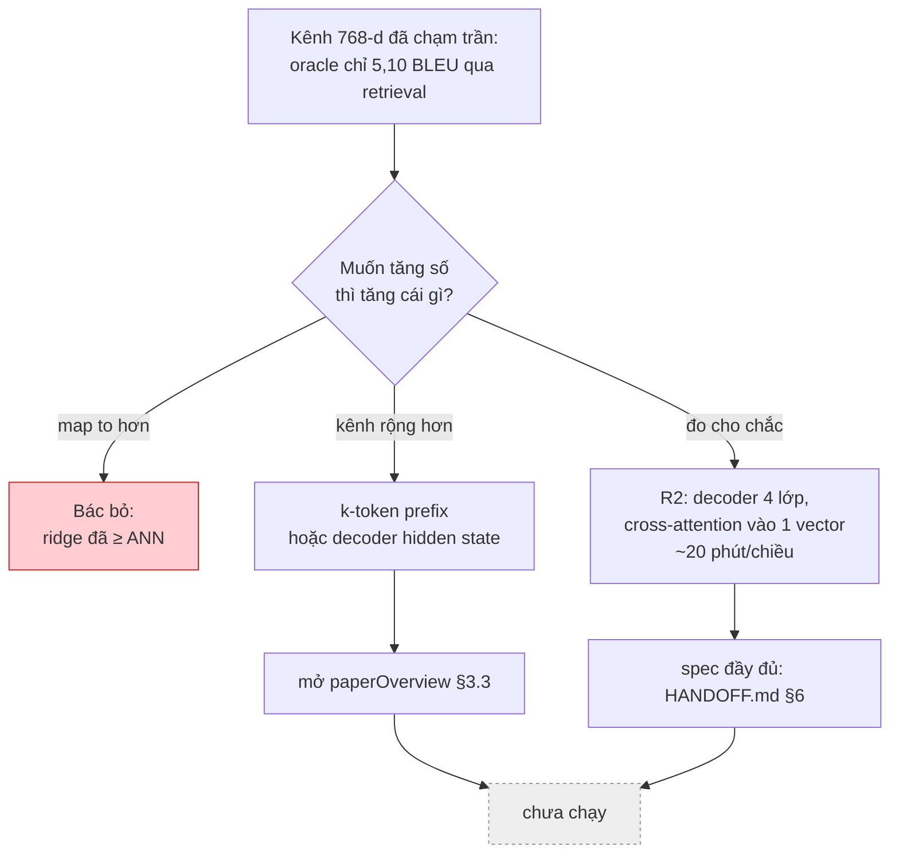

# PROJECT WORKFLOW — trạng thái thực tế (2026-10-24)

Tài liệu này mô tả **dự án đang ở đâu**, không phải dự án *muốn* đi đâu.
Mọi con số dưới đây lấy từ `results/` đã commit, không phải ước lượng.

Nguồn gốc yêu cầu: `paperOverview.md`. Bằng chứng chi tiết:
`small-experiment/results/`, `small-experiment-02/results/summary.md`.

## 0. Chú thích (đọc trước khi xem hình)

| ký hiệu | nghĩa |
|---|---|
| nét liền, xanh | **đã chạy, đã đo**, có file kết quả trong `results/` |
| nét đứt, vàng | **đã thiết kế, chưa chạy** (spec có trong `HANDOFF.md`) |
| nét chấm, xám | **chưa bắt đầu** (chỉ là đề xuất trong `paperOverview.md`) |
| `[số]` | thứ tự stage trong pipeline, chạy được độc lập |

Nguyên tắc bất biến của cả hai experiment: seed 42, cặp câu đóng băng ra
parquet + SHA-256, mọi stage chạy lại được (idempotent), vector không bao giờ
được vẽ lại giữa chừng.

## 1. Ý tưởng của paper (kiến trúc *mong muốn*)

```mermaid
flowchart LR
    A["Câu nguồn<br/>EN: 'the soup is sour'"] --> B["Model nguồn<br/>frozen"]
    B --> C["Hidden state<br/>h_en ∈ R^768"]
    C --> D["ANN ánh xạ f<br/>THAM SỐ DUY NHẤT ĐƯỢC TRAIN"]
    D --> E["Vector đã map<br/>f(h_en) ∈ R^768"]
    E --> F["Model đích<br/>frozen"]
    F --> G["Câu dịch<br/>'canh chua'"]
    G --> H["Chèn fact ẩm thực<br/>(RAG, Stage 4)"]
    H --> I["Câu dịch có ngữ cảnh văn hoá"]

    classDef train fill:#ffe0b2,stroke:#e65100,stroke-width:2px
    classDef todo fill:#eeeeee,stroke:#999,stroke-dasharray:3 3
    class D train
    class H,I todo
```

Điểm cốt lõi: **không train lại LLM**, chỉ train mạng ánh xạ. Vì vậy câu hỏi
nghiên cứu không phải "dịch có tốt không" mà là **"một vector 768 chiều có đủ
làm kênh truyền ngôn ngữ hay không"**.

## 2. Thực tế đã làm — hai experiment nhỏ

> Điểm phải nhớ: **paper nói "hidden state của decoder"**, nhưng hai experiment
> chỉ đo trên **sentence embedding của encoder**. Hai checkpoint có sẵn trên ổ
> đĩa là encoder-only (không `lm_head`), nên mũi tên "model đích sinh chữ" ở
> §1 **chưa từng được test**.

## 3. Pipeline chi tiết — `small-experiment/` (Stage 1)

**Kết quả đo được** (closed-set, 2.000 test):

| phương pháp | R@1 | R@10 | ghi chú |
|---|---|---|---|
| identity (không map) | 0,1% | 0,85% | sàn — vector nằm sai không gian |
| **ridge** | **74,1%** | **92,2%** | thắng ở mọi pooling |
| MLP (ANN) | 66,0% | 90,5% | thêm phi tuyến **không đáng** với 9k cặp |

Probe food/not-food: **accuracy 99,3%, AUC 0,9997** → thông tin ẩm thực mã hoá
tuyến tính trong không gian EN. *Cảnh báo confound*: positive là cụm danh từ
ngắn, negative là câu đầy đủ → probe có thể thắng nhờ **style**, chưa chắc nhờ
ngữ nghĩa món ăn.

## 4. Pipeline chi tiết — `small-experiment-02/` (Stage 2)

**5 nhánh so sánh** (bắt buộc giữ `shuffled` trong mọi readout sau này):

`roundtrip` (trần trên, vector oracle) · `identity` · `ridge` · `ann` ·
`shuffled` (vector lấy từ cặp câu khác — đối chứng "vector hợp lý nhưng sai").

BLEU, mean pooling:

| nhánh | en→vi | vi→en |
|---|---|---|
| roundtrip (trần) | 5,10 | 2,54 |
| **ridge** | **3,27** | **1,35** |
| ann | 3,29 | 1,44 |
| identity | 0,09 | 0,04 |
| shuffled | 0,24 | 0,13 |

Ba kết luận đã có bằng chứng:

1. **Vector sau map vẫn mang nội dung câu**: 3,27 BLEU = **13,7×** shuffled.
2. **Mất chữ, không mất nghĩa**: giữ 87–92% chrF của trần nhưng chỉ 53–64% BLEU.
3. **ANN chưa xứng đáng**: ridge ≥ ann trên mọi trục đo.

Và một lỗi khoa học đã sửa: không gian EN dị hướng mạnh (‖μ‖ = 10,8) nên hai
vector **ngẫu nhiên** đã có cosine 0,52. Con số `vi2en` = 0,80 của exp 01 là
**ảo giác**; sau khi trừ mean còn 0,52 → hai chiều đối xứng, không có bất đối
xứng như tưởng.

## 5. Cổng quyết định — bước tiếp theo

Logic của nhánh `R2` đáng nhớ vì nó *quyết định được*: nếu `ridge ≈ novec`
(vector không đóng góp gì) → map vô dụng; nếu `oracle ≫ ridge` → map làm mất
thông tin; nếu **mọi nhánh bằng nhau** → nút thắt là **kênh**, không phải map.

## 6. Bản đồ file — đọc gì trước

| muốn biết | đọc |
|---|---|
| mục tiêu, giới hạn, câu hỏi nghiên cứu | `paperOverview.md` |
| thí nghiệm 1 làm gì, giả định nào | `small-experiment/agent-work/ASSUMPTIONS.md` |
| thí nghiệm 1 chạy lại thế nào | `small-experiment/REPRODUCE.md` |
| **bằng chứng mới nhất** | `small-experiment-02/results/summary.md` |
| trạng thái + việc kế tiếp | `small-experiment-02/agent-work/HANDOFF.md` |
| bài học kỹ thuật (bẫy đã sập) | `small-experiment-02/agent-work/MISSION_NOTE.md` |
| lệnh chạy lại exp 02 | `small-experiment-02/REPRODUCE.md` |

## 7. Ranh giới của những gì đã chứng minh

**Được phép nói:**
- Một bi-encoder EN có thể được **map tuyến tính** sang không gian bi-encoder VI
  với R@1 = 74% (so với 0,1% khi không map).
- Vector sau map **còn đọc được nội dung câu**, không chỉ chủ đề.
- Thông tin "đây là món ăn" **tuyến tính** trong embedding EN.

**Không được nói:**
- "Hệ dịch hoạt động" — chưa có decoder nào sinh câu.
- "ANN là cần thiết" — ridge đã đủ và tốt hơn.
- "Dịch ẩm thực" — corpus là general domain (pháp lý/hằng ngày).
- "Chuyển được văn hoá" — chưa có thí nghiệm nào về văn hoá.
- So sánh BLEU ở đây với BLEU trong literature MT — readout là **retrieval**,
  trần do gallery 10k quyết định.

## 8. Phần chưa chạm tới

| hạng mục | trạng thái | phụ thuộc |
|---|---|---|
| decoder sinh token (R2) | thiết kế xong, chưa chạy | user đã dừng |
| neural metrics (COMET, BERTScore…) | chưa tải gì | cần đo feasibility từng cái |
| significance test (bootstrap) | chưa | cần trước khi công bố chênh lệch nhỏ |
| corpus ẩm thực thật | chưa | thay `train-00008.parquet` |
| RAG chèn fact (Dynamic Fact Insertion) | chưa | cần corpus + retrieval |
| survey độ quen thuộc món ăn | chưa | hướng nghiên cứu **tách rời** |
