# Fit the Bridge to the Decoder, Not to the Vector

### Behavioural supervision of a 263k-parameter cross-lingual map between two frozen T5 models

*Internal technical report · November 2026 · Draft for conference submission*

---

## Abstract

Two monolingual models already know their languages. If translation between them is therefore a
coordinate change between hidden states, the only thing left to learn is the map — and the only
question that matters is what that map should be fitted on. The literature fits it on representation
error, because the translation likelihood looks intractable. With a frozen decoder it is not: the
likelihood is an ordinary supervised loss over 262,656 parameters. We test the difference on two
60M-parameter T5 models, Vietnamese and English, with different tokenisers and no shared parameters,
on MTet. The same 263k-parameter linear bridge, refitted on the decoder's cross-entropy instead of
squared error, moves from **2.47 to 7.90 BLEU** on 1,000 held-out sentences (3.2×), lowers reference
cross-entropy from 3.23 to 2.74 nats/token, halves degeneration (16.7% → 6.7%) and raises COMET from
0.480 to 0.583. Controls exclude the corpus (the same 20k pairs), pure rescaling (+0.39 BLEU),
covariance matching (+0.59) and a better initialisation alone (cross-entropy from identity is *worse*
than the least-squares solution). The mechanism is measured rather than assumed: the decoder's
tolerance is a thin, anisotropic band — a 5% random displacement already changes 22% of its outputs,
and the least-squares bridge sits about five times outside the radius at which the decoder still
behaves — while its residual is direction-blind (1.3–1.4× chance in the directions the decoder reads
most), so the null-space rescue is unavailable. A 74.2-BLEU oracle shows that 89% of the readout's
ceiling remains unexplored.

---

## 1. Introduction

A child can tell that a bigger box holds more before it has the word *more*. Comparative and causal
structure, spatial maps, and predicate–argument relations are old in evolution: what is distinctly
human is not representing the world but **externalising a representation into a shared symbol
system** [Gallistel 2011]. Translation is the clearest case. The thought is already there; only the
symbols change.

A transformer's hidden state is a representation of exactly this kind — formed before any word is
emitted, shaped by the language it was trained on, and not yet a sentence. The surprising empirical
fact of the last few years is that such representations, built by models that never shared a
parameter, a vocabulary or a sentence, are *alignable*. Feed two such models a parallel pair and
their states agree far above chance; a single orthogonal rotation, fitted once, retrieves the correct
counterpart for most sentences; patching a rotated activation into one model moves its prediction
toward the other's answer [Zhou et al. 2026; Peng and Søgaard 2024]. Across modalities and
objectives, representations appear to converge on a shared statistical model of reality
[Huh et al. 2024], and can be translated between spaces with no paired data at all
[Jha et al. 2025].

If the interface is already there, translation between two frozen models is a **coordinate change**,
not a language lesson: the same relational structure, two sets of coordinates (Figure 1). And the
literal version of that idea is testable, and it fails in an instructive way. Feed the Vietnamese
encoder's states straight into the English decoder — no map, no translation model, nothing learned
but the readout that every arm shares. On 1,000 held-out sentences that channel produces **0.05
BLEU**, 7.1% empty strings, and output half the length of the reference (8.6 words against 17.9). The
decoder receives a memory it was never trained to read, and writes token salad (Figure 2a).

So *something* has to be learned. The question that organises this paper is what, and — more
importantly — **against which loss**. The field's answer has been remarkably uniform:
representation error. Procrustes, ridge, contrastive and optimal-transport alignment all minimise a
distance between the mapped source state and the target state, or a similarity surrogate for it
[Zhou et al. 2026; Peng and Søgaard 2024; Zhao and Gilman 2020; Bu and Feng 2026]. The
justification is equally uniform: the likelihood the decoder assigns to the translation has no
closed form and would require back-propagating through the decoder for every map update.

That justification does not survive contact with the setting. When the decoder is **frozen**, the
translation likelihood is not intractable at all: it is a scalar, differentiable function of 262,656
parameters, and its gradient is an ordinary back-propagation through a fixed network. What looks like
a modelling constraint is a **leftover from the era when the map had to be solved in closed form** —
and it has been silently doing the job of an objective ever since.

This paper asks three questions.

- **RQ1 — What does the decoder tolerate?** How large is the set of memories that produce the same
  translation, in units of memory displacement, and is it isotropic?
- **RQ2 — Where does the bridge's error sit?** Is a least-squares residual harmless because it lies
  in a null space the decoder ignores?
- **RQ3 — Does the objective matter at fixed capacity?** Same function class, same parameter count,
  same data: can changing only the loss change what the system can do?

The answers are: **a thin, anisotropic band** (RQ1); **no, the error is direction-blind** (RQ2);
**yes, by a factor of 3.2 in BLEU** (RQ3). Our contributions are four.

1. **The decoder's behavioural tolerance, measured.** Around a memory the adapter reads perfectly, a
   5% random displacement changes 22% of outputs; BLEU holds within 3% of the ceiling out to a
   displacement of 0.2, while the least-squares bridge sits at 1.0; and the same displacement in the
   steepest direction multiplies the loss by 2.1 where a random one is invisible (Figures 4, 8).
2. **A falsified rescue.** The natural hope — the map's error lives in the decoder's null space, so it
   is harmless — is false. The residual is spread almost evenly over the directions the decoder reads
   (1.3–1.4× chance), the opposite of what a null-space argument needs (Figure 9).
3. **The objective swap, with controls.** Refitting the *same* 262,656 parameters on the decoder's
   cross-entropy gives 2.47 → 7.90 BLEU, 3.23 → 2.74 nats/token, 16.7% → 6.7% degeneration and
   0.480 → 0.583 COMET (+5.40 BLEU [4.50, 6.27] by paired bootstrap). Controls attribute at most a
   third of it to scale, covariance or data (Figure 10).
4. **An accounting of what remains.** The decoder reading the target encoder's states *of the
   reference* produces 74.2 BLEU: the readout is not the bottleneck, the bridge is, and the best map
   is at 11% of that ceiling. Distillation from the oracle adds nothing, locating the remaining gap in
   the memory's capacity rather than in the learning signal.

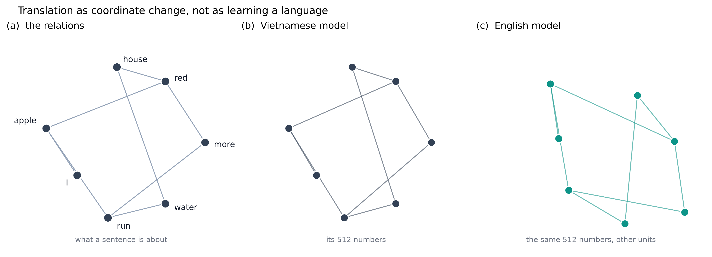

**Figure 1. Translation as a coordinate change.** *(Conceptual model.)* (a) A sentence carries
relational structure — who does what to what — that exists before it is lexicalised. (b, c) Two
independently trained models encode that structure as coordinates in their own 512-dimensional
spaces. The relations survive; the units do not. If that is all translation is, the object to learn
is a map between the two coordinate systems, and the interesting question is not its function class
but its objective.

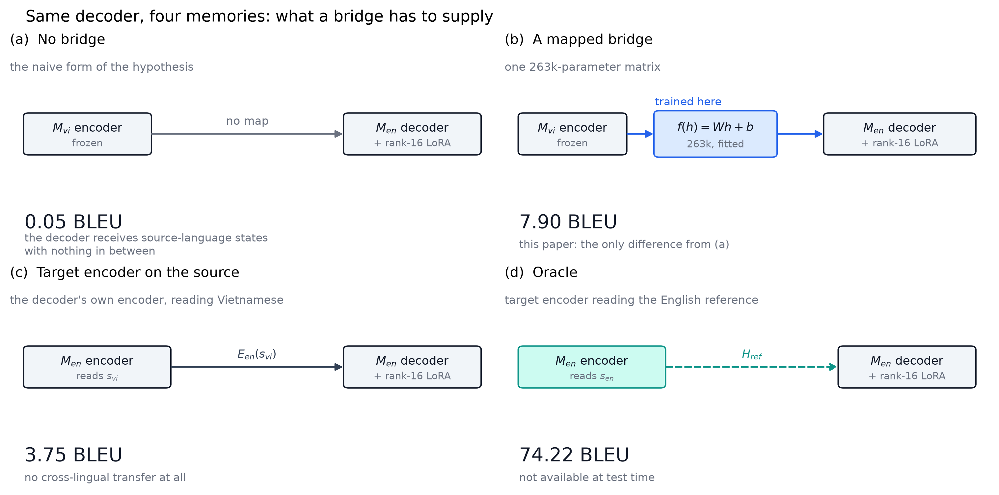

**Figure 2. Four memories, one decoder.** *(Conceptual wiring; BLEU values measured on the same
1,000 held-out sentences.)* (a) The naive form of the hypothesis: the Vietnamese encoder's states go
into the English decoder with nothing in between — 0.05 BLEU, 7.1% empty strings, output half the
reference's length. (b) A single 263k-parameter matrix, fitted, restores a usable signal: 7.90 BLEU.
(c) The decoder's own encoder reading Vietnamese needs no transfer at all and reaches 3.75. (d) The
same decoder reading the target encoder's states of the *English reference* reaches 74.2 BLEU: the
behavioural ceiling of the readout, unavailable at test time. All four panels use the same decoder and
the same rank-16 adapter; (a) and (b) differ only by the matrix.

---

## 2. Related work

**The premise: independently trained spaces converge.** Static-embedding work established that two
spaces can be related by a linear map, and that an orthogonal constraint often helps
[Zhao and Gilman 2020]. Inside multilingual LLMs concept subspaces align *linearly*, less well for
distant languages and abstract concepts [Peng and Søgaard 2024]. The strongest evidence comes from
strictly monolingual models trained on disjoint corpora: their states agree far above chance for
parallel sentences, a single Procrustes rotation maps between them, and patching a rotated residual
changes the other model's factual prediction [Zhou et al. 2026]. The Platonic Representation
Hypothesis names the mechanism — convergence on a shared statistical model of reality as models scale
[Huh et al. 2024] — and vec2vec shows the constructive form, translating embeddings between encoders
with no paired data [Jha et al. 2025]. Relative representations give the partner result: describing a
sample by its similarity to fixed anchors yields a representation invariant to the isometries that
separate two spaces [Moschella et al. 2023].

**Stitching: the receiver is satisfiable, not exacting.** A finding that matters here is negative:
stitches can reach high accuracy even when the stitched layers are far apart or ordered backwards,
which suggests the receiving network finds *some* workable representation rather than recovering the
one it was trained with [Hernandez et al. 2023]. That is the first hint that a decoder's tolerance is
a set rather than a point. It also warns that a stitched model's accuracy measures the pair, not the
similarity.

**Latent communication between frozen models.** A recent line routes activations rather than text:
gated KV-caches between LLMs [Fu et al. 2026], vector translation between two frozen 7B models
[Yang 2025], KV-cache alignment into a shared space [Dery et al. 2026]. All keep both models frozen
and all learn a *representation* mapping, usually with a cosine or contrastive objective. Their
target is collaboration or steering, not translation; none reports what a frozen decoder does with a
mapped memory when the task is to write the sentence.

**The alternative: train the model.** The interventions that change behaviour mostly train the
generator: a middle-layer alignment loss inside fine-tuning [Liu and Niehues 2025], layer-wise
CKA+REPINA inside an 8B model [Nakai et al. 2025], source–target fusion inside LoRA
[Borchert et al. 2025], looped latent computation [Chen et al. 2026]. The closest composition,
XBridge, freezes an English-centric LLM and routes multilingual understanding through pretrained
translators, learning only mapping layers with an optimal-transport objective [Bu and Feng 2026]. In
every case either the generator is trained or a trained translator is in the loop.

**The metric critique.** A separate literature warns that alignment scores do not predict transfer.
Explicitly aligned encoders can improve token-, sentence- and MLM-level alignment while *degrading*
zero-shot downstream performance [Veitsman et al. 2026]; the survey of the area lists evaluation
methodology as an open problem [Pallucchini et al. 2025]. The counter-evidence is equally instructive:
instance-level alignment in middle layers *does* track correctness, and patching parallel English
activations repairs errors [Ravisankar et al. 2026]. Alignment is therefore a good **diagnostic** and,
we will argue, the wrong **training signal**. Two older observations complete the picture: multilingual
spaces are strongly anisotropic, so raw cosines are dominated by a shared direction
[Rajaee and Pilehvar 2022]; and linearity is not a law [Zhao and Gilman 2020]. Architecture evidence
adds that a single compressed source state loses the token-level information MT needs
[Vardasbi et al. 2023], which is why the object we map is a *sequence* of states.

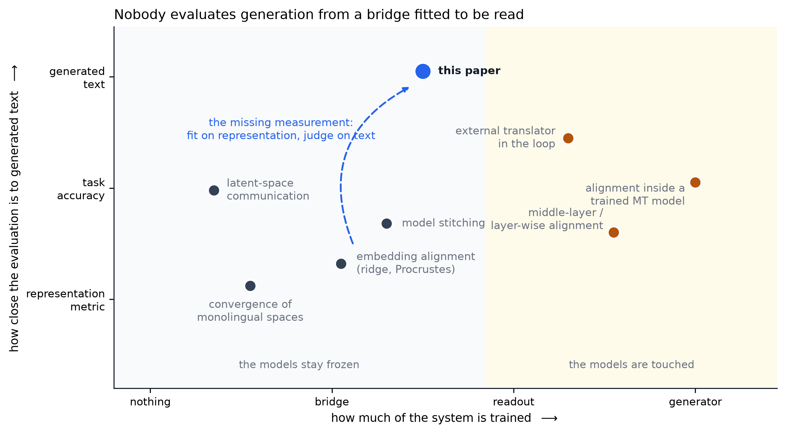

**Figure 3. Where the literature sits.** *(Conceptual map; positions are the authors' reading, not a
measurement.)* Horizontal axis: how much of the system is trained. Vertical axis: how close the
evaluation gets to generated text. Convergence and embedding-alignment work (grey) evaluate
representations with models frozen; latent-communication work sits slightly higher but routes
activations; the interventions that change behaviour (amber) train the generator or an alignment
module inside it. The empty cell — bridge frozen models, judge by the text they produce — is the one
this paper occupies.

*Table 1. Related work, grouped by what is aligned and what is measured.*

| Group | What is aligned | Supervision | Evaluated by | Generates text? |
|---|---|---|---|---|
| Embedding alignment [Zhao and Gilman 2020; Jha et al. 2025; Moschella et al. 2023] | Word or sentence embeddings | Parallel or unpaired | Retrieval, similarity | No (words/vectors) |
| Cross-model latent alignment [Zhou et al. 2026; Peng and Søgaard 2024; Huh et al. 2024] | Hidden states of independent models | Parallel sentences | CKA, retrieval@1, patching | No |
| Stitching [Hernandez et al. 2023] | Layers of two trained networks | Task data | Task accuracy | Yes, but the receiver is trained |
| Latent communication [Fu et al. 2026; Yang 2025; Dery et al. 2026] | KV-cache / activations | Paired prompts | Downstream accuracy, steering | Yes, for collaboration |
| Alignment inside a trained model [Liu and Niehues 2025; Nakai et al. 2025; Borchert et al. 2025; Chen et al. 2026] | Middle layers, adapters, latents | Task data + alignment loss | Downstream accuracy, MT | Yes, the model is trained |
| Frozen composition with a translator [Bu and Feng 2026] | LLM ↔ encoder–decoder MT | Mapping layers, OT | MT / understanding quality | Yes, a translator is in the loop |
| **This paper** | **Final encoder states of two frozen 60M models** | **The frozen decoder's own likelihood** | **Geometry *and* generated text** | **Yes, with a 1.2M readout only** |

---

## 3. Problem definition

### 3.1 Objects

Two encoder–decoder models, $M_1 = D_1\circ E_1$ (Vietnamese) and $M_2 = D_2\circ E_2$ (English).
Both have $d = 512$ and six layers; their tokenisers are different and not shared. For a sentence $s$
in language $\ell$,

$$
H_\ell(s) \;=\; E_\ell(s)\in\mathbb{R}^{T_\ell\times d},
\qquad
H_\ell(s) = \big(h_1,\dots,h_{T_\ell}\big),
$$

so $h_i$ is the contextualised vector of token $i$ in the last encoder layer. The decoder is a
function of the *whole memory*, not of one vector: it defines a distribution over target strings

$$
p_{\theta}(y \mid H) \;=\; \prod_{t=1}^{|y|} p\big(y_t \,\big|\, y_{<t},\, H\big),
$$

and choosing a memory $H$ is choosing a distribution. A bridge is a map $f_\theta(h) = Wh+b$ applied
position-wise, with $W\in\mathbb{R}^{512\times512}$ and $b\in\mathbb{R}^{512}$: **262,656
parameters**, 0.44% of one model.

### 3.2 What it means for two memories to coincide

Translation succeeds if the mapped source memory induces the same distribution as the target encoder's
memory of the translation, $f_\theta(H_1(s_{vi})) \approx_{\text{behaviour}} H_2(s_{en})$. Equality of
vectors is neither necessary nor sufficient for this, so we do not ask for it. Writing $d(H)=D_2(H)$
for the decoder's output given memory $H$, the object of interest is the **level set**

$$
\mathcal{S}_\tau(H^{*}) \;=\; \Big\{\, H : \mathrm{BLEU}\big(d(H),\, d(H^{*})\big) \;\ge\; \tau \,\Big\},
$$

the set of memories the decoder reads into (almost) the same sentence. How large $\mathcal{S}_\tau$ is,
and how it is shaped, decides whether fitting $f_\theta$ to a *vector* can work: if $\mathcal{S}_\tau$
were a fat isotropic ball, a small Euclidean error would be harmless by construction. Section 5.3
measures it, and it is neither fat nor isotropic.

Two empirical witnesses fix the scale. The **oracle** memory is $H_{\text{ref}} = H_2(s_{en})$, the
target encoder applied to the English reference: whatever the bridge could produce, this is what a
memory that already encodes the answer looks like, and the decoder reads it into 74.2 BLEU. The
**in-distribution** memory is $H_{\text{nat}} = H_2(s_{vi})$, the same encoder applied to the source;
it is position-aligned with the bridge's output but carries weak content (3.75 BLEU). Behavioural
questions use the former; any question about *where* the error sits needs corresponding token
positions and therefore uses the latter.

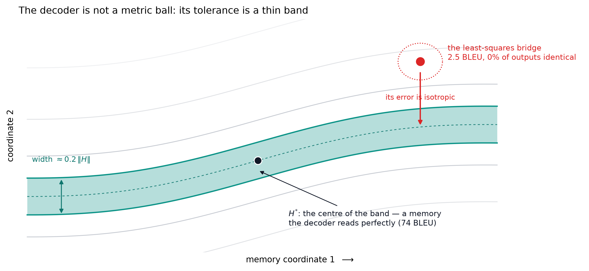

**Figure 4. The object the paper is about.** *(Conceptual geometry; the widths annotated are
measured.)* The decoder's tolerance is not a ball around the correct memory: it is a thin band of
memories that produce the same sentence (teal). The band is about 0.2 wide in units of the memory
norm — the radius at which a random displacement still leaves 97% of the oracle's BLEU. A
least-squares bridge is fitted in the ambient Euclidean metric, so its error is isotropic (dotted
circle) and lands several band-widths away: at the displacement where the ridge memory actually sits,
the decoder reproduces 3% of the oracle's BLEU.

### 3.3 The two objectives

The objective we care about is the likelihood of the reference under the frozen decoder:

$$
\mathcal{L}_{\text{beh}}(\theta)
=-\mathbb{E}_{(s_{vi},s_{en})\sim\mathcal{D}}
\Big[\log p_\theta\big(s_{en}\mid f_\theta(H_1(s_{vi}))\big)\Big].
\tag{1}
$$

The objective the literature optimises aligns target states onto source positions with a character-span
pooling operator $\mathrm{Align}(\cdot)$ and minimises squared error:

$$
\mathcal{L}_{\text{emb}}(\theta)
=\mathbb{E}\Big[\tfrac{1}{T_{vi}}\textstyle\sum_{j=1}^{T_{vi}}
\big\|f_\theta(h_j)-\tilde{h}_j\big\|_2^2\Big],
\qquad \tilde{H}_{en}=\mathrm{Align}\big(H_2(s_{en})\big).
\tag{2}
$$

Equation (2) is the surrogate; equation (1) is the task. The standard defence of (2) is a first-order
bound: a perturbation $h\mapsto h+\varepsilon$ changes the token logit by $W_{\text{lm}}\varepsilon$,
so $\Delta\log p \ge -\|W_{\text{lm}}\|_2\|\varepsilon\|_2$. The bound is true and it is **over all
directions**. It says a small error cannot be catastrophic *if* the constant is small; it says nothing
about which directions the error occupies, and it does not run backwards. An error of fixed Euclidean
norm can be invisible (along a direction the decoder ignores) or fatal (along one it reads). Because
(2) minimises the norm and not the weighted norm, it is free to spend its budget on the wrong
coordinates — and, we will show, it does.

### 3.4 The constraint: touch as little as possible

"Minimal intervention" needs a definition to be falsifiable. We fix it as a parameter budget: the
encoder of either model never changes; the target decoder is frozen except for a rank-16 LoRA;
everything else is the bridge. The trainable budget is therefore

$$
B \;=\; \frac{|\theta_{\text{bridge}}| + |\theta_{\text{LoRA}}|}{|M_2|}
\;=\; \frac{262{,}656 + 1.18\text{M}}{60\text{M}} \;\approx\; 2.4\%,
\tag{3}
$$

of which the cross-lingual part — the only component that has to be learned from parallel data — is
0.44%. The claim under test is not "a small model can translate" (it cannot; see §7) but "the
*interface* between two frozen models can be learned cheaply, if it is learned correctly". A readout is
not optional (§5.1), so we count it.

---

## 4. Methodology

### 4.1 Models, data and split

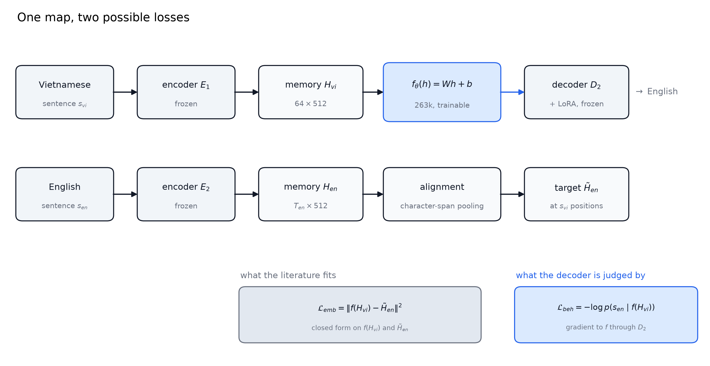

**Figure 5. One map, two possible losses.** *(Conceptual diagram; the shapes are the real ones.)* The
same 263k-parameter matrix sits between the source encoder's memory and the target decoder. The
literature's loss compares the mapped memory with an aligned target memory; the loss this paper uses
asks the frozen decoder how likely the reference is under that memory. Nothing else in the graph
changes, and the readout (rank-16 LoRA) is shared by every arm.

*Table 2. Setting.*

| Item | Value |
|---|---|
| Source model $M_1$ | `t5-small-vietnamese`, 60M, 6 layers, $d=512$, frozen |
| Target model $M_2$ | `t5-small`, 60M, 6 layers, $d=512$, frozen except LoRA |
| Tokenisers | different, not shared (vocabularies 36,096 and 32,128) |
| Corpus | MTet, 6.67M Vietnamese–English pairs after dedup and filtering |
| Split | 80/10/10 by hashed id, so a re-run cannot move a sentence |
| Bridge fitted on | 20,000 training pairs (the published map used 85M token pairs) |
| Bridge | $f(h)=Wh+b$, 262,656 parameters |
| Readout | rank-16 LoRA on the target decoder, 1.18M parameters |
| Evaluation | first 1,000 test sentences; a disjoint second 1,000 for replication |

Both models are used as published. No gradient reaches an encoder, and the decoder's weights never
move outside the adapter.

### 4.2 The readout, and why it is not optional

A pretrained T5 decoder was trained on span corruption, not on reconstruction, so it cannot be assumed
to reproduce a memory faithfully. We therefore treat the readout as a **gate**: a small LoRA is trained
on the mapped channel, and the same adapter serves every arm, so a difference between arms is
attributable to the memory rather than to the adapter. This is what makes the naive channel in
Figure 2a a *fair* control — it has the readout and lacks only the map.

### 4.3 Fitting the bridge, two ways

**Representation-fitted (the baseline).** Character-span alignment pools target states onto source
token positions, and the map is the ridge solution of (2), $\hat W=(A+\lambda I)^{-1}B$ with
$A=X^{\top}X$, $B=X^{\top}\tilde Y$, accumulated in float64; at this sample size the $\lambda$ sweep is
flat and $\lambda=0$ is used. This is the map used by the earlier experiments in this line of work,
fitted on 85M token pairs; we also refit it on exactly the 20k pairs the behaviour-fitted arm sees,
so that "more data" is controlled.

**Behaviour-fitted (the intervention).** Take the ridge solution as the initialisation and minimise
(1) directly: AdamW, learning rate $10^{-4}$, batch 32, 20,000 pairs, decoder frozen, teacher forcing
on the reference, encoder states cached once. Only $W$ and $b$ move — the parameter count is identical
to the baseline. Runs of 2, 6 and 16 epochs are reported; the 16-epoch trajectory is three warm-started
segments of one model (2 + 4 + 10). Nothing about (1) required new machinery: the gradient is taken with
respect to the map only, so the frozen decoder is just a fixed non-linearity in the middle of the graph.

### 4.4 Controls

Four controls isolate what the gain is not, each cheap because the encoder states are cached:

- **Data.** Ridge refitted on the same 20k pairs (`ridge_sub`), isolating the corpus.
- **Scale.** The same map multiplied by 1.22, exactly the norm ratio to the behaviour-fitted map
  (`ridge_scale122`), isolating the shrinkage a least-squares fit is known to produce.
- **Covariance.** A 10% blend toward covariance matching, the best free repair of that shrinkage found
  earlier in this line of work (`ridge_recolor10`).
- **Initialisation.** Cross-entropy fitting from the identity map (`ce_scratch`), isolating the warm
  start from the objective.

A fifth arm distils the oracle into the map — cross-entropy plus a KL term to the decoder's distribution
over $H_{\text{ref}}$ — to test whether the *signal* rather than the capacity is the limit.

### 4.5 Measurement

Greedy decoding, maximum 64 new tokens (48 to match the earlier runs). BLEU with 13a tokenisation,
chrF, reference cross-entropy in nats per token under the decoder, a degeneration rate (the fraction of
outputs whose type/token ratio is at most 0.5, i.e. token loops), and COMET
(`Unbabel/wmt22-comet-da`) as an independent learned metric on 400 sentences. Intervals are paired
bootstraps over sentences, 200 resamples. Throughout, $n=1{,}000$ gives a BLEU resolution of about ±0.3;
effects we call real are an order of magnitude larger.

### 4.6 The perturbation protocol

To measure $\mathcal{S}_\tau$ we displace the oracle memory by $\varepsilon\cdot\delta$, where
$\varepsilon$ is a fraction of that memory's own Frobenius norm and $\delta$ a unit direction, and
re-decode the same 300 sentences. Three families of directions are used: random (the isotropic null
hypothesis), the direction separating the ridge memory from the oracle memory, and the steepest
direction of the decoder's own loss, $\partial\mathrm{CE}/\partial H$. Because the sweep needs no
positional correspondence between memories it can be run on $H_{\text{ref}}$; the subspace projection
of §5.4 does need correspondence and is therefore run on $H_{\text{nat}}$.

---

## 5. Results

### 5.1 Calibration: the naive channel, and the ceiling

Three channels fix the scale of the problem (Table 3). The **naive** channel — source states injected
directly, no map — reaches 0.05 BLEU and 7.1% empty output: it is not a weak translator, it is not
translating. The **ridge** channel, with 263k fitted parameters, reaches 2.50 BLEU and 19.8 chrF, and
its cross-entropy (3.228) reproduces the earlier run to three decimals, so the pipeline is calibrated.
The **oracle** reaches 74.2 BLEU, 84.7 chrF and 0.302 nats/token: there exists a memory the adapter
reads almost perfectly.

*Table 3. Channels on 1,000 held-out sentences, greedy, max 64 new tokens. CE is the mean per-token
negative log-likelihood of the reference.*

| Channel | BLEU | chrF | CE | degenerate | empty |
|---|---|---|---|---|---|
| naive (no bridge) | 0.05 | 6.11 | 4.608 | 22.8% | 7.1% |
| ridge (263k, representation-fitted) | 2.50 | 19.77 | 3.228 | 15.5% | — |
| native (target encoder on the source) | 3.75 | 14.73 | 3.413 | 34.2% | — |
| **oracle (target encoder on the reference)** | **74.22** | **84.70** | **0.302** | **1.1%** | — |

The honest reading is that the *readout is not the bottleneck*. The adapter turns a good memory into a
near-correct sentence and a mapped memory into a bad one. The gap between 3.23 and 0.30 nats is
therefore a statement about the bridge, and it is the quantity the rest of the paper attacks.

### 5.2 The objective swap

*Table 4. Every arm on the same 1,000 sentences. `max48` scores the same hypotheses at the earlier
runs' decoding budget. COMET is on 400 sentences. $\|H\|$ is the mean Frobenius norm of the arm's
memory; $z$ is the median distance of its tokens from the target cloud in target standard deviations
(genuine states sit at 22.9).*

| Arm | BLEU | BLEU (max48) | chrF | CE | degen. | COMET | $\|H\|$ | $z$ |
|---|---|---|---|---|---|---|---|---|
| CE from identity, 2 ep | 2.25 | 2.43 | 17.28 | 3.314 | 26.5% | 0.436 | 24.4 | 33.7 |
| ridge, same 20k pairs | 2.47 | 2.67 | 19.68 | 3.232 | 16.7% | 0.475 | 7.6 | 6.2 |
| ridge, published map | 2.50 | 2.71 | 19.77 | 3.228 | 15.5% | 0.480 | 7.6 | 6.2 |
| ridge × 1.22 | 2.89 | 3.21 | 20.88 | 3.248 | 19.0% | 0.490 | 9.3 | 7.9 |
| ridge + recolour ($t$=0.1) | 3.08 | 3.43 | 20.70 | 3.262 | 14.4% | 0.497 | 8.8 | 8.6 |
| **behaviour, 2 ep** | **5.33** | **5.73** | **25.00** | **2.857** | **11.8%** | **0.533** | 9.3 | 10.6 |
| **behaviour, 6 ep** | **7.04** | **7.59** | **27.24** | **2.761** | **9.0%** | **0.564** | 11.3 | 14.3 |
| behaviour + KL, 8 ep | 7.25 | 7.77 | 27.57 | 2.741 | 10.4% | 0.568 | 11.9 | 15.4 |
| **behaviour, 16 ep** | **7.90** | **8.46** | **29.36** | **2.738** | **6.7%** | **0.583** | 13.8 | 18.8 |

Two epochs of behaviour fitting — a few minutes on a 4 GB laptop GPU — more than double BLEU. Sixteen
epochs reach 7.90, a 3.2× improvement over the published map with **no new parameters, no new data and
no change to either model**. Degeneration falls by more than half, chrF rises by 9.6 points, and COMET
rises by 0.10, the largest movement any arm shows on the learned metric.

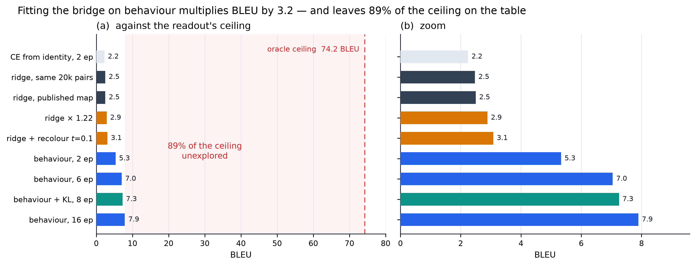

**Figure 6. BLEU against the readout's ceiling.** *(Measured, n = 1,000.)* (a) The oracle (dashed) is
the same decoder reading the target encoder's states of the reference: 74.2 BLEU. The best bridge
reaches 11% of it. (b) The same arms on a zoomed axis. Colours: slate, representation-fitted; amber,
cheap repairs of it; blue, behaviour-fitted; teal, behaviour plus distillation.

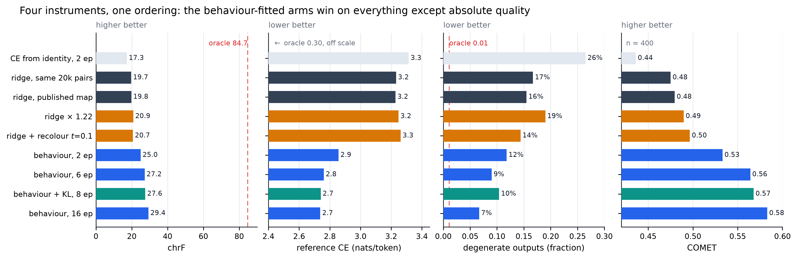

**Figure 7. The same arms on the other instruments.** *(Measured; COMET on 400 sentences.)* The
ordering the blue arms establish on BLEU also holds on chrF, reference cross-entropy and degeneration.
The chrF panel keeps the oracle on scale (84.7); the cross-entropy oracle (0.30) is off the zoomed
axis. This is the point at which the improvement stops being a BLEU artefact.

### 5.3 What the decoder tolerates (RQ1)

Displace the oracle memory and re-decode. In a **random** direction a 5% displacement leaves 78% of
outputs identical, and BLEU falls only from 74.3 to 73.7; at 20% BLEU is still 72.1. Along the
**bridge's own error direction**, 25% of the way to the ridge memory costs 4 BLEU, half way costs 23,
and at 100% — which *is* the ridge memory — BLEU is 2.4 and no output is identical. The ridge memory is
not "slightly off": it is five times outside the radius at which the decoder still reproduces 97% of the
oracle's BLEU.

The same displacement is not the same cost in different directions. At $\varepsilon=0.05$ on the
in-distribution memory, a random perturbation changes nothing measurable (CE 3.396 → 3.402, BLEU 4.04 →
4.07), while the steepest direction multiplies CE by 2.1 (→ 7.164) and cuts BLEU to 1.42. **The
decoder's sensitivity spans two orders of magnitude inside one ball of the same radius** (Figure 8c). A
loss that treats all directions alike cannot know which side of that shape a memory is on.

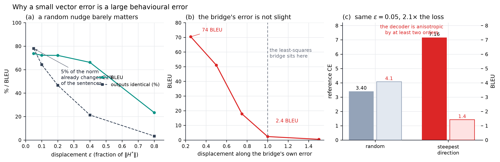

**Figure 8. The tolerance, measured.** *(Measured, n = 300.)* (a) Random displacement: 5% of the memory
norm already changes 22% of the outputs, and BLEU decays gently. (b) Displacement along the direction
that separates the ridge memory from the oracle: BLEU collapses, and at $\varepsilon=1$ the sweep
reproduces the ridge channel (2.4 BLEU, CE 3.32). (c) At the same displacement magnitude (5%), a random
direction is invisible and the steepest direction doubles the loss.

### 5.4 Where the least-squares error sits (RQ2)

The most attractive explanation for the ridge failure is that its error lies in directions the decoder
ignores — a null space — so that minimising the norm should have been harmless. It is false. Projecting
the error onto the top-$k$ right singular directions of the decoder's per-sentence gradient at the
oracle memory yields 0.8×, 1.2×, 1.4× and 1.3× chance for $k=1,8,64,256$: a mild concentration at best,
and at $k=256$ — 0.8% of the 32,768 dimensions of the memory — the subspace the decoder reads most
holds **1% of the error's energy** (Figure 9). Weighting sentences by their error magnitude instead
of equally raises the concentration to 3–5× at small $k$, and still leaves 98% of the error outside the
top-256 directions. The gradient spectrum explains why: the top singular values of the per-sentence
Jacobian decay by only 1.8× from the first to the 64th and 2.8× to the 256th. There is no narrow
sensitive subspace to hide from and no wide null space to hide in. The residual is, to a good
approximation, **direction-blind** — exactly what a least-squares solution produces when the target is
anisotropic: error of equal size everywhere, including on the coordinates that decide the output.

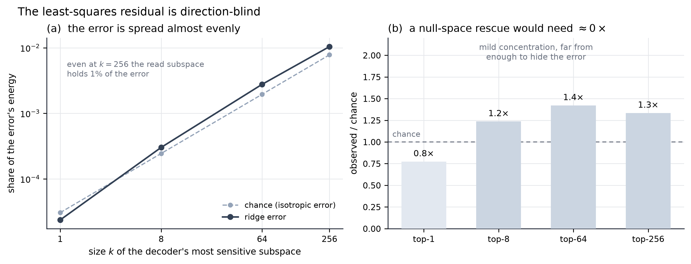

**Figure 9. The residual is direction-blind.** *(Measured, n = 1,000.)* (a) Share of the error's energy
inside the top-$k$ singular subspace of the decoder's gradient, against the isotropic chance level.
(b) The same ratio: a null-space argument would need values near zero; the measurement is 1.3–1.4×.

### 5.5 What the gain is *not* (RQ3, controls)

*Table 5. Paired bootstrap against the published ridge map, 200 resamples over 1,000 sentences.*

| Arm | ΔBLEU | 95% CI | $P(\Delta>0)$ | share of the 2-epoch gain |
|---|---|---|---|---|
| ridge, same 20k pairs | −0.03 | [−0.22, +0.17] | 0.41 | **0%** — the corpus is not the cause |
| CE from identity, 2 ep | −0.26 | [−0.77, +0.33] | 0.21 | — a worse basin, not a better one |
| ridge × 1.22 | +0.39 | [−0.27, +1.19] | 0.82 | 14% |
| ridge + recolour ($t$=0.1) | +0.59 | [−0.08, +1.42] | 0.93 | 21% |
| **behaviour, 2 ep** | **+2.83** | **[+2.29, +3.47]** | **1.00** | **100%** |
| behaviour, 6 ep | +4.55 | [+3.78, +5.26] | 1.00 | |
| distill (6+2 ep) | +4.76 | [+3.92, +5.57] | 1.00 | |
| **behaviour, 16 ep** | **+5.40** | **[+4.50, +6.27]** | **1.00** | |

**Data is not the cause**: refitting ridge on exactly the 20k pairs the behaviour arm used changes BLEU
by −0.03. **Scale and covariance are small parts**: matching the memory norm buys 0.39 BLEU, matching
the covariance 0.59 — both positive, neither individually distinguishable from zero at this sample size,
together 35% of what two epochs of behaviour fitting achieve. **The objective is the rest**: 65% of the
gain is directional, and only a loss that looks at the decoder can find it.

The identity-initialised row is the most informative negative. Cross-entropy fitting from the identity
map does *not* beat ridge: 2.25 BLEU against 2.47, a *worse* validation cross-entropy (3.364 against
3.307), and a memory norm of 24.4 — past the genuine 22.9. The cross-entropy landscape has bad basins,
and the least-squares solution is an excellent place to start. **MSE is not a model of the task; it is
a very good initialiser for one.** That distinction explains why ridge beat every nonlinear mapper in
earlier rounds of this work without ever being asked to predict text: it was winning the initialisation,
not the argument.

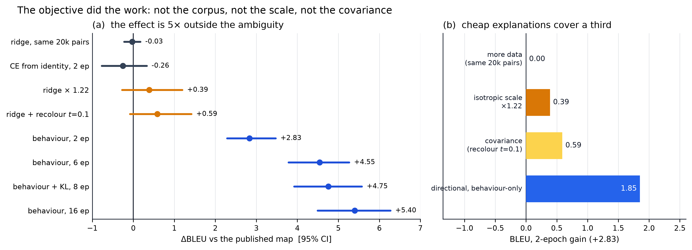

**Figure 10. The gain, attributed.** *(Measured.)* (a) Paired bootstrap intervals; only the
behaviour-fitted arms are outside the ambiguity, and they are outside it by a factor of five. (b) What
the cheap explanations account for, as a share of the two-epoch gain: nothing (data), 14% (scale), 21%
(covariance), and 65% that no control reaches.

### 5.6 Convergence, and a negative result about distillation

Validation cross-entropy falls steeply for two epochs and then flattens: 3.014, 2.929 → 2.889 … 2.825 by
epoch 6, oscillating within ±0.007 from epoch 4 to 16. Over that flat stretch BLEU keeps moving, 7.04 →
7.90, chrF 27.2 → 29.4, degeneration 9.0% → 6.7%. The surrogate saturates before the task does — a small,
second-order version of the paper's own theme, and a warning that even the likelihood is a surrogate for
translation quality.

The distillation arm tests the literal version of "transport the oracle's behaviour into the map":
cross-entropy plus a KL term to the decoder's distribution over $H_{\text{ref}}$. It reaches the best
raw numbers of any 8-epoch arm (7.25 BLEU, COMET 0.568) but the KL term does nothing: after the same two
extra epochs, cross-entropy alone gives validation CE 2.8089 and cross-entropy plus KL gives 2.8090,
identical to four decimals. The 0.21 BLEU over the 6-epoch arm is the extra epochs. At this capacity the
student's memory cannot represent a distribution whose CE is 0.30, and being told about that
distribution does not help it try.

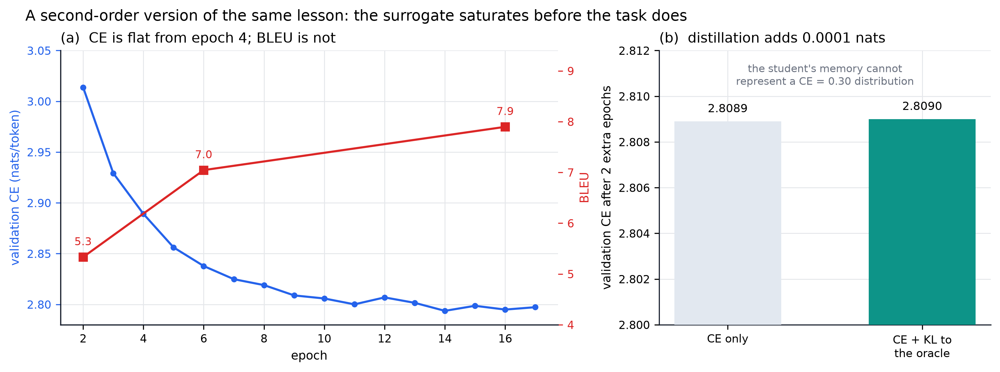

**Figure 11. The surrogate saturates; the task does not.** *(Measured.)* (a) Validation cross-entropy
over 16 epochs (three warm-started segments of one model) against BLEU at the three checkpoints. (b) The
distillation arm's KL term against the plain cross-entropy run at the same number of epochs: 2.8090
against 2.8089.

### 5.7 Replication and independence of the metric

Every arm is re-scored on a disjoint 1,000-sentence sample that was used for nothing else. The ordering
is identical and the gap is identical in size: ridge 2.68, recolour 2.90, 6 epochs 7.20, 16 epochs 8.08
— a +5.40 BLEU gap on both samples. COMET, which shares no term with BLEU, is **monotone in BLEU across
all nine arms** (Spearman ρ = 1.0), from 0.436 for the identity-initialised arm to 0.583 for the
16-epoch map. The improvement is not a split artefact and not a BLEU artefact.

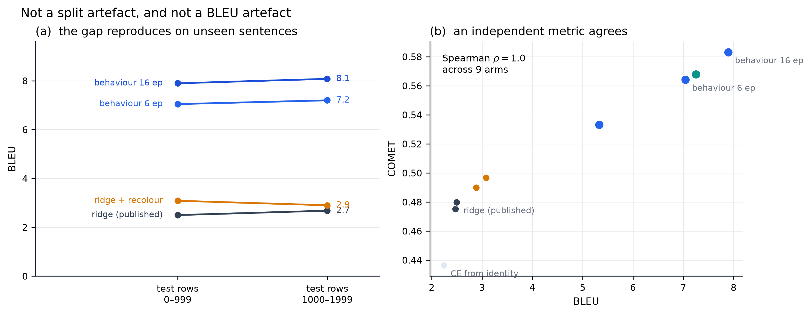

**Figure 12. Not a split artefact, not a BLEU artefact.** *(Measured.)* (a) The same fitted maps on a
disjoint sample. (b) COMET against BLEU for all nine arms; the rank correlation is perfect.

---

## 6. Discussion

### 6.1 The right object is a level set, and it is thin

A decoder does not define a metric; it defines a partition of memory space into regions that produce the
same text. Around a good memory that region is a **thin, tilted band**: thin because a 5% random
displacement already changes a fifth of the outputs, tilted because the same displacement along the
steepest direction is fatal while a random one is invisible. The thickness is set by the decoder, not by
the data.

A least-squares bridge is fitted in the ambient Euclidean metric, so its error is isotropic: it spends
an equal share of its budget in every direction, including the ones the decoder weights most. Our
measurement of the residual's projection is the direct evidence, and it is the opposite of the null-space
picture that motivates much of the linear-alignment literature. There is a large null space — the
gradient spectrum says most directions matter little — but least squares does not *find* it. Minimising
a norm is not a way of steering error into the null space; it is a way of guaranteeing that some of the
error lands outside it.

This also explains why the effect is large for so small a change. We did not add capacity, data or
nonlinearity. We changed which coordinate system the *error* is measured in: from the ambient one to the
one the decoder actually uses. At 263k parameters the ambient metric was leaving a factor of 3.2 on the
table.

### 6.2 MSE is an initialiser, not an objective

If the only problem with ridge were that it minimises the wrong thing, then starting from identity and
minimising the right thing should be at least as good. It is not (`ce_scratch`): worse BLEU, worse
validation cross-entropy, and an overshoot of the memory scale by 7%. Two objectives are therefore in
play: one that finds the right *region* (least squares, reliably) and one that finds the right *point
inside it* (the decoder's likelihood, if it starts in the region). The practical recipe is their
composition, and it is cheap: a closed-form ridge solve followed by two epochs of gradient descent.

This reframes a question the earlier rounds of this work kept asking: *why does a linear map keep beating
nonlinear ones?* The answer is not that the relation is linear. It is that the linear estimator is the
best-regularised way to land in the right basin, and that no experiment had varied the *loss* while
holding the function class fixed. Change the loss and the linear map gains a factor of 3.2 without
changing a single architectural assumption. The function class was never the hypothesis under test.

### 6.3 What "minimal intervention" buys, and what it costs

The system moves 2.4% of one model's parameters, of which 0.44% is the cross-lingual bridge. Both parts
are necessary: without the bridge the channel is token salad (0.05 BLEU), and without the readout the
decoder cannot be assumed to render a predicted memory at all. The honest statement is therefore narrower
than "translation is a 263k-parameter map" and more useful: **the interface is cheap, the readout is not
free, and the interface's *objective* is what determines whether the readout can use it.**

There is a corollary for how such systems should be reported. A bridge evaluated by retrieval, cosine,
CKA or reconstruction error can be improved while the system gets worse — the alignment literature has
documented this [Veitsman et al. 2026], and our arms reproduce it in miniature: the recolour repair raises
BLEU and chrF over plain ridge (3.08 against 2.50; 20.7 against 19.8) while *raising* reference
cross-entropy (3.262 against 3.228). The instruments disagree, and only the behaviour-fitted arms move
all of them in the right direction at once (Figure 7). If a bridge is to be judged at all, it should be
judged by the thing it is for.

### 6.4 The remaining 89%

The oracle changes the interpretation of the headline. 7.90 BLEU sounds like a small system; against a
74.2-BLEU readout it is 11% of what the decoder can do with a memory that already contains the answer.
The bridge, not the decoder, is the bottleneck — and the distillation result says the bottleneck is not
the *learning signal*: telling the map about the oracle's distribution adds nothing, so the limit is what
a single position-wise linear map (plus a fixed adapter) can represent.

Three candidates remain, in increasing order of cost: the **length and tokenisation mismatch** (the mapped
memory has Vietnamese token positions, the reference memory English ones, so the decoder must both read
and re-time the content); the **one-memory-per-source-token** assumption (a position-wise map cannot
reorder or merge, so word-order differences are structurally out of reach); and the **capacity of the
readout** (a rank-16 adapter trained on one channel). Our perturbation curves bound how much of the gap is
reachable at all: at a displacement where the decoder still reproduces 97% of the oracle's BLEU, a bridge
would be scoring in the seventies. Nothing about the current map suggests it is near that radius.

### 6.5 What this says about measuring representations

The methodological claim is not "alignment metrics are useless". They are excellent *diagnostics*: they
localise the failure, and the curves in §5.3 would be uninterpretable without them. The claim is that they
are the wrong *loss*. The field's default is to optimise the diagnostic and report it as evidence of
success; a frozen decoder makes the alternative nearly free. Whenever the consumer of a representation is
available and differentiable, the consumer's own loss is a better training signal than any distance to a
reference representation, and the cost is one backward pass.

---

## 7. Limitations and future work

**Scope.** One model pair, one direction (vi→en), one corpus, one seed, one adapter. The absolute numbers
are not usable translation quality (7.9 BLEU); the claims are about ordering, mechanism and relative
effect at fixed capacity. Nothing here was tested on larger models, on en→vi, or with a nonlinear bridge —
although the objective, not the function class, is what we varied, so a nonlinear bridge fitted on
behaviour is the natural next test.

**Supervision.** The behaviour objective needs parallel data at fit time. "No new data" means no pairs
beyond those already used by the representation-fitted baseline; it is not unsupervised alignment.

**The oracle is empirical.** 74.2 BLEU is the best memory we can construct, not a proven optimum, and it
is depressed by noisy reference pairs in MTet as every absolute number here is. "89% unexplored" is
therefore an accounting, not a bound.

**Measurement.** n = 1,000 for generation (BLEU resolution ≈ ±0.3), 300 for the perturbation curves, 400
for COMET, no human evaluation. In the sweep the oracle memory's attention mask is held fixed, which
reproduces the ridge channel to 0.1 BLEU but leaves a residual; the subspace measurement uses one gradient
basis per sentence at the in-distribution memory, not at the oracle.

**Theory.** We can say that the empirical level set is thin and anisotropic, and that a least-squares
residual is direction-blind, but not yet *why* the decoder's sensitivity has that shape, nor how the band
width scales with model size, task or language pair. A theory that predicts the tolerance radius from the
decoder's Jacobian would turn "fit on behaviour" from a recipe into a design rule.

**Future work.** Empirically: en→vi, larger pairs (ViT5/Flan), two adapters instead of one mixed adapter,
and a bridge that can reorder positions (a monotone attention or a small convolution over the memory).
Theoretically: whether the level set is reachable from below (test-time refinement on the memory), whether
the linear class remains sufficient at higher capacity, and whether a cheap proxy for the decoder's loss —
a distilled critic, or the gradient spectrum alone — can replace the backward pass.

---

## 8. Conclusion

Two frozen monolingual models can be joined by 263k parameters, but only if those parameters are fitted
on what the second model *does*. Fitting the same map on representation error leaves it five times outside
the decoder's tolerance, with a residual spread evenly across the directions that matter; fitting it on
the decoder's likelihood moves BLEU from 2.47 to 7.90, halves degeneration and raises an independent
learned metric, with no new parameters and no new data. The least-squares solution is the right place to
start and the wrong place to stop. Against a 74-BLEU ceiling the method has explored a ninth of its
range — and the fact that the ceiling exists at all is the more important result: the bridge, not the
decoder, is what stands between two frozen models and a translation.

---

## References

All works below were verified against the copies held in this project's reference library.

- **Borchert, Vulić, Moens, De Weerdt 2025.** Language Fusion for Parameter-Efficient Cross-lingual Transfer. ACL 2025, 25848–25868.
- **Bu, Feng 2026.** Language on Demand, Knowledge at Core: Composing LLMs with Encoder–Decoder Translation Models for Extensible Multilinguality. ACL 2026, 20863–20885.
- **Chen, Magdy, Zhang, Zhu, Wang, Abdul-Mageed 2026.** LatentMT: Machine Translation with Latent Reasoning. arXiv:2607.18618.
- **Dery, Yahav, Prior, Feng, Shen, Szlam 2026.** Latent Space Communication via K-V Cache Alignment. arXiv:2601.06123.
- **Fu, Min, Zhang, Yan, Dai, Ouyang, Wang 2026.** Cache-to-Cache: Direct Semantic Communication Between Large Language Models. ICLR 2026.
- **Gallistel 2011.** Prelinguistic Thought. *Language Learning and Development* 7(4), 253–262.
- **Hernandez, Dangovski, Lu, Soljačić 2023.** Model Stitching: Looking for Functional Similarity Between Representations. arXiv:2303.11277.
- **Huh, Cheung, Wang, Isola 2024.** The Platonic Representation Hypothesis. ICML 2024, PMLR 235.
- **Jha, Zhang, Shmatikov, Morris 2025.** Harnessing the Universal Geometry of Embeddings. NeurIPS 2025 (arXiv:2505.12540).
- **Liu, Niehues 2025.** Middle-Layer Representation Alignment for Cross-Lingual Transfer in Fine-Tuned LLMs. ACL 2025, 15979–15996.
- **Moschella, Maiorca, Fumero, Norelli, Locatello, Rodolà 2023.** Relative Representations Enable Zero-Shot Latent Space Communication. ICLR 2023.
- **Nakai, Chikkala, Oberkircher, Jennings, Skachkova, Anikina, Alabi 2025.** TRepLiNa: Layer-wise CKA+REPINA Alignment Improves Low-Resource Machine Translation in Aya-23 8B. MMLoSo 2025, 25–34.
- **Ngo, Trinh, Phan, Tran, Dang, Nguyen, Nguyen, Luong 2019.** MTet: Multi-domain Translation for English and Vietnamese. arXiv:2210.05610.
- **Pallucchini, Malandri, Mercorio, Mezzanzanica 2025.** Lost in Alignment: A Survey on Cross-Lingual Alignment Methods for Contextualized Representation. *ACM Computing Surveys* 58(5), Article 116.
- **Park, Choe, Veitch 2024.** The Linear Representation Hypothesis and the Geometry of Large Language Models. ICML 2024, PMLR 235.
- **Peng, Søgaard 2024.** Concept Space Alignment in Multilingual LLMs. EMNLP 2024, 5511–5526.
- **Rajaee, Pilehvar 2022.** An Isotropy Analysis in the Multilingual BERT Embedding Space. arXiv:2110.04504.
- **Ravisankar, Han, Wiegreffe, Carpuat 2026.** Can You Map It to English? The Role of Cross-Lingual Alignment in the Multilingual Performance of LLMs. EACL 2026, 4854–4872.
- **Vardasbi, Pires, Schmidt, Peitz 2023.** State Spaces Aren't Enough: Machine Translation Needs Attention. arXiv:2304.12776.
- **Veitsman, Liu, Schütze 2026.** Why Better Cross-Lingual Alignment Fails for Better Cross-Lingual Transfer: The Case of Encoders. MRL 2026, 119–134.
- **Yang 2025.** Direct Semantic Communication Between Large Language Models via Vector Translation. arXiv:2511.03945.
- **Zhao, Gilman 2020.** Non-Linearity in Mapping Based Cross-Lingual Word Embeddings. LREC 2020, 3583–3589.
- **Zhou, Salhan, Arnett, Korhonen 2026.** Cross-Lingual Alignment Without Joint Training: Do Monolingual Language Models Converge on Universal Representations? EMNLP 2026, 21811–21837.

---

## Provenance

Every number in this report is produced by the scripts committed with it: calibration and the oracle by
`validate`, the perturbation curves by `coincidence`, the arms and their bootstrap intervals by
`fit_behaviour` and `bootstrap_all`, the gradient spectrum by `analyse_basis`, COMET by `eval_comet`, the
disjoint-sample replication by `replicate`, and the naive channel by `eval_identity`. Figures are
generated by `figures.ipynb` from the JSON these scripts write; the captions mark which figures are
measured and which are conceptual. Two quirks are worth recording: the cross-entropy of the ridge channel
(3.228) reproduces the earlier run exactly while its BLEU does not (2.50 against 2.73), which is a
decoding-budget difference and not a precision difference; and the 12-epoch cross-entropy run was killed
by a restart before generation, so its BLEU is not reported.
