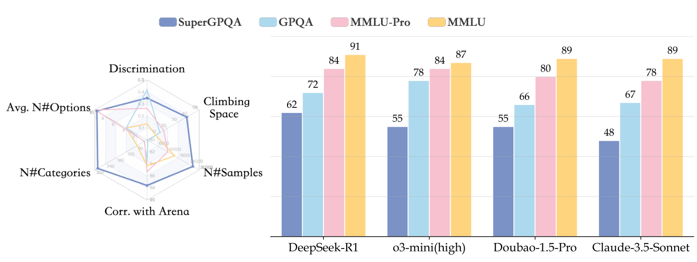
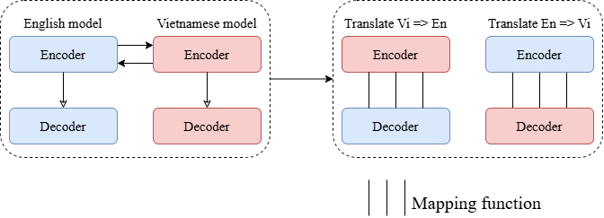
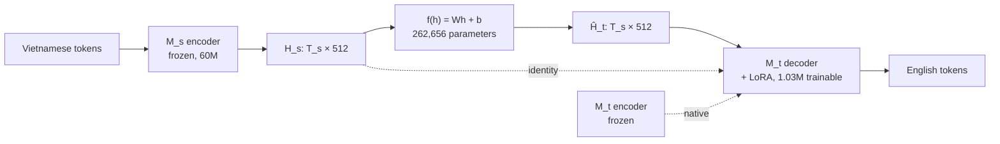
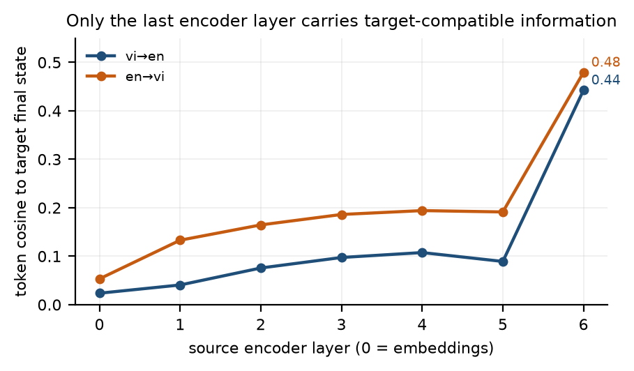
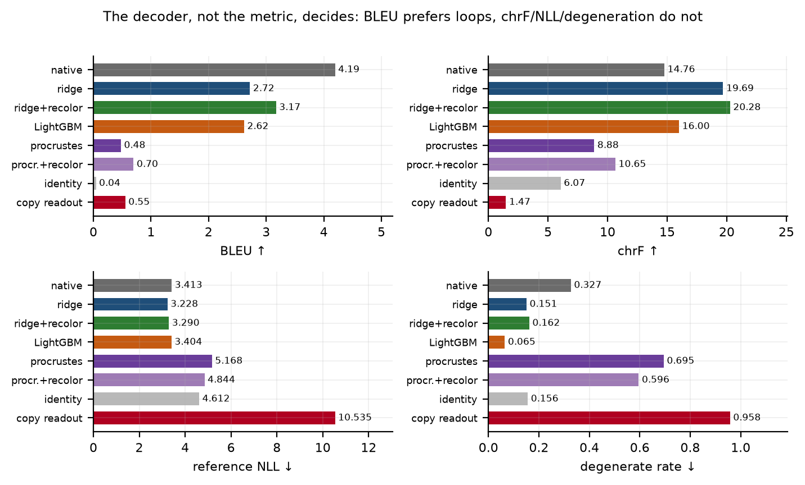
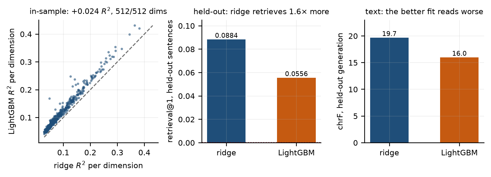
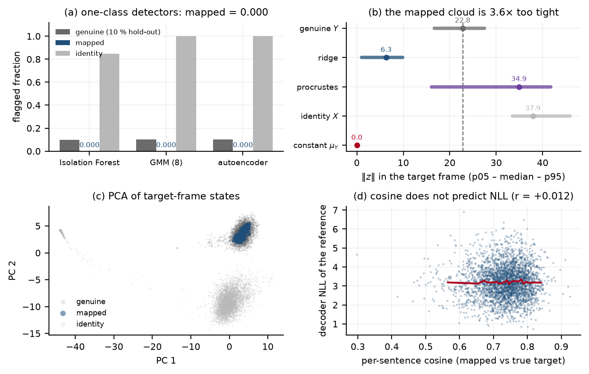
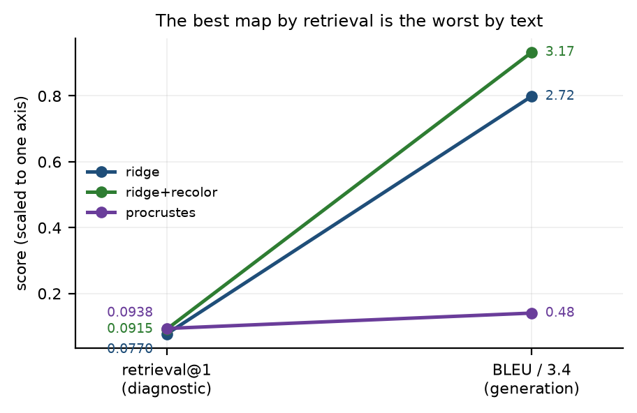
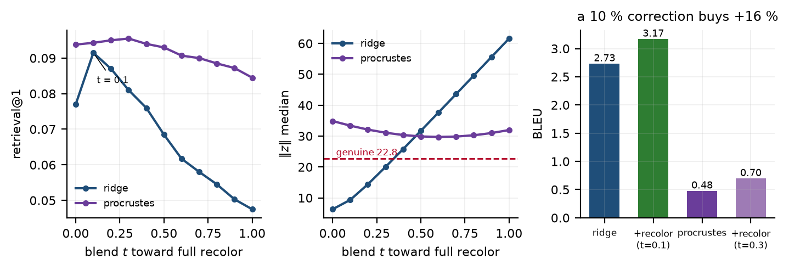

# A Bridge Between Frozen Models: What Alignment Metrics Cannot Tell You About Translation

*Technical report · November 2026*

---

## Abstract

Two language models trained on different languages, with no shared parameters and different tokenisers, can be bridged by a single linear map: on parallel sentences the map recovers the matching target representation far above chance. It is tempting to conclude that translation is therefore a small map plus a frozen decoder, and to rank candidate maps by how well their outputs align. This report tests that conclusion end to end with two 60M-parameter T5 models on 6.67M Vietnamese–English pairs. A 512×512 map (262,656 parameters), fitted on representations and never on a translation loss, turns source states into text: without it BLEU falls from 2.72 to 0.04, and with it the channel beats the target model's own encoder on chrF (19.7 vs 14.8), COMET (0.482 vs 0.379), reference NLL and degeneration, while losing on BLEU (2.72 vs 4.19) because the native channel emits token loops that BLEU rewards.

Every standard alignment diagnostic then ranks the maps wrongly. Orthogonal Procrustes has 22 % better retrieval@1 and is 5.7× worse at BLEU; a constant vector scores higher uncentred cosine (0.354) than Procrustes (0.228); 512 gradient-boosted regressors improve all 512 dimensions in sample and lose on held-out sentences and on text. The diagnosis is not distribution shift: three one-class detectors flag **0.000** of the mapped vectors, which are collapsed toward the target mean (median ‖z‖ 6.31 against 22.77 for genuine states). Partially undoing that collapse (+10 %) recovers 16 % relative BLEU at zero training cost in a 1,000-pair single-seed run; undoing it fully destroys retrieval. Alignment metrics measure a surrogate whose null space the decoder does not share. We close with a five-number protocol that a constant cannot satisfy.

---

## 1. Introduction

Two independently trained transformers represent the same sentence in different spaces. Feed them a parallel pair and compare their hidden states with linear CKA: the agreement is 0.86, against 0.24 when the sentences are paired at random, and it replicates across 36 model pairs over nine languages and across ten pairs of ~1B-parameter monolingual models built by different groups [1]. A single orthogonal rotation, fitted once on parallel sentences, then places 88.7 % of source sentences nearest their true counterpart, where the unaligned identity places 0.2 % [1]. The correspondence is not merely correlational: patching a rotated English activation into the German model's forward pass moves its next-token prediction toward the English content in 66–85 % of cross-fact pairs [1]. Related evidence says the same thing in other settings — concepts align linearly inside multilingual LLMs [2], and representations converge across modalities as models grow [3].

If the interface already exists, what is left to learn in order to translate? One answer is "almost nothing": freeze both models, learn a small map between their spaces, and let the target decoder write the sentence. The alternative is that geometry is not behaviour — that aligning vectors does not make a decoder able to read them — and that the gap between "the right sentence is nearby" and "the right sentence is written" is where translation actually lives.

The question is worth asking because monolingual competence is no longer the bottleneck. Figure 1 shows four models on four benchmarks. On GPQA, a graduate-level, "Google-proof" science benchmark on which skilled non-experts with unrestricted web access reach 34 % [4], DeepSeek-R1 answers 72 % and o3-mini(high) 78 %; on SuperGPQA, which extends the format to 285 graduate disciplines [5], the same models reach 62 % and 55 %. Whatever else these numbers mean, they rule out the simplest explanation for translation failure: the models do not fail because they cannot understand their own language. They may still fail because understanding is represented in two coordinate systems that no decoder was trained to read.

*Figure 1. Monolingual competence is high. Left: SuperGPQA differs from GPQA and MMLU in scale and diversity (radar: average number of options, climbing space, number of samples, categories, correlation with arena). Right: accuracy of four models on MMLU, MMLU-Pro, GPQA and SuperGPQA. Values as reported by the SuperGPQA benchmark [5]; GPQA's own non-expert baseline is 34 % [4]. This figure motivates the question; it does not measure cross-lingual alignment.*

This report therefore asks three questions:

- **RQ1.** Can two independently trained monolingual models communicate through a small map, with minimal intervention?
- **RQ2.** Is the information carried through the map sufficient for the target decoder to generate the translation?
- **RQ3.** How does the bridge actually change the representation, and do the geometric measures we normally use reflect that change?

The short answers are: **yes, weakly** (RQ1); **only if the readout is trained on the injected distribution** (RQ2); and **no — the standard measures invert the ranking that the decoder gives** (RQ3). The evidence is a sequence of controlled comparisons in which only one thing changes at a time: the same decoder, the same pairs, the same adapter, and a different channel or a different map.

The paper makes four contributions.

1. **A frozen-pair translation test.** Two 60M models, a 262,656-parameter map fitted without any translation loss, and a decoder-only LoRA as readout. Removing the map collapses BLEU from 2.72 to 0.04. The mapped channel beats the decoder's own encoder on chrF, COMET, NLL and degeneration while losing BLEU — and the reason is that the native channel loops.
2. **A falsification of the nonlinear remedy.** 512 per-dimension gradient-boosted regressions improve every one of the 512 dimensions in sample and lose the advantage on held-out sentences and on text. The nonlinearity is sentence-specific noise.
3. **A diagnosis of the failure that is the opposite of the one expected.** Mapped vectors are not out of distribution; they are too far inside it. The cloud is 3.6× tighter than genuine states, a constant vector reproduces 80 % of the reported cosine, and the collapse predicts the token loops.
4. **A measurement protocol.** Const baseline, centred cosine, distance to the genuine cloud, sentence-held-out retrieval, and a generation number. Each of the first four can be computed without a decoder; only the last one ranks the maps correctly.

*Figure 2. Model stitching, in the sense of exchanging parts between two trained networks. Blue: the Vietnamese model; red: the English model. Top row: each model intact (blue encoder→blue decoder, red encoder→red decoder). Bottom row: the encoders exchanged, including the configuration this report uses — the Vietnamese encoder feeding the English decoder (third panel) — and its mirror image. The readout channels of §4.2 are variants of the third panel: native substitutes the English encoder for the Vietnamese one, identity bypasses the map, and copy feeds the English decoder its own encoder's states. Only the decoder is adapted, and only by a rank-16 LoRA.*

---

## 2. Related work

**The interface exists, and it is close to linear.** Work on static word embeddings established that independently trained spaces can be related by a linear map, and that constraining the map to be orthogonal often helps [6], [7]. With contextual encoders the same holds token-wise: orthogonal Procrustes on independently trained models can beat alignment between multilingual models that share a vocabulary [6]. Inside LLMs, concept spaces align linearly across languages [2]; across modalities a single linear projection can stitch a vision encoder to a language model [3]; between a base model and its finetuned descendant one linear "task matrix" approaches finetuned accuracy [8]; and a map can even be learned without paired data, for retrieval and attribute inference on static embeddings [9]. The strongest evidence for the premise of this report is [1]: 36 monolingual Goldfish pairs, nine languages, CKA 0.76 against 0.18 shuffled, and 88.7 % retrieval from one rotation. What none of these studies do is generate a sentence through the aligned space.

**Two families of interventions, neither of them frozen.** The first keeps the model trainable and adds an alignment term: token-level optimal transport between language-agnostic representations [10], a middle-layer alignment objective folded into task-specific fine-tuning [11], layer-wise CKA+REPINA regularisation inside Aya-23 8B [12], source–target fusion inside LoRA adapters [13], centroid intervention [14], or monolingual adapters trained without parallel data [15]. The second leaves the outer models frozen but inserts a trained translation model in the loop: XBridge routes an LLM's multilingual understanding through external encoder–decoder MT models and learns only the cross-model mapping layers [16]. Closer to our setting, inference-time latent injection and activation surgery show that a residual stream can be edited to change language or suppress undesirable content [17], [18], [19]. In all of these, either the generator is trained, or a pretrained translator supplies the target-side competence. Our setting removes both: the generator is frozen except for a small readout adapter, and no translation model is in the loop.

**The gap this report measures.** The alignment literature evaluates maps by retrieval, MSE, CKA or probing. Recent work warns that these do not reliably predict downstream transfer [20], and [1] itself reports the ordering conflict: Procrustes wins retrieval in 36/36 pairs while affine and MLP win reconstruction MSE and post-map CKA. The same wedge appears between embedding-level alignment and task accuracy in encoders [20]. What is missing is a *generation-side* test of that wedge in a frozen pair, with the map and the readout varied independently. That is the experiment below.

*Table 1. Related work, grouped by what is aligned and what is measured. Numbers are references; the last column is the property this report adds.*

| Group | What is aligned | Supervision | Evaluated by | Generates text? |
|---|---|---|---|---|
| Static / contextual embedding alignment [6], [7], [9], [15] | Word or token embeddings | Parallel or unsupervised | Retrieval, translation accuracy | No (words) |
| Cross-model latent alignment, no joint training [1], [2], [3], [8] | Hidden states of independent models | Parallel sentences | CKA, retrieval@1, patching | No |
| Alignment inside a trainable model [11]–[14], [17]–[18] | Middle layers, adapters, residual stream | Task data + alignment loss | Downstream accuracy, MT | Yes, but the model is trained |
| Frozen composition with an external translator [16] | LLM ↔ encoder–decoder MT | Mapping layers | MT quality | Yes, but a translator is in the loop |
| **This report** | **Final encoder states of two frozen 60M models** | **Parallel sentences, representation loss only** | **Geometry *and* generation, same decoder** | **Yes, with a trained readout only** |

---

## 3. Problem definition

### 3.1 Notation and objective

Let $\mathcal{D}=\{(x_i,y_i)\}_{i=1}^{N}$ be a parallel corpus, $x_i$ Vietnamese and $y_i$ English. A conventional translator learns $F_\theta:x\mapsto\hat y$ end to end. We instead decompose translation into a frozen source encoder $E_s$, a map $f_\theta$, and a frozen target decoder $D_t$:

$$
x \;\xrightarrow{\;E_s\;}\; H_s\in\mathbb{R}^{T_s\times d}
\;\xrightarrow{\;f_\theta\;}\; \hat H_t\in\mathbb{R}^{T_s\times d}
\;\xrightarrow{\;D_t\;}\; \hat y .
\tag{1}
$$

Both models have $d=512$ and six layers. The only cross-lingual parameters are $f_\theta(h)=Wh+b$ with $W\in\mathbb{R}^{512\times512}$ and $b\in\mathbb{R}^{512}$: **262,656 parameters**, 0.43 % of one model. The map is fitted on representations, not on the task, so no gradient flows through the decoder while it is fitted. This separates "how much cross-lingual information is linearly decodable from $H_s$?" from "how well can a decoder be trained?".

The object we actually care about is the translation likelihood under the frozen decoder,

$$
\mathcal{L}_{\text{trans}}(\theta)
=-\mathbb{E}_{(x,y)\sim\mathcal{D}}
\left[\log P_{M_t}\!\left(y\mid f_\theta(E_s(x))\right)\right],
\tag{2}
$$

but (2) has no closed-form solution, and optimising it directly would require back-propagating through the decoder for every map update. We optimise a token-level surrogate instead. Target states are aligned onto source token positions (§4.3),

$$
\mathcal{L}_{\text{emb}}(\theta)
=\mathbb{E}\left[\frac{1}{T_s}\sum_{j=1}^{T_s}
\left\|Wh_j+b-\tilde h_j\right\|_2^2\right],
\qquad \tilde H_t=\mathrm{Align}(H_t).
\tag{3}
$$

### 3.2 Why the surrogate is not the objective

The decoder's logits at a position are $z=W_{\text{lm}}h$, so

$$
\log P(y_j\mid y_{<j},x)=z_{y_j}-\log\sum_{v}e^{z_v}.
\tag{4}
$$

Perturb $h\mapsto h+\varepsilon$. Then $z\mapsto z+W_{\text{lm}}\varepsilon$ and, to first order,

$$
\Delta\log P(y_j\mid y_{<j},x)
=\left(W_{\text{lm}}\varepsilon\right)_{y_j}
-\sum_v\pi_v\left(W_{\text{lm}}\varepsilon\right)_v
\;\ge\;-\|W_{\text{lm}}\|_2\,\|\varepsilon\|_2,
\tag{5}
$$

where $\pi=\mathrm{softmax}(z)$ and the inequality is Cauchy–Schwarz on the worst case. A map with small (3) therefore cannot be arbitrarily bad in (2): the drop is bounded by a Lipschitz factor. But the bound is over *all* directions. An error that lies in the null space of $W_{\text{lm}}$ costs nothing; an error along a sensitive direction costs everything. Minimising $\|\varepsilon\|_2$ in the Euclidean metric of the target space is not the same as minimising the decoder's loss, and the converse of (5) is false. That gap is the subject of this report: every metric in the alignment literature is a version of (3), while the decoder reads (2).

### 3.3 What the metrics measure

Five diagnostics appear throughout. Let $m_t=f(h_{s,t})$ and $y_t$ be the aligned genuine target state, with target mean $\mu_Y$ and per-dimension standard deviation $\sigma_Y$.

- **`cos_abs`** — the number usually reported as "token cosine": $\frac{1}{T}\sum_t \cos(m_t,y_t)$, uncentred.
- **`cos_centre`** — the same after subtracting the respective means, $\cos(m_t-\mu_M,\,y_t-\mu_Y)$.
- **`const_cos`** — what the constant predictor $\mu_Y$ earns under `cos_abs`; a map that does not beat it has demonstrated nothing.
- **`zdist`** — $\|z\|$ with $z=(m_t-\mu_Y)/\sigma_Y$: how far the mapped vector sits from the centre of the decoder's own cloud. Genuine states have a median of 22.77.
- **`ret@1`** — nearest-neighbour accuracy of sentence-mean mapped states against the true target states in a bank of $n$ test sentences; chance is $1/n$.

We also fit one-class detectors on genuine target states and report the fraction of mapped states they flag as anomalous.

### 3.4 Hypotheses

The design is a sequence of falsifiable statements, not a demonstration.

- **H1 (transfer).** The map carries sentence identity: `ret@1` is far above chance, and generation through the mapped channel is far above the identity control.
- **H2 (metric–behaviour agreement).** Ranking maps by `cos_abs`, `cos_centre` or `ret@1` agrees with ranking them by generated text.
- **H3 (nonlinearity).** A nonlinear map fits the residual better and therefore generates better text.
- **H4 (distribution shift).** If the mapped channel fails, the cause is that mapped vectors lie outside the decoder's familiar distribution.

H1 survives, with a qualification. H2, H3 and H4 are rejected, and the way each fails is informative.

---

## 4. Method

### 4.1 Models, data and split

**Models.** $M_s$ = `t5-small-vietnamese`, $M_t$ = `t5-small`; both encoder–decoder T5 models with 60M parameters, six layers and $d=512$ [21]. The two tokenisers are different and not shared. Both models are frozen; the only trainable parameters are the map and a rank-16 LoRA on $M_t$'s decoder.

**Corpus.** MTet, 14 training shards, 8.33M raw rows [22]. Rows are deduplicated per shard, the Vietnamese side is identified by the higher count of non-ASCII characters, lengths are restricted to 20–300 characters, and every text used by an earlier experiment is removed. Result: **6,668,910 pairs**. Ids are assigned by `row_number() OVER (ORDER BY md5(vi), file)`, so a re-run cannot move a sentence between splits. One shard (`train-00008`) is used for the map; inside it the split is 80/10/10 by md5 position: **383,516 / 47,939 / 47,939**.

Shard choice was tested rather than assumed. A 50k-row stratified sample of every shard was encoded with $M_s$, mean-pooled, centred, stripped of its first principal direction, and clustered with $K=4$ (MTet's four domains). Every eligible shard falls in the same narrow band — representativeness 0.051–0.052, cluster entropy 0.995–0.997, outlier rate 0.048–0.052, coverage 1.000, JS divergence $\le 10^{-4}$ — and a 100× within-shard bootstrap puts the standard deviation of the composite score at ±0.46 on a 1.31 range. The shards are exchangeable; "the most representative shard" has no meaningful answer. Any choice is unbiased, and one shard is a limitation on variance, not on selection.

*Table 2. Models and data.*

| Item | Value |
|---|---|
| Source model $M_s$ | `t5-small-vietnamese`, 60M, 6 layers, $d=512$, frozen |
| Target model $M_t$ | `t5-small`, 60M, 6 layers, $d=512$, frozen except LoRA |
| Map | $f(h)=Wh+b$, $W\in\mathbb{R}^{512\times512}$, 262,656 parameters |
| Readout adapter | rank-16 LoRA on decoder $q,k,v,o$ and FFN, 1.03M parameters (1.68 %) |
| Corpus | MTet, 14 shards, 8.33M rows → 6,668,910 pairs after per-shard dedup |
| Map shard | `train-00008-of-00014`, 479,394 pairs |
| Split | 383,516 / 47,939 / 47,939 (80/10/10, md5 order) |
| Token pairs for the map | 9.28M, character-span aligned |
| Generation test | first 3,000 test pairs; first 1,000 for COMET and for the variant table |

### 4.2 Readout and the four channels

The decoder is adapted with a rank-16 LoRA on its $q,k,v,o$ and FFN projections: 1.03M trainable parameters, 1.68 % of the decoder [23]. Copying is a routing behaviour — the information is already in the encoder states, the decoder has to be told to read it — so a small adapter is the right size for the question. If a LoRA cannot make the model copy, a larger intervention would be learning a new task, which invalidates the premise.

The three translation channels — native, mapped and identity — share one adapter and the same pairs, so a difference between them is attributable to the map rather than to the adapter. The copy gate uses its own adapter, trained on the identity task.

- **native** — $D_t$ reads $E_t(x)$, the target model's own encoder applied to Vietnamese. This requires no cross-lingual transfer and sets the decoder-side ceiling.
- **mapped** — $D_t$ reads $f(E_s(x))$.
- **identity** — $D_t$ reads $E_s(x)$ unchanged. This is the "no map" control.
- **copy** — a decoder trained to reproduce its own encoder's states, $D_t^{\text{copy}}(E_t(s))=s$ for target-language $s$. It is a gate, not a translation channel.

The copy gate is measured before any map is fitted. If the decoder cannot render a vector that is already exactly right, a mapped vector — necessarily wrong by some $\varepsilon$ — cannot be rendered either, and any downstream BLEU would measure the gate rather than the map.

*Pipeline. Solid path: the mapped channel. Dashed paths: the identity and native controls. The copy gate is a separate adapter on the same decoder, trained to reproduce the target model's own encoder states.*

*Table 3. Copy gate: identity reconstruction from the model's own encoder states, no prompt, 1,000 sentences per model.*

| Model | Adapter | Exact match | Empty | Hyp/ref words |
|---|---|---|---|---|
| `t5-small` (en) | none | 9.6 % | 1.6 % | 16.9 / 17.1 |
| `t5-small` (en) | LoRA r=16, 6.4k sentences | **85.9 %** | 0.0 % | 17.2 / 17.1 |
| `t5-small-vietnamese` | none | 0.0 % | 0.7 % | 8.1 / 22.4 |
| `t5-small-vietnamese` | LoRA r=16, 15k sentences | 13.5 % | 0.1 % | 22.7 / 22.4 |

The gate passes for the English decoder and fails for the Vietnamese one. The asymmetry is a property of the decoder, not of the method, and it is why the en→vi direction has no `copy` channel. It also sets a floor: 14 % of sentences still fail to be reproduced from a *perfect* vector, so no map can exceed that readout on this task.

### 4.3 Fitting the map

Vietnamese and English tokenisations have different lengths. For each pair, target token $j$ is assigned to source token $i$ when their character spans intersect:

$$
a_{ij}=\mathbb{1}\left[[s_i,e_i)\cap[s_j,e_j)\neq\varnothing\right],
\qquad
\tilde h_i=\frac{\sum_j a_{ij}h_j}{\sum_j a_{ij}}.
\tag{6}
$$

A source token that intersects no target token (punctuation dropped by the other normaliser, whitespace pieces) is filled from the proportionally nearest target token, so no source position is silently dropped. This is a coarse character-level approximation of word alignment; roughly 14 % of source tokens fall back, and that is the main source of label noise in (3).

With $A=X^{\top}X$, $B=X^{\top}\tilde Y$ and $C=\tilde Y^{\top}\tilde Y$ accumulated in float64 over the training split,

$$
\hat W=(A+\lambda I)^{-1}B,
\qquad
\hat b=\bar{\tilde y}-\bar x\hat W .
\tag{7}
$$

Column $k$ of $\hat W$ is exactly the least-squares coefficient vector of the regression $\tilde y_k\sim x$; solving (7) once is the same estimator with 512 right-hand sides, not an approximation. Per-dimension $R^2$ follows from the moments without touching activations:

$$
R^2_k=1-\frac{\mathrm{SSE}_k}{\mathrm{SST}_k},
\qquad
\mathrm{SSE}_k=\left[\hat W^{\top}A\hat W-2\hat W^{\top}B+C\right]_{kk}
+n\left(\hat b+\bar x\hat W-\bar{\tilde y}\right)_k^2 .
\tag{8}
$$

The moments are additive over shards, so 9.28M token pairs never exist in memory at once: each batch contributes three 512×512 matrices and is discarded. The $\lambda$ sweep is then free. The sweep is flat for vi→en (best relative gain $7\times10^{-9}$ at 9.28M tokens); no regularisation is needed at this sample size, and $\lambda=0$ is used.

### 4.4 Nonlinear control

For each target dimension $k$, a gradient-boosted tree model $g_k:\mathbb{R}^{512}\to\mathbb{R}$ is fitted on the *same token sample* as the ridge comparison: 150 rounds, 15 leaves, `feature_fraction=0.3`, `max_bin=63`, `min_data_in_leaf=100` [24]. Ridge is fitted on all 9.28M tokens; LightGBM gets 90k training and 10k validation tokens, so the comparison is biased against trees on data and in favour of them on capacity. If trees still do not win on held-out sentences, the conclusion "the residual is not learnable by this family" is conservative. The 90k/10k split is a random permutation of the sampled tokens from 12k training sentences; evaluating on tokens from the same sentences shares sentence-level information, which is exactly the leakage that §5.3 exploits as a diagnostic.

### 4.5 Orthogonal control and variance correction

**Procrustes.** The orthogonal map $W_{\text{orth}}$ minimising $\|XW-Y\|_F$ subject to $W^{\top}W=I$ is fitted on the same token sample. It is the map the alignment literature would recommend, and it is length-preserving.

**Recolor.** Ridge shrinks predictions toward the mean. To test whether that shrinkage is the defect, we fit a colouring matrix $\Sigma_Y^{1/2}\Sigma_M^{-1/2}$, where $\Sigma_M$ is the covariance of mapped outputs and $\Sigma_Y$ the covariance of genuine target states, and blend it with the original map:

$$
M_t=(1-t)\,M+t\,\Sigma_Y^{1/2}\Sigma_M^{-1/2}M .
\tag{9}
$$

At $t=0$ this is the original map; at $t=1$ it matches the target covariance. The blend is swept over $t\in\{0,0.1,\dots,1\}$ for ridge and over four values for Procrustes. All transforms are fitted on 30k training tokens and scored on 30k held-out validation tokens; nothing is fitted on what it is measured against.

### 4.6 Decoder training and metrics

The translation adapter is trained on 60k pairs, one epoch, greedy decoding at evaluation, maximum 48 new tokens. The same adapter is used for every channel, so a channel difference is attributable to the map, not to the adapter. Metrics are COMET (`Unbabel/wmt22-comet-da`) [25], chrF [26], BLEU with 13a tokenisation [27], reference NLL under the decoder, empty rate and degenerate rate. A hypothesis is *degenerate* when the ratio of unique tokens to total tokens is at most 0.5 — the operational definition of a token loop such as `the sex of the sex of the sex of …`.

The five-channel comparison was originally run on 3,000 pairs. For this report every channel is re-scored on the **first 1,000 pairs**, the same subset used for COMET and for the map-variant experiment, so that all rows of Table 5 share one test set and one scorer. The 3,000-pair values are quoted in the text where they differ materially.

### 4.7 One-class anomaly protocol

Six thousand held-out validation sentences are encoded with the frozen pair, giving 145,298 aligned token pairs. Detectors are fitted on 90 % of genuine target-side states only, with the threshold set so exactly 10 % of the fitting set is flagged. Test A is the held-out 10 % of genuine states, which must return ≈0.10 or the detector is broken. Test B is all mapped vectors. Three detectors with three different notions of "anomalous" are used: Isolation Forest (path length), a Gaussian mixture with 8 diagonal components (density), and an autoencoder 512→256→64→256→512 (reconstruction error) [28]. A single architecture, one seed and 40 epochs for the autoencoder mean the claim is the ordering, not the third decimal.

---

## 5. Results

### 5.1 The bridge is real, and the reported cosine is nearly free

Table 4 reports the geometry of the ridge map and its controls on 5,000 held-out sentences (121,713 token pairs). The identity control is near-orthogonal — token cosine 0.091, sentence cosine 0.270 — so the two spaces have nothing to do with each other without a map. Ridge reaches token cosine 0.443, sentence cosine 0.764 and retrieval@1 0.0884 against a chance of 0.0002: the bridge carries sentence identity, and H1's geometric half is supported.

*Table 4. Geometry on 5,000 held-out vi→en sentences (121,713 token pairs). Chance retrieval@1 = 0.0002. Source: `geometry_vi_en.json`.*

| Variant | Token cosine | Token MSE | Sentence cosine | Retrieval@1 |
|---|---|---|---|---|
| **ridge map** | **0.4429** | **9.5698** | **0.7641** | **0.0884** |
| LightGBM | 0.4388 | 9.5836 | 0.7332 | 0.0556 |
| mean (constant) | 0.3542 | 10.4702 | 0.6671 | 0.0002 |
| identity (no map) | 0.0906 | 33.9243 | 0.2700 | 0.0040 |

The middle row is the problem. Predicting the dataset mean earns a token cosine of 0.354 and a sentence cosine of 0.667 **for free**, i.e. 80 % of the map's cosine, because raw transformer states are strongly anisotropic: every state points roughly the same way, and cosine rewards pointing the same way. Cosine cannot separate a real map from a constant here. Retrieval can: 0.0884 versus 0.0002 is 440× chance, and the mean control is exactly at chance. This is why Table 8 reports `const_cos` next to every cosine.

The reverse direction reproduces the geometry with a different tokeniser and a different target space. On 3,000 held-out en→vi sentences (67,130 token pairs) the map reaches token cosine 0.4792, sentence cosine 0.8113 and retrieval@1 0.1800, against identity 0.0989 / 0.2731 / 0.0050 and a mean control at 0.0000 retrieval. Chance is 0.00033. The map is *better* in this direction on every geometric metric, which is consistent with Vietnamese target states being more distinctive per sentence. That is a property of the target token space, not evidence about generation: generation is measured only in the vi→en direction here, and geometry does not predict it even there (§5.6). Retrieval and generation measure different things, again.

*Figure 3. Layer-wise transfer: token cosine between the mapped state at source layer ℓ and the target's final state, both directions. The curve is flat for layers 1–5 and jumps at layer 6 (0.443 vi→en, 0.479 en→vi). For a six-layer model the "which layer should we map?" question has a degenerate answer: the last one, or none. This contrasts with retrieval studies in 12-layer models, where mid-stack layers are best [1]; generation through a frozen decoder is a different task.*

### 5.2 The map produces text, and BLEU prefers the wrong channel

Table 5 is the central comparison: eight channels, one decoder, one test set, 1,000 pairs. Removing the map collapses BLEU from 2.72 to 0.04 (62×) and chrF from 19.69 to 6.07. The identity output is literal token salad, and 7.3 % of it is empty: the decoder has never seen source-language states and cannot use them.

*Table 5. Generation on 1,000 held-out vi→en pairs. BLEU/chrF/NLL/degeneration are re-scored on the first 1,000 outputs of the original run; COMET is the original 1,000-pair score. Greedy decoding, max 48 new tokens. Dashes: COMET was not computed for the map variants. The recolor and Procrustes rows are single-seed point estimates without bootstrap intervals.*

| Channel | BLEU | chrF | COMET | Ref. NLL | Degenerate | Empty |
|---|---|---|---|---|---|---|
| native (own encoder) | **4.19** | 14.76 | 0.3787 | 3.413 | 0.327 | 0.001 |
| ridge map | 2.72 | 19.69 | **0.4816** | **3.228** | **0.151** | 0.000 |
| ridge + recolor (t=0.1) | 3.17 | **20.28** | — | 3.290 | 0.162 | 0.000 |
| LightGBM | 2.62 | 16.00 | 0.4590 | 3.404 | 0.065 | 0.000 |
| Procrustes | 0.48 | 8.88 | — | 5.168 | 0.695 | 0.006 |
| Procrustes + recolor (t=0.3) | 0.70 | 10.65 | — | 4.844 | 0.596 | 0.004 |
| identity (no map) | 0.04 | 6.07 | 0.3360 | 4.612 | 0.156 | 0.073 |
| copy readout | 0.55 | 1.47 | 0.2755 | 10.535 | **0.958** | 0.016 |

Three of four metrics say the mapped channel is the best non-augmented channel. It has the highest COMET (0.4816), the highest chrF among the un-augmented maps (19.69) and the lowest reference NLL (3.228); only BLEU prefers native (4.19 vs 2.72). The disagreement is explained by degeneration: **32.7 % of native outputs are token loops**, against 15.1 % for ridge. BLEU is precision-oriented and a short repetitive output can score on it; chrF, COMET and the NLL are not fooled. Reporting BLEU alone would have inverted the conclusion of this section — and of the paper.

The absolute BLEU is decoder-bound, not map-bound. 2.72 is low for MT. The native channel, which uses the decoder's *own* encoder and needs no cross-lingual transfer at all, reaches only 4.19 BLEU. The correct reading of Table 5 is the ordering and the gaps, not the absolute value. The 3,000-pair run gives the same ordering with slightly different absolutes (mapped 2.84 / 19.96 / 0.4816, native 4.17 / 15.35 / 0.3787, identity 0.03 / 6.09 / 0.3360); the paired differences there are identity−mapped = −2.80 BLEU [−3.05, −2.54] and native−mapped = +1.34 [+0.80, +1.91].

*Figure 4. Eight channels, one decoder, 1,000 pairs. Native wins BLEU through loops; ridge and ridge+recolor win chrF and NLL; Procrustes, the best map by retrieval, is the worst usable map; the copy readout collapses to punctuation. The ordering is stable across metrics except BLEU.*

**RQ1, first answer.** Two frozen monolingual models can communicate through a 262,656-parameter map: the mapped channel produces English that is lexically and semantically above the identity control by an order of magnitude, and it beats the target model's own encoder on three of four metrics. The intervention is minimal — 0.43 % of one model for the map and 1.68 % of the decoder for the readout — but it is not zero, and §5.4 shows that the readout is not optional.

### 5.3 The nonlinear map wins in sample and loses everywhere else

Table 6 compares ridge and 512 LightGBM regressions on identical target dimensions. In sample, the trees improve **all 512 dimensions**: mean per-dimension $R^2$ rises from 0.0918 to 0.1160 (+26 %), token MSE falls 2.6 %, and token cosine rises 0.018. They use all 150 boosting rounds and 457 of 512 features per dimension. The nonlinear component of the residual is real, consistent, and spread across nearly the whole input space — but worth only 2.4 points of $R^2$, leaving 88 % of the per-dimension variance unexplained by either mapper.

*Table 6. Ridge vs 512 LightGBM regressions on the same token sample and the same target dimensions. In-sample is the 10k held-out tokens of the fit; held-out is the 5,000 test sentences of Table 4; text is the 1,000-pair generation run of Table 5.*

| Metric | Ridge (9.28M tokens) | LightGBM (90k tokens) | Difference |
|---|---|---|---|
| Mean per-dimension $R^2$, in sample | 0.0918 | **0.1160** | +0.0242 (+26 %) |
| Token MSE, in sample | 8.8606 | **8.6311** | −2.6 % |
| Token cosine, in sample | 0.4595 | **0.4776** | +0.0181 |
| Token cosine, held-out sentences | **0.4429** | 0.4388 | −0.0041 |
| Retrieval@1, held-out | **0.0884** | 0.0556 | −0.0328 (−37 %) |
| chrF, held-out generation | **19.69** | 16.00 | −3.69 |
| Reference NLL | **3.228** | 3.404 | +0.176 |
| BLEU | **2.72** | 2.62 | −0.10 (inside noise) |

The gain does not survive held-out sentences. Table 6's in-sample rows evaluate tokens drawn from the *same 12k sentences* used to fit the trees, so they share sentence-level information. On the 5,000 test sentences neither mapper saw, the ordering reverses: ridge reaches token cosine 0.4429 and retrieval@1 0.0884, LightGBM 0.4388 and 0.0556. On text, LightGBM loses 3.7 chrF and 0.18 NLL; the BLEU difference is inside noise at this $n$. In other words, the 2.4-point $R^2$ advantage is **sentence-specific noise that trees can memorise**, not a transferable nonlinearity. H3 is rejected.

*Figure 5. The same two mappers, three views. Left: per-dimension $R^2$ on the shared 90k/10k token split — every point above the diagonal. Middle: on 5,000 unseen sentences, ridge retrieves the correct target 1.6× as often. Right: on text, the better in-sample fit produces 3.7 chrF less. The in-sample and held-out evaluations disagree, and the disagreement is the finding.*

This is the cleanest available answer to "why does linear mapping keep winning": given the same sentences, trees win; given new sentences, they do not. The residual is dominated by irreducible cross-lingual variance — two independently pretrained models were never optimised to agree — plus directions the decoder does not read. No function of $x$ recovers information that $H_s$ does not contain, and a tree fitted on 90k tokens spends its capacity on sentence-specific structure that does not transfer.

### 5.4 The copy readout fails, and the failure is a result

The adapter that copies 85.9 % of sentences from its own encoder's states produces punctuation when fed *mapped* vectors: BLEU 0.55, chrF 1.47, COMET 0.2755, degenerate rate 95.8 %, reference NLL 10.535. The naive form of the vector-injection hypothesis — "predict the vector of the translation, then let a copy-trained decoder render it" — is therefore **falsified**. A decoder trained on its own encoder's distribution does not generalise to a predicted distribution, even when the prediction carries the topic.

The practical consequence is that the copy gate is **necessary but not sufficient**. Passing it proves the decoder *can* read vectors; it does not prove it will read *predicted* ones. The channel that works is trained on the injected distribution (`mapped`), which is a weaker and more expensive claim: the readout is not a generic renderer, it is a learned decoder for a specific input distribution. This also explains why the 100k-pair run that used a copy-tuned decoder produced loops: its numbers measured echoing, not translation.

**RQ2, answer.** The information through the map is sufficient for the decoder to generate a translation only when the decoder is trained on the mapped channel. The mapping alone, with a readout trained elsewhere, is not enough.

### 5.5 The failure is collapse, not strangeness

H4 predicted that mapped vectors would be out of distribution. The opposite is true. Three one-class detectors, fitted on 90 % of genuine target states and calibrated to flag 10 % of them, flag **0.000** of the mapped vectors; the unmapped source vectors are flagged at 0.85–1.00 (Table 7). Three different notions of "anomalous" — path length, density, reconstruction error — agree.

*Table 7. One-class anomaly rates. Detectors fitted on 90 % of genuine target states, threshold calibrated to flag 10 % of the fitting set. Source: `anomaly_detection.json`.*

| Detector | Genuine, 10 % hold-out | **Mapped** | Identity (raw source) |
|---|---|---|---|
| Isolation Forest | 0.099 | **0.000** | 0.846 |
| Gaussian mixture (8 components) | 0.103 | **0.000** | 1.000 |
| Autoencoder (512→256→64→256→512) | 0.102 | **0.000** | 1.000 |

The reason is visible in the distance statistics. In the z-scored target frame, genuine states live in a shell at median ‖z‖ 22.77 (p05 16.65, p95 27.46). Mapped states live at **6.31** (p05 0.99, p95 9.85): the cloud is 3.6× tighter, and its lower tail reaches essentially the mean. That is textbook ridge shrinkage: the least-squares solution pulls predictions toward the mean, hardest in the directions where the source carries little signal. The mapped vector is therefore an excellent "average plausible activation" — which is exactly why density- and reconstruction-based detectors score it as maximally normal.

This explains the token loops. If every injected vector is within ‖z‖ ≈ 6 of the same point, the decoder receives almost no sentence-specific signal. A decoder with no conditioning signal produces fluent, repetitive, generic text; `the sex of the sex of …` is the expected output of an input that barely varies. Degeneration is not a mysterious failure mode, it is the signature of a collapsed conditioning vector. It also explains the ordering native > mapped > identity: identity vectors are far outside the manifold (median ‖z‖ 37.9) and produce nothing at all; collapsed vectors are inside it, so the decoder at least emits language; a real encoder emits language *and* carries content. H4 is rejected in its literal form, and the rejection is more informative than the hypothesis.

*Figure 6. (a) Three one-class detectors flag none of the mapped vectors and most of the unmapped ones. (b) Median ‖z‖: genuine 22.8, ridge 6.3, Procrustes 34.9, identity 37.9, constant 0. (c) PCA of target-frame states: the mapped cloud is a tight blob inside the genuine cloud, while identity states sit outside it. (d) Per-sentence mapped cosine against the decoder's NLL of the reference: the trend is flat (r = +0.012).*

### 5.6 What actually predicts generation

Table 8 ranks the diagnostics by whether they predict the decoder's ordering. The result is a hierarchy, not a single number.

*Table 8. Diagnostics against generation. Geometry from the 4,000-vector bank (`map_repairs.json`); generation from Table 5. A diagnostic is "predictive" only if it ranks ridge above Procrustes, which the decoder does.*

| Diagnostic | Ridge | Procrustes | Constant | Predicts generation? |
|---|---|---|---|---|
| `cos_abs` (the reported "token cosine") | 0.4433 | 0.2279 | **0.3541** | **No** — the constant beats Procrustes by 55 % |
| `cos_centre` | 0.2703 | 0.1465 | 0.0001 | Partly — right order for ridge vs Procrustes, wrong for recolor |
| `ret@1` (4,000-vector bank) | 0.0770 | **0.0938** | 0.0003 | **Inverted** — best retrieval, worst text |
| `zdist_med` (genuine = 22.77) | **6.31** | 34.88 | 0.00 | **Yes** — survivable scale vs degenerate |
| Per-dimension $R^2$, in sample | 0.0918 | — | — | No — higher $R^2$, worse text |
| Pearson(`cos`, decoder NLL) | +0.012 | — | — | No — flat by construction |
| Anomaly rate | 0.000 | — | — | No — collapse, not shift |

Three readings, in order of importance.

1. **`cos_abs` is gameable.** The constant vector scores 0.3541, higher than the orthogonal map (0.2279) that has 22 % better retrieval. Any alignment claim based on an uncentred cosine can be satisfied by predicting the mean, which is precisely what ridge does (it beats the constant by only 0.089 while collapsing to ‖z‖ = 6.3). Report `const_cos` next to every cosine; a map that does not beat it has demonstrated nothing.
2. **`ret@1` is actively misleading.** Procrustes wins retrieval (+22 % relative, 0.0938 vs 0.0770, both far above chance) and is 5.7× worse at BLEU, with 4.6× the degeneration. This is consistent with [1], where Procrustes wins retrieval in 36/36 pairs while affine wins MSE and CKA — two metrics ranking the same two maps in opposite orders — and with [20], where better alignment does not reliably mean better transfer. The decoder settles the disagreement, and the decoder is the only instrument that measures the task.
3. **`zdist` is the cheap diagnostic that worked.** It tracked generation correctly in the decisive comparison: ridge at 6.3 is survivable, Procrustes at 34.9 is degenerate, identity at 37.9 produces nothing. It is computable without a decoder, and it measures the property that separated the two mappers in the decisive comparison — whether the conditioning vector lies in the region the cross-attention can use.

`cos_centre` agrees with generation on ridge > Procrustes, but ranks ridge+recolor below plain ridge while generation says above; it is a partial signal, not a substitute. In-sample $R^2$ and anomaly rates are not signals at all for this question.

*Figure 7. The ranking flip. On the diagnostic that the alignment literature reports, Procrustes is the best map; on the task, it is the worst usable map. Ridge+recolor is second on retrieval and first on BLEU. A constant vector would sit at 0.354 on `cos_abs` and at chance on retrieval, beating Procrustes on the former.*

### 5.7 A 10 % correction buys 16 % BLEU

If the defect is shrinkage, the obvious repair is to undo it. Doing so fully fails, and the failure is instructive. The colouring matrix $\Sigma_Y^{1/2}\Sigma_M^{-1/2}$ over-corrects catastrophically: `zdist_med` goes from 6.31 to **61.59**, far past the genuine 22.77, and retrieval *drops* from 0.0770 to 0.0475. Ridge's output covariance is near-singular in the collapsed directions, and $\Sigma_M^{-1/2}$ inverts those near-zero eigenvalues, amplifying noise. Whitening an ill-conditioned matrix inflates rather than repairs.

The blend does help, but only partially. Table 9 reports the sweep. Ridge at $t=0.1$ gains **+19 % relative retrieval** (0.0770 → 0.0915) while keeping `cos_centre` at 0.2132 and `zdist_med` at 9.35; in generation it reaches **3.17 BLEU / 20.28 chrF**, i.e. +16 % relative BLEU and +2.8 % chrF over the 2.73 BLEU obtained by the same map without recolor in the same run, with a slightly higher NLL (3.290 vs 3.228) and degeneration (0.162 vs 0.151). The cost is one 512×512 matrix fitted in seconds on data already on disk: no retraining, no GPU.

*Table 9. Recolor sweep on 30k training / 30k held-out tokens. Genuine `zdist_med` = 22.77. Generation for the two selected blends is in Table 5.*

| Map | $t$ | `cos_centre` | `zdist_med` | `ret@1` |
|---|---|---|---|---|
| ridge | 0.0 | 0.2703 | 6.31 | 0.0770 |
| ridge | **0.1** | 0.2132 | 9.35 | **0.0915** |
| ridge | 0.2 | 0.1581 | 14.41 | 0.0870 |
| ridge | 0.3 | 0.1273 | 20.01 | 0.0810 |
| ridge | 0.5 | 0.0967 | 31.70 | 0.0685 |
| ridge | 1.0 | 0.0706 | 61.59 | 0.0475 |
| Procrustes | 0.0 | 0.1465 | 34.88 | 0.0938 |
| Procrustes | **0.3** | 0.1520 | 31.10 | **0.0955** |
| Procrustes | 0.6 | 0.1492 | 29.72 | 0.0907 |
| Procrustes | 1.0 | 0.1290 | 31.96 | 0.0845 |

Two things follow, and the first is a correction to the obvious story.

1. **Matching the marginal distance distribution is not the fix.** The sweep that brings ridge's `zdist_med` closest to the genuine 22.77 ($t \approx 0.3$) does **not** give the best retrieval: 0.0810 against 0.0915 at $t=0.1$. Recovering the marginal spread by blending in a whitened version adds variance but less usable signal than the small blend. The defect is in the joint structure, not the marginal variance; the collapse was a symptom, not the cause.
2. **A small correction helps because it moves the cloud into a survivable scale without rewriting the directions.** The best configuration in the study by retrieval is Procrustes + recolor($t=0.3$) at 0.0955, 382× chance. It nevertheless generates 0.70 BLEU with 59.6 % degeneration: it preserves source norms, which sit well above the target's (`zdist` 34.9 against 22.8), and the decoder cannot tolerate that scale. The decoder cares about the marginal scale far more than about per-token neighbour structure. The practical rule is: match the scale of the target distribution, preserve the joint direction structure — which is what the $t=0.1$ blend does and what full whitening destroys.

*Figure 8. Left: retrieval peaks at a small blend (ridge $t=0.1$, Procrustes $t=0.3$). Middle: the median distance from the target mean. Full recolor overshoots the genuine value (22.8) by 2.7×; the best retrieval is not the best distance match. Right: on text, the 10 % correction gains 16 % relative BLEU over ridge, while the orthogonal map remains unusable.*

**RQ3, answer.** The map does not make the representation "strange"; it makes it average. The familiar geometric measures either reward averaging (`cos_abs`), reward the wrong property (`ret@1`), or measure fit rather than function ($R^2$). The one cheap measure that tracked the decoder was the distance of the mapped cloud from the genuine cloud, and even that is a scale check, not a quality measure.

### 5.8 Summary of the evidence

*Table 10. Hypotheses, outcomes and the measurement that decided them.*

| Hypothesis | Outcome | Deciding measurement |
|---|---|---|
| H1: the map carries sentence identity | **Supported** | `ret@1` 0.0884 vs chance 0.0002; BLEU 2.72 vs 0.04 for identity |
| H2: alignment metrics rank maps correctly | **Rejected** | Procrustes +22 % retrieval, −82 % BLEU; constant beats Procrustes on `cos_abs` |
| H3: a nonlinear map generates better text | **Rejected** | +0.024 in-sample $R^2$, −37 % held-out retrieval, −3.7 chrF |
| H4: the failure is distribution shift | **Rejected** | 0.000 anomaly rate; `zdist` 6.31 vs 22.77 (collapse, not shift) |
| The copy readout can render mapped vectors | **Rejected** | 85.9 % copy gate, 0.55 BLEU and 95.8 % degeneration on mapped vectors |

---

## 6. Discussion

### 6.1 Why the metrics fail, mechanically

Three mechanisms, in decreasing order of evidence.

**The surrogate's null space is not the decoder's.** Equation (5) bounds the damage of a representation error by $\|W_{\text{lm}}\|\,\|\varepsilon\|$, but the bound is over all directions. Error that lies in the null space of the decoder's readout costs nothing; error along a sensitive direction costs everything. Ridge minimises $\|\varepsilon\|_2$ in the Euclidean metric of the target space; the decoder cares about a handful of directions weighted by $W_{\text{lm}}$. A map can therefore improve every aggregate metric while moving its error *into* the directions the decoder reads. This is exactly the LightGBM result: better $R^2$, better cosine, worse text — trees spend capacity on directions the decoder ignores.

**Cosine rewards the mean direction, and the spaces are anisotropic.** Raw transformer states have a large shared component; every state points roughly the same way. An uncentred cosine therefore measures "did you predict the shared component?" more than "did you predict this sentence?". The constant predictor earns 0.354 of a possible 0.443, i.e. 80 % of the reported score, and beats a real orthogonal map. Centring removes the shared component and changes the ranking, but even the centred cosine is a per-token average and can be dominated by a few dimensions.

**Nonlinear gains are sentence-specific.** With enough capacity, a model can memorise the residual of the sentences it was fitted on. The 90k/10k token split shares sentences between fit and validation, so it measures exactly that memorisation. On new sentences the gain inverts. This is not a claim that nonlinear maps are useless in general — a kernel map does beat linear CCA on static word embeddings in some language pairs [7] — but at this scale and supervision budget, the nonlinearity is noise. The honest formulation is that the linear map is the best *regularised* estimator available, and the constraint is a prior that happens to match the data.

### 6.2 What "minimal intervention" means

The original question was whether translation requires touching the models at all. The answer this report supports is narrower than "no" and more useful than "yes".

- The **map** is genuinely minimal: 262,656 parameters, 0.43 % of one model, fitted in closed form from streaming moments, no translation loss. It is doing real work: removing it collapses BLEU by 62×.
- The **readout** is not minimal in the same sense. A decoder trained on its own encoder's distribution cannot read mapped vectors (0.55 BLEU, 95.8 % degeneration), even though it copies 85.9 % of sentences from perfect vectors. A rank-16 LoRA trained on the injected channel makes the mapped vectors usable (2.72 BLEU, 19.7 chrF), but it is a trained component, and the channel it is trained on matters.
- The **intervention is therefore 1.03M + 0.263M ≈ 1.29M parameters**, 2.1 % of the 60M decoder, and the decoder's weights never move outside the adapter. That is a meaningful notion of "lightweight", but it is not "parameter-free", and the copy-gate framing overstates the case if it is reported alone.

This also explains why the mapped channel can beat the native channel on chrF/COMET/NLL. The native channel asks an English-centric encoder to read Vietnamese; the mapped channel asks a Vietnamese-aware encoder to produce target-space vectors. The latter is a better interface even though the map is far from perfect. A Vietnamese-aware encoder plus 263k linear parameters is a better bridge than the English model's attempt to read the source language.

### 6.3 A five-number protocol

The practical contribution is a measurement protocol for anyone who reports a cross-model map. Each item is cheap, and each blocks a failure mode observed here.

1. **`const_cos`** — the score of the constant $\mu_Y$. Report the map's `cos_abs` next to it. A map that does not beat the constant has not demonstrated transfer.
2. **`cos_centre`** — the centred cosine, which removes the shared component that inflates every uncentred number.
3. **`zdist_med`** — the median distance of the mapped cloud from the genuine mean, against the genuine value. This is the only cheap diagnostic that tracked generation in the decisive comparison, and it detects collapse before any GPU time is spent.
4. **Sentence-held-out `ret@1`** — retrieval on sentences the mapper never saw, with the chance floor and the identity control. Token-level splits leak sentence identity and must not be used for this number.
5. **A generation number that is not BLEU alone** — at minimum chrF, reference NLL and a degeneration rate. BLEU inverted the conclusion here twice: it prefers native's loops and it prefers the worse map in the variant table.

A paper that reports only items 1–2 has measured the surrogate. A paper that reports 1–5 has measured the task.

### 6.4 Threats to validity

- **One shard.** The coreset analysis says the shards are exchangeable, which makes this less damaging than it sounds, but shard-level variance is not in any confidence interval here.
- **A 60M decoder trained for one epoch on 60k pairs.** The native channel, needing no transfer, reaches only 4.19 BLEU, so the decoder, not the map, sets the ceiling. The channel gaps are the measurement; the absolute values are not comparable to MT benchmarks.
- **Character-span alignment.** About 14 % of source tokens have no intersecting target token and are filled from the nearest target token, injecting label noise exactly where it hurts (numbers, names). Word or optimal-transport alignment is the obvious fix [10].
- **Sample size and seeds.** The variant table (recolor, Procrustes) is n=1,000, one seed, no paired bootstrap; the +16 % BLEU is a point estimate and is reported as preliminary. The five-channel table's 3,000-pair run has bootstrap intervals; the 1,000-pair rescore does not.
- **COMET coverage.** COMET is available for the five original channels at n=1,000, not for the map variants. NLL and chrF cover the gap but are not equivalent.
- **No human evaluation.** Degeneration, chrF and NLL are automatic proxies. A human study is missing, and the absolute quality is low enough that it would matter.
- **No end-to-end MT baseline in this run.** The claim is about representation transfer, not translation quality. The decoder budget, not the map, is the binding constraint, and a small end-to-end translator trained on the same pairs is the missing comparison.

### 6.5 What would change the conclusion

In order of expected effect per hour of GPU time: (i) train the translation adapter for 3–5 epochs instead of one (the loss is still falling at the end of the run); (ii) replace character-span alignment with word or optimal-transport alignment, which removes the label noise that forces shrinkage; (iii) use two adapters instead of one shared adapter, to remove the shared-capacity confound between native and mapped; (iv) fit the map on all 13 eligible shards rather than one. If a longer-trained decoder still prefers native on BLEU while mapped wins chrF/COMET, the metric critique stands; if the collapse disappears with better alignment, the diagnosis becomes a statement about supervision rather than about linear maps. Both outcomes are informative.

---

## 7. Conclusion

A 262,656-parameter linear map between two frozen 60M language models is enough to drive translation: removing it collapses BLEU by 62×, and the mapped channel beats the target model's own encoder on chrF, COMET, NLL and degeneration while losing BLEU to token loops. But the map is not the object that the alignment literature measures. Uncentred cosine is 80 % earned by a constant; sentence retrieval ranks an orthogonal map first and the decoder ranks it last; in-sample $R^2$ rewards a nonlinear map that loses on new sentences; and one-class anomaly detection finds the mapped vectors maximally normal because they are collapsed toward the mean. What tracks the decoder is the scale of the mapped cloud, and a 10 % correction of that scale buys 16 % relative BLEU at zero training cost in a preliminary 1,000-pair run, while a 100 % correction destroys retrieval.

The broader lesson is methodological. In cross-model representation work, the gap between "the right sentence is nearby" and "the right sentence is written" is not a detail to be checked later; it is the quantity of interest, and the cheap proxies can invert its sign. Report the constant, the centred cosine, the distance to the genuine cloud, sentence-held-out retrieval, and at least one generation metric that is not BLEU alone — then the map can be judged by what it does, not by how similar it looks.

---

## References

[1] E. Zhou, S. Salhan, C. Arnett, and A. Korhonen, "Cross-lingual alignment without joint training: Do monolingual language models converge on universal representations?" in *Proc. EMNLP*, 2026, pp. 21811–21837.

[2] Q. Peng and A. Søgaard, "Concept space alignment in multilingual LLMs," in *Proc. EMNLP*, 2024, pp. 5511–5526.

[3] M. Huh, B. Cheung, T. Wang, and P. Isola, "The Platonic representation hypothesis," arXiv preprint, 2024.

[4] D. Rein, B. L. Hou, A. C. Stickland, J. Petty, R. Y. Pang, J. Dirani, A. Julien, and S. R. Bowman, "GPQA: A graduate-level Google-proof Q&A benchmark," arXiv:2311.12022, 2023.

[5] M-A-P Team et al., "SuperGPQA: Scaling LLM evaluation across 285 graduate disciplines," in *Proc. NeurIPS Datasets and Benchmarks Track*, 2025, arXiv:2502.14739.

[6] Q. Liu, D. McCarthy, I. Vulić, and A. Korhonen, "Investigating cross-lingual alignment methods for contextualized embeddings with token-level evaluation," in *Proc. CoNLL*, 2019, pp. 33–43.

[7] J. Zhao and A. Gilman, "Non-linearity in mapping based cross-lingual word embeddings," in *Proc. LREC*, 2020, pp. 3583–3589.

[8] D. O'Brien, D. Gajulapalli, P. R. Nalem, A. Ramsey, and E. Xia, "Task matrices: Linear maps for cross-model finetuning transfer across modalities," preprint, 2025.

[9] R. Jha, C. Zhang, V. Shmatikov, and J. X. Morris, "Harnessing the universal geometry of embeddings," arXiv preprint, 2025.

[10] T. Yamamoto, R. Kumon, D. Bollegala, and H. Yanaka, "Cross-lingual representation alignment by token-level optimal transport in a language-agnostic space," in *Proc. EMNLP*, 2026, pp. 21495–21514.

[11] D. Liu and J. Niehues, "Middle-layer representation alignment for cross-lingual transfer in fine-tuned LLMs," in *Proc. ACL*, 2025, pp. 15979–15996.

[12] T. Nakai, R. K. Chikkala, L. S. Oberkircher, N. Jennings, N. Skachkova, T. Anikina, and J. O. Alabi, "TRepLiNa: Layer-wise CKA+REPINA alignment improves low-resource machine translation in Aya-23 8B," in *Proc. MMLoSo*, 2025, pp. 25–34.

[13] P. Borchert, I. Vulić, M.-F. Moens, and J. De Weerdt, "Language fusion for parameter-efficient cross-lingual transfer," in *Proc. ACL*, 2025, pp. 25848–25868.

[14] W. Sun et al., "Cross-lingual representation learning via centroid intervention fusion," in *Proc. EMNLP*, 2026.

[15] P. Arya, "Monolingual adapter networks for efficient cross-lingual alignment," in *Proc. MRL*, 2025, pp. 360–368.

[16] M. Bu and Y. Feng, "Language on demand, knowledge at core: Composing LLMs with encoder-decoder translation models for extensible multilinguality," in *Proc. ACL*, 2026, pp. 20863–20885.

[17] J. A. Lopo, M. R. S. Habibi, T. H. Wong, M. I. Ghozali, F. Koto, G. I. Winata, P. Limkonchotiwat, A. F. Aji, and S. Cahyawijaya, "Language surgery in multilingual large language models," in *Proc. MRL*, 2025, pp. 438–467.

[18] B. Nguyen, B. Nguyen, and D. Nguyen, "Distributional surgery for language model activations," in *Findings of EMNLP*, 2025, pp. 8192–8212.

[19] K. Ravisankar, H. Han, S. Wiegreffe, and M. Carpuat, "Can you map it to English? The role of cross-lingual alignment in the multilingual performance of LLMs," in *Proc. EACL*, 2026, pp. 4854–4872.

[20] Y. Veitsman, Y. Liu, and H. Schütze, "Why better cross-lingual alignment fails for better cross-lingual transfer: Case of encoders," in *Proc. MRL*, 2026, pp. 119–134.

[21] C. Raffel, N. Shazeer, A. Roberts, K. Lee, S. Narang, M. Matena, Y. Zhou, W. Li, and P. J. Liu, "Exploring the limits of transfer learning with a unified text-to-text transformer," *J. Mach. Learn. Res.*, vol. 21, no. 140, pp. 1–67, 2020.

[22] C. Ngo, T. H. Trinh, L. Phan, H. Tran, T. Dang, H. Nguyen, M. Nguyen, and M.-T. Luong, "MTet: Multi-domain translation for English and Vietnamese," arXiv preprint, 2019.

[23] E. J. Hu, Y. Shen, P. Wallis, Z. Allen-Zhu, Y. Li, S. Wang, L. Wang, and W. Chen, "LoRA: Low-rank adaptation of large language models," in *Proc. ICLR*, 2022.

[24] G. Ke, Q. Meng, T. Finley, T. Wang, W. Chen, W. Ma, Q. Ye, and T.-Y. Liu, "LightGBM: A highly efficient gradient boosting decision tree," in *Proc. NeurIPS*, 2017.

[25] R. Rei, C. Stewart, A. C. Farinha, and A. Lavie, "COMET: A neural framework for MT evaluation," in *Proc. EMNLP*, 2020.

[26] M. Popović, "chrF: Character n-gram F-score for automatic MT evaluation," in *Proc. WMT*, 2015.

[27] M. Post, "A call for clarity in reporting BLEU scores," in *Proc. WMT*, 2018.

[28] F. Pedregosa et al., "Scikit-learn: Machine learning in Python," *J. Mach. Learn. Res.*, vol. 12, pp. 2825–2830, 2011.
