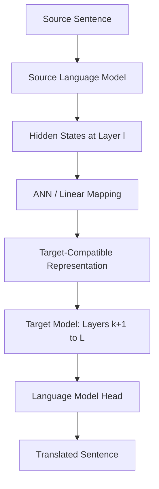

# 1. Problem Definition

## 1.1. Task Formulation

Given a parallel corpus:

$$
\mathcal{D}=\{(x_i,y_i)\}_{i=1}^{N}
$$

where:
- $x_i$: source-language sentence.
- $y_i$: corresponding target-language sentence.
- $N$: number of parallel sentence pairs.

The objective is to learn a translation function:

$$
F_{\theta}:x_i\rightarrow \hat{y}_i
$$

such that:

$$
\hat{y}_i\approx y_i
$$

Instead of training a conventional encoder-decoder translation model, we employ two independently pretrained language models:

- $M_s$: source-language model.
- $M_t$: target-language model.

Both models are assumed to have fewer than $1$ billion parameters.

Let:

$$
H_s^{(l)}=M_s^{(l)}(x_i)
$$

$$
H_t^{(k)}=M_t^{(k)}(y_i)
$$

where $H_s^{(l)}$ and $H_t^{(k)}$ denote hidden representations extracted from the $l$-th and $k$-th transformer layers, respectively.

The proposed method introduces a lightweight mapping function:

$$
f_{\theta}:
\mathbb{R}^{d_s}
\rightarrow
\mathbb{R}^{d_t}
$$

to transform source-language representations into target-compatible representations:

$$
\hat{H}_t^{(k)}
=
f_{\theta}(H_s^{(l)})
$$

The translation objective is:

$$
\boxed{
\min_{\theta}
\mathbb{E}_{(x,y)\sim\mathcal{D}}
\left[
-\log P_{M_t}
(y\mid f_{\theta}(M_s(x)))
\right]
}
$$

The target model is initially frozen, and only the mapping network is optimized.

The reverse translation direction is formulated independently:

$$
f_{\phi}:
\mathbb{R}^{d_t}
\rightarrow
\mathbb{R}^{d_s}
$$

---

## 1.2. Research Constraints

The proposed framework considers the following constraints:

- **Model size:** Both language models should contain fewer than $1$ billion parameters.
- **Parameter efficiency:** The mapping network should introduce substantially fewer trainable parameters than the pretrained language models.
- **Model independence:** The two language models may have different tokenizers, hidden dimensions, and transformer architectures.
- **Bidirectional translation:** English-to-Vietnamese and Vietnamese-to-English are investigated separately.
- **Computational efficiency:** The possibility of skipping target-model layers is evaluated.
- **Representation transfer:** The mapping network should preserve sufficient linguistic and semantic information for target-language generation.

---

# 2. Proposed Methodology

## 2.1. Overall Architecture

The proposed framework consists of four main components:

1. Source-language representation extraction.
2. Cross-lingual representation mapping.
3. Target-language representation injection.
4. Autoregressive translation generation.

The framework is investigated under different source and target layer configurations.

---

## 2.2. Language Model Preparation

### A. Copy-task Fine-tuning

Before representation extraction, both language models are fine-tuned using a sentence reconstruction task.

Given a sentence $s$, construct:

$$
x_e=\text{``Say: ''}+s_e
$$

$$
x_v=\text{``Nói: ''}+s_v
$$

The expected outputs are:

$$
y_e=s_e,\qquad y_v=s_v
$$

The training objective is:

$$
\mathcal{L}_{copy}
=
-\sum_{i=1}^{N}
\log P_M(s_i\mid p(s_i))
$$

where $p(\cdot)$ denotes the corresponding instruction prompt.

**Purpose:**
- Improve sentence reconstruction reliability.
- Establish a controlled representation extraction setting.
- Evaluate whether model errors originate from reconstruction or cross-lingual mapping.

**Evaluation:**
- Exact Match.
- Character Error Rate (CER).
- Token Accuracy.

The copy task is a preparation step, not the primary translation objective.

---

## 2.3. Cross-Lingual Representation Extraction

For each parallel sentence pair $(x_i,y_i)$, extract hidden states from selected transformer layers:

$$
H_{s,i}^{(l)}
=
M_s^{(l)}(x_i)
$$

$$
H_{t,i}^{(k)}
=
M_t^{(k)}(y_i)
$$

where:

$$
H_{s,i}^{(l)}
\in
\mathbb{R}^{T_s\times d_s}
$$

$$
H_{t,i}^{(k)}
\in
\mathbb{R}^{T_t\times d_t}
$$

Two representation strategies are investigated.

### A. Sentence-level Representation

Apply mean pooling:

$$
h_s^{(l)}
=
\frac{1}{T_s}
\sum_{j=1}^{T_s}H_{s,j}^{(l)}
$$

$$
h_t^{(k)}
=
\frac{1}{T_t}
\sum_{j=1}^{T_t}H_{t,j}^{(k)}
$$

This produces fixed-dimensional sentence representations.

### B. Token-level Representation

Retain the complete hidden-state sequences:

$$
H_s^{(l)}\in\mathbb{R}^{T_s\times d_s}
$$

$$
H_t^{(k)}\in\mathbb{R}^{T_t\times d_t}
$$

An appropriate alignment mechanism is required because English and Vietnamese may have different tokenization and sequence lengths.

**Comparison:**

| Representation | Advantages | Limitations |
|---|---|---|
| Sentence-level | Simple, fixed-dimensional mapping | May lose token-level information |
| Token-level | Preserves contextual information | Requires sequence alignment |

Sentence-level mapping is used as the initial baseline. Token-level mapping is investigated as an extension.

---

## 2.4. Cross-Lingual Mapping Network

Given source and target representations:

$$
h_s\in\mathbb{R}^{d_s},
\qquad
h_t\in\mathbb{R}^{d_t}
$$

the objective is to learn:

$$
f_{\theta}(h_s)\approx h_t
$$

Two architectures are considered.

### A. Linear Projection

$$
\hat{h}_t=Wh_s+b
$$

where:

$$
W\in\mathbb{R}^{d_t\times d_s}
$$

This serves as the simplest mapping baseline.

### B. ANN Mapping

$$
z=\sigma(W_1h_s+b_1)
$$

$$
\hat{h}_t=W_2z+b_2
$$

where $\sigma$ is a nonlinear activation function.

The ANN provides greater transformation capacity and may capture nonlinear relationships between independently learned representation spaces.

### C. Mapping Loss

The initial representation alignment objective is:

$$
\mathcal{L}_{MSE}
=
\frac{1}{N}
\sum_{i=1}^{N}
\left\|
f_{\theta}(h_{s,i})-h_{t,i}
\right\|_2^2
$$

An alternative cosine-distance objective is:

$$
\mathcal{L}_{cos}
=
1-
\frac{
f_{\theta}(h_s)^\top h_t
}{
\|f_{\theta}(h_s)\|_2
\|h_t\|_2
}
$$

Both objectives are evaluated experimentally.

### D. Bidirectional Mapping

Two independent mapping functions are trained:

$$
f_{e\rightarrow v}(h_e)=\hat{h}_v
$$

$$
f_{v\rightarrow e}(h_v)=\hat{h}_e
$$

Parameter sharing is not assumed in the initial experiments.

---

## 2.5. Target Representation Injection

This component investigates whether the mapped representation can be used directly by the target language model.

Let $L_t$ denote the number of target-model transformer layers.

Three configurations are evaluated.

| Configuration | Processing |
|---|---|
| Full execution | Execute all target layers |
| Intermediate injection | Inject at layer $k$, execute layers $k+1,\ldots,L_t$ |
| Final-layer injection | Inject at layer $L_t$, directly use the output projection |

### A. Intermediate-Layer Injection

The mapping network predicts a representation compatible with the selected target layer:

$$
\hat{H}_t^{(k)}
=
f_{\theta}(H_s^{(l)})
$$

The remaining target layers process this representation:

$$
H_t^{(L_t)}
=
M_t^{(k+1:L_t)}
\left(
\hat{H}_t^{(k)}
\right)
$$

The output distribution is:

$$
P(y_j\mid y_{<j},x)
=
\operatorname{Softmax}
\left(
W_{LM}H_{t,j}^{(L_t)}+b_{LM}
\right)
$$

Autoregressive decoding is then performed to generate the target sentence.

### B. Final-Layer Injection

The mapping network directly predicts final-layer representations:

$$
\hat{H}_t^{(L_t)}
=
f_{\theta}(H_s^{(l)})
$$

The target model's output projection is subsequently applied:

$$
P(y_j)
=
\operatorname{Softmax}
\left(
W_{LM}\hat{H}_{t,j}^{(L_t)}
+b_{LM}
\right)
$$

This configuration aims to eliminate target-model transformer computation.

However, the mapping must produce a sequence of target-compatible hidden states rather than a single sentence vector if token-level generation is required.

The validity of this configuration is an experimental question, particularly regarding compatibility with the target model's normalization, hidden-state distribution, and autoregressive decoding process.

---

## 2.6. Translation Optimization

Representation alignment alone does not guarantee translation quality.

Therefore, the mapping network is additionally optimized using target-language generation loss.

Given a reference translation:

$$
y=(y_1,y_2,\ldots,y_T)
$$

the translation loss is:

$$
\mathcal{L}_{trans}
=
-\sum_{j=1}^{T}
\log P(y_j\mid y_{<j},x)
$$

Three training objectives are compared.

| Objective | Loss function |
|---|---|
| Representation-only | $\mathcal{L}_{MSE}$ |
| Translation-only | $\mathcal{L}_{trans}$ |
| Joint optimization | $\lambda_1\mathcal{L}_{MSE}+\lambda_2\mathcal{L}_{trans}$ |

The joint objective is:

$$
\boxed{
\mathcal{L}_{total}
=
\lambda_1\mathcal{L}_{repr}
+
\lambda_2\mathcal{L}_{trans}
}
$$

where $\lambda_1,\lambda_2$ are hyperparameters.

Initially, both pretrained language models remain frozen, and only the mapping network is optimized.

Selective fine-tuning of target-model layers may be investigated if representation injection proves insufficient.

---

## 2.7. Layer-wise Representation Analysis

The proposed framework investigates different source-target layer combinations.

Let:

$$
\mathcal{P}
=
\{(l,k)\mid
1\leq l\leq L_s,\,
1\leq k\leq L_t
\}
$$

For each pair $(l,k)$:

1. Extract source and target representations.
2. Train the corresponding mapping network.
3. Calculate representation alignment loss.
4. Evaluate translation quality.
5. Measure computational efficiency.

The resulting performance matrix is:

$$
B_{l,k}
=
BLEU(f_{\theta}^{(l,k)})
$$

A corresponding alignment matrix is:

$$
A_{l,k}
=
\mathcal{L}_{repr}^{(l,k)}
$$

These matrices are used to investigate:

- Which source layers provide the most transferable information?
- Which target layers are most compatible with mapped representations?
- Whether final-layer alignment is preferable to intermediate-layer alignment.
- Whether low representation loss correlates with high translation quality.

---

## 2.8. Representation Perturbation Analysis

To investigate representation sensitivity, perturbations are introduced into the mapped representations:

$$
\hat{H}_t'
=
\hat{H}_t+\epsilon
$$

where:

$$
\epsilon\sim\mathcal{N}(0,\sigma^2I)
$$

Different perturbation magnitudes are evaluated.

The impact on translation is measured by:

$$
\Delta BLEU
=
BLEU(\hat{H}_t')
-
BLEU(\hat{H}_t)
$$

The impact on token prediction is measured by:

$$
\Delta\mathcal{L}_{trans}
=
\mathcal{L}_{trans}(\hat{H}_t')
-
\mathcal{L}_{trans}(\hat{H}_t)
$$

Additional experiments investigate individual hidden dimensions:

$$
h_j'=h_j+\delta
$$

The analysis aims to identify:

- Sensitivity to representation perturbations.
- Dimensions with greater influence on generation.
- Differences in robustness across transformer layers.
- The relationship between numerical representation changes and translation degradation.

---

## 2.9. Perplexity-Based Domain Knowledge Analysis

For domain-specific translation, particularly culinary translation, perplexity is used to identify potentially difficult expressions.

For a sentence $x$:

$$
PPL(x)
=
\exp\left(
-\frac{1}{T}
\sum_{i=1}^{T}
\log P(x_i\mid x_{<i})
\right)
$$

The proposed procedure is:

1. Calculate sentence-level and, where appropriate, span-level perplexity.
2. Identify expressions with unusually high perplexity relative to suitable reference distributions.
3. Classify potential causes:
   - Rare vocabulary.
   - Domain-specific terminology.
   - Unfamiliar entities.
   - Linguistic complexity.
4. Evaluate translation quality for the identified expressions.
5. Investigate whether additional domain knowledge improves translation.

High perplexity is treated as an anomaly signal, not direct evidence of missing knowledge.

---

# 3. Experimental Configuration

## 3.1. Main Experimental Variables

| Category | Configurations |
|---|---|
| Source model | English LM / Vietnamese LM |
| Target model | Vietnamese LM / English LM |
| Mapping network | Linear / ANN |
| Source representation | Early / Intermediate / Final layer |
| Target representation | Early / Intermediate / Final layer |
| Representation | Sentence-level / Token-level |
| Alignment loss | MSE / Cosine |
| Training objective | Representation / Translation / Joint |
| Injection strategy | Full / Intermediate / Final |
| Fine-tuning | Without / With copy-task fine-tuning |

## 3.2. Evaluation Metrics

| Objective | Metrics |
|---|---|
| Translation quality | BLEU, chrF, COMET |
| Semantic similarity | BERTScore |
| Token prediction | Cross-Entropy |
| Copy-task performance | Exact Match, CER |
| Representation alignment | MSE, Cosine Similarity |
| Computational efficiency | Latency, Throughput, Peak GPU Memory |
| Model complexity | Trainable Parameters, Executed Layers |

## 3.3. Baseline Comparison

The proposed framework will be compared against:

- Original pretrained language models.
- Fine-tuned translation models.
- Lightweight conventional encoder-decoder translation models.
- Linear representation mapping.
- ANN representation mapping.
- Full target-model execution.

All comparisons should use consistent evaluation datasets and document differences in training data, decoding settings, and computational resources.

---

# 4. Expected Research Contributions

The research investigates the following potential contributions:

1. **Cross-lingual representation mapping:** A lightweight ANN-based framework for transferring contextual representations between independently trained language models.

2. **Layer-wise translation analysis:** An empirical investigation of which transformer-layer combinations are most suitable for cross-lingual translation.

3. **Representation-to-generation analysis:** An investigation into how mapped hidden representations can be injected into target language models for autoregressive translation.

4. **Loss-performance relationship:** An analysis of the relationship between representation alignment loss, token prediction loss, and translation quality.

5. **Representation sensitivity:** An investigation into how hidden-state perturbations and individual dimensions affect translation performance.

6. **Lightweight inference:** An evaluation of whether selective target-layer execution can reduce computational cost while maintaining translation quality.

7. **Domain-specific translation:** An investigation of perplexity-based anomaly detection and additional knowledge for challenging culinary translation cases.

---

# 5. Core Research Hypothesis

The proposed research investigates the following hypothesis:

$$
\boxed{
\text{Cross-lingual Translation}
\approx
\text{Representation Mapping}
+
\text{Target-side Generation}
}
$$

Specifically, a lightweight mapping network may transform contextual representations from a source language model into target-compatible representations, allowing a target language model to generate translations without requiring full end-to-end retraining.

The hypothesis will be evaluated through three primary criteria:

- **Translation effectiveness:** Whether the generated translations preserve the meaning of the source sentences.
- **Representation transferability:** Whether representations from independently trained language models can be aligned effectively.
- **Computational efficiency:** Whether the proposed architecture reduces training or inference requirements compared with conventional translation approaches.