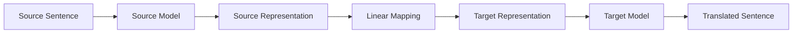
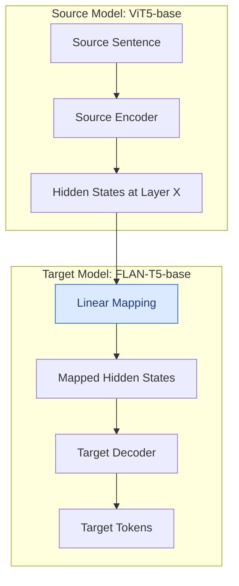
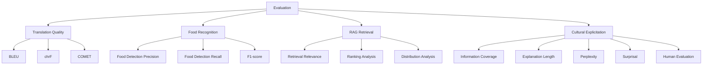
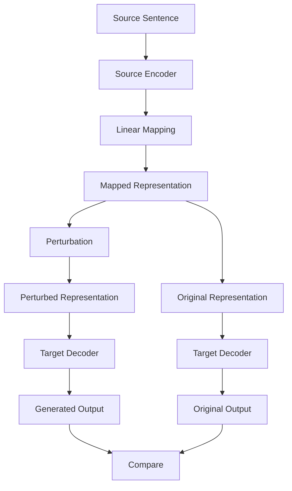
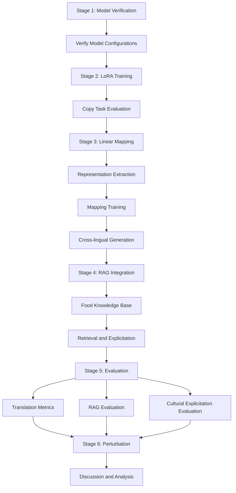

# Cross-Model Linear Mapping for Cross-Lingual Translation and Cultural Explicitation

## 1. Research Objective

### 1.1. Mục tiêu chính

Mục tiêu của nghiên cứu là train một **linear mapping** để ánh xạ vector representation giữa hai không gian biểu diễn của hai mô hình ngôn ngữ khác nhau:

- Source model: `vit5-base`
- Target model: `flan-t5-base`

Cụ thể, nghiên cứu muốn tìm một phép biến đổi tuyến tính có khả năng chuyển representation từ model nguồn sang representation phù hợp với model đích, sau đó sử dụng model đích để tiếp tục sinh văn bản.

Về mặt toán học, ta cần học một hàm:

$$
f_\theta: \mathbb{R}^{d_s} \rightarrow \mathbb{R}^{d_t}
$$

Trong đó:

- \(d_s\): Hidden dimension của source model.
- \(d_t\): Hidden dimension của target model.
- \(\theta\): Các tham số của linear mapping.

Nếu hai model có cùng hidden dimension, chẳng hạn \(d_s=d_t=768\), mapping có thể được biểu diễn bằng:

$$
\mathbf{y} = \mathbf{xW}+\mathbf{b}
$$

Với:

- \(\mathbf{x}\in\mathbb{R}^{768}\): Vector representation từ source model.
- \(\mathbf{W}\in\mathbb{R}^{768\times768}\): Ma trận mapping.
- \(\mathbf{b}\in\mathbb{R}^{768}\): Bias.
- \(\mathbf{y}\in\mathbb{R}^{768}\): Vector sau mapping.

**Giới hạn phạm vi nghiên cứu:**

- Chỉ sử dụng `vit5-base` và `flan-t5-base`.
- Không sử dụng các phiên bản `large` vì giới hạn tài nguyên phần cứng.
- Hai model base hiện tại sẽ được giữ nguyên về mặt kiến trúc và không mở rộng sang các model lớn hơn.
- Các thí nghiệm tập trung vào khả năng alignment giữa hai representation spaces và ứng dụng của nó trong dịch thuật có yếu tố văn hóa.

---

## 2. Model Specifications

Các thông số dưới đây là thông số dự kiến. Cần xác nhận lại trực tiếp bằng code từ model configuration, thay vì mặc định rằng các thông số lấy từ tài liệu đều chính xác.

### 2.1. FLAN-T5-base

| Parameter | Expected value |
|---|---|
| Parameters | ~250M |
| Architecture | Encoder-Decoder |
| Encoder layers | 12 |
| Decoder layers | 12 |
| Hidden dimension | 768 |
| Attention heads | 12 |
| Vocabulary size | ~32K (verify) |

### 2.2. ViT5-base

| Parameter | Expected value |
|---|---|
| Parameters | ~310M |
| Architecture | Encoder-Decoder |
| Encoder layers | 12 |
| Decoder layers | 12 |
| Hidden dimension | 768 |
| Attention heads | 12 |
| Vocabulary size | ~36K (verify) |

### 2.3. Những thông số cần kiểm tra bằng code

Không nên hard-code các thông số trên. Cần lấy trực tiếp từ `config` của từng model:

- `d_model`
- `num_layers`
- `num_decoder_layers`
- `num_heads`
- `vocab_size`
- `is_encoder_decoder`

Ngoài ra, cần kiểm tra số lượng parameters thực tế bằng cách đếm toàn bộ model parameters.

---

## 3. Overall Methodology

### 3.1. General Pipeline

Ý tưởng tổng quát là:

Thay vì yêu cầu source model trực tiếp dịch câu, ta sử dụng representation của nó làm đầu vào cho một phép biến đổi tuyến tính.

Sau đó, representation đã được biến đổi sẽ được đưa vào target model để sinh câu ở ngôn ngữ đích.

### 3.2. Proposed Encoder-to-Decoder Architecture

Đây là kiến trúc dự kiến cần triển khai và kiểm chứng trong code.

Thay vì sử dụng toàn bộ hai mô hình Encoder-Decoder, ta muốn tận dụng:

- Encoder của source model.
- Decoder của target model.

Cụ thể:

Về bản chất:

- Source model chỉ sử dụng Encoder.
- Target model chỉ sử dụng Decoder.
- Decoder của source model không cần thiết.
- Encoder của target model không cần thiết trong quá trình inference chính.

Pipeline dự kiến:

$$
\mathbf{H}_s^{(X)}
=
\operatorname{Encoder}_s^{(X)}(S_s)
$$

$$
\mathbf{H}_t^{(Y)}
=
f_\theta(\mathbf{H}_s^{(X)})
$$

$$
\hat{S}_t
=
\operatorname{Decoder}_t(\mathbf{H}_t^{(Y)})
$$

Trong đó:

- \(S_s\): Source sentence.
- \(\mathbf{H}_s^{(X)}\): Hidden states tại layer \(X\) của source encoder.
- \(f_\theta\): Linear mapping.
- \(\mathbf{H}_t^{(Y)}\): Representation sau mapping, được kỳ vọng tương thích với decoder của target model.
- \(\hat{S}_t\): Câu được sinh ra ở ngôn ngữ đích.

**Lưu ý quan trọng:** Đây mới là kiến trúc đề xuất. Cần kiểm tra code để xác nhận:

1. Có thực sự lấy hidden states từ layer \(X\) hay không.
2. Có thực sự bỏ qua source decoder và target encoder hay không.
3. Mapping được thực hiện trên toàn bộ sequence hay chỉ một pooled representation.
4. Decoder nhận mapped hidden states thông qua `encoder_outputs` hay một cơ chế khác.
5. Attention mask, positional information và các thành phần conditioning có tương thích hay không.

Đặc biệt, cùng hidden dimension không đồng nghĩa với việc hai representation spaces đã tương thích.

---

## 4. Cultural Background and Explicitation

### 4.1. The Cultural Gap

Một vấn đề quan trọng trong dịch thuật là sự khác biệt về kiến thức văn hóa giữa người đọc ở hai ngôn ngữ.

Ví dụ:

- Người Việt nghe đến Kraft Mac and Cheese có thể không có bất kỳ liên tưởng văn hóa đặc biệt nào.
- Người nước ngoài nghe đến mì tôm cũng có thể không hiểu được những liên tưởng quen thuộc của người Việt.

Hai khái niệm này đều có thể được dịch về mặt ngôn ngữ, nhưng người đọc không nhất thiết có cùng mức độ hiểu biết về chúng.

Nói cách khác:

**Một bản dịch đúng về mặt từ vựng chưa chắc đã truyền tải đầy đủ thông tin văn hóa.**

### 4.2. Cultural Explicitation

Nghiên cứu không hướng tới việc xây dựng một model có khả năng tự tìm ra những khái niệm tương đồng giữa hai nền văn hóa.

Ví dụ, không kỳ vọng model tự hiểu rằng một món ăn quen thuộc ở Việt Nam có thể có một số đặc điểm tương đồng với một món ăn quen thuộc ở châu Âu.

Thay vào đó, nghiên cứu sử dụng RAG để bổ sung thông tin giải thích khi cần thiết.

Ví dụ:

- Original: `Bánh chưng`
- Translation without explicitation: `Banh chung`
- Translation with explicitation: `Banh chung (a traditional Vietnamese sticky rice cake)`

Phần giải thích được bổ sung nhằm giúp người đọc hiểu được khái niệm văn hóa mà không nhất thiết phải thay thế tên gọi gốc.

### 4.3. Knowledge Sources

Dự kiến sử dụng hai nguồn dữ liệu:

| Cultural domain | Dataset |
|---|---|
| European food | RecipeNLG |
| Vietnamese food | Vietnamese cookbook |

Các nguồn dữ liệu này sẽ được sử dụng để xây dựng knowledge base phục vụ RAG.

Thông tin cần trích xuất có thể bao gồm:

- Tên món ăn.
- Nguyên liệu.
- Phương pháp chế biến.
- Đặc điểm nhận diện.
- Bối cảnh văn hóa.
- Các thông tin có khả năng giúp người đọc hiểu món ăn.

Mục tiêu không phải là giải thích toàn bộ món ăn một cách dài dòng, mà là cung cấp lượng thông tin vừa đủ để giảm khoảng cách kiến thức giữa người đọc và khái niệm văn hóa.

---

# 5. Technical Implementation

## 5.1. LoRA: Making the Models Learn to Copy

### 5.1.1. Why LoRA is necessary

Một vấn đề ban đầu là cả hai model đều không thể copy hoàn chỉnh input của chính chúng.

Điều này khá quan trọng đối với nghiên cứu hiện tại.

Bởi vì chúng ta không muốn model thực hiện một tác vụ dịch thuật phức tạp ngay từ đầu. Trước tiên, chúng ta cần model có khả năng tiếp nhận một representation và thực hiện đúng một command đơn giản.

Do đó, cần sử dụng LoRA để fine-tune model cho tác vụ copy.

Có thể hiểu đơn giản là chúng ta đang dạy model một nhiệm vụ rất cơ bản:

**Nhận đầu vào và nhắc lại chính xác nội dung đó.**

### 5.1.2. Training strategy

Giả sử:

- \(s_e\): Một câu tiếng Anh.
- \(s_v\): Một câu tiếng Việt.

Hai model được fine-tune trên 50,000 câu tương ứng.

| Model | Input | Expected output |
|---|---|---|
| ViT5-base | `Nói {s_v}` | `{s_v}` |
| FLAN-T5-base | `Say {s_e}` | `{s_e}` |

Lưu ý: Tên model và ngôn ngữ thực tế phải được đối chiếu lại với cách tổ chức dataset và code hiện tại. Bảng trên mô tả cách chia nhiệm vụ dự kiến.

### 5.1.3. Training results

Kết quả thực nghiệm hiện tại:

| Model | n | Exact before | Exact after | Fixed | Broken | BLEU after | chrF after | Hyp/Ref words |
|---|---:|---:|---:|---:|---:|---:|---:|---:|
| `vit5-base` | 736 | 0.0% | **96.6%** | 711 | 0 | 99.59 | 99.60 | 26.9 / 27.0 |
| `flan-t5-base` | 2000 | 2.9% | **99.8%** | 1938 | 0 | 99.97 | 99.98 | 21.08 / 21.09 |
| `vit5-large` | — | Not evaluated | Not trained | — | — | — | — | — |
| `flan-t5-large` | — | Not evaluated | Not trained | — | — | — | — | — |

### 5.1.4. Training efficiency

Training configuration:

- Dataset: 50,000 rows.
- Epochs: 1.
- Decoding strategy during evaluation: Greedy decoding.

| Model | Steps | Wall time | Sentences/s | VRAM | Last-100 loss | Adapter size |
|---|---:|---:|---:|---:|---:|---:|
| `vit5-base` | 3,125 | 20.9 min | 39.9 | 1,817 MB | 0.028 | ~1 MB |
| `flan-t5-base` | 1,563 | 26.6 min | 31.4 | 4,021 MB | 0.0219 | 6.78 MB |

**Important:** FLAN-T5-base sử dụng 1,563 steps, không phải 3,125 steps. Run đầu tiên sử dụng batch size 16, dẫn đến số steps gấp đôi. Hai lần training đều chạy một epoch trên cùng 50,000 rows.

### 5.1.5. Interpretation

Kết quả cho thấy LoRA giúp cải thiện đáng kể khả năng copy input của cả hai model.

Điều này tạo tiền đề cho bước tiếp theo: thay vì yêu cầu model tự xử lý một command thông qua prompt, chúng ta có thể thử truyền command trực tiếp thông qua vector representation.

Nói cách khác, LoRA giúp model có khả năng thực hiện tác vụ cơ bản mà nghiên cứu cần.

---

## 5.2. Training the Linear Mapping

### 5.2.1. Core idea

Ở bước này, chúng ta không trực tiếp train một mô hình dịch thuật.

Thay vào đó, chúng ta muốn train một linear mapping để chuyển đổi representation của một command từ source model sang target model.

Ví dụ:

- English command: `Say {s_e}`
- Vietnamese command: `Nói {s_v}`

Giả sử hai câu trên được mã hóa thành hai representation:

$$
\mathbf{e}_e
=
\operatorname{Encoder}_e(\text{Say }s_e)
$$

$$
\mathbf{e}_v
=
\operatorname{Encoder}_v(\text{Nói }s_v)
$$

Mục tiêu là học một mapping sao cho:

$$
f_\theta(\mathbf{e}_e)
\approx
\mathbf{e}_v
$$

Sau khi học được mapping, chúng ta có thể truyền representation đã biến đổi trực tiếp vào decoder của target model.

### 5.2.2. Training intuition

Giả sử input là:

`Hello, I am a cat.`

Câu này đi qua encoder của English model và được biểu diễn thành một chuỗi vector:

$$
\mathbf{H}_e =
[0.34,\ 0.12,\ \ldots]
$$

Sau đó, linear mapping biến đổi representation này thành:

$$
\hat{\mathbf{H}}_v
=
f_\theta(\mathbf{H}_e)
$$

Mục tiêu là khiến representation mới tương thích với representation mà Vietnamese model có thể sử dụng để sinh ra:

`Xin chào, tôi là một con mèo.`

Điểm quan trọng là chúng ta không đưa một prompt dịch thuật mới vào model.

Thay vào đó, chúng ta muốn representation tự mang thông tin cần thiết để decoder thực hiện tác vụ.

### 5.2.3. Why LoRA matters here

Nếu model ban đầu còn không thể copy input một cách hoàn chỉnh, việc yêu cầu nó giải mã một representation được inject từ một model khác sẽ càng khó khăn hơn.

Do đó, LoRA được sử dụng để chuẩn bị model trước khi thực hiện representation injection.

Nói cách khác:

- LoRA giúp model học cách thực hiện tác vụ copy.
- Linear mapping học cách chuyển đổi representation giữa hai model.
- Target decoder sử dụng representation sau mapping để sinh output.

Đây là hai thành phần có vai trò khác nhau.

### 5.2.4. Optimization objective

Giả sử có một tập dữ liệu song ngữ gồm các cặp câu:

$$
\mathcal{D}
=
\{(s_e^{(i)},s_v^{(i)})\}_{i=1}^{N}
$$

Với mỗi cặp câu, ta trích xuất representation từ hai model:

$$
\mathbf{H}_e^{(i)}
=
E_e(s_e^{(i)})
$$

$$
\mathbf{H}_v^{(i)}
=
E_v(s_v^{(i)})
$$

Sau đó, train linear mapping:

$$
\hat{\mathbf{H}}_v^{(i)}
=
f_\theta(\mathbf{H}_e^{(i)})
$$

Một objective ban đầu có thể sử dụng Mean Squared Error:

$$
\mathcal{L}_{MSE}
=
\frac{1}{N}
\sum_{i=1}^{N}
\left\|
f_\theta(\mathbf{H}_e^{(i)})
-
\mathbf{H}_v^{(i)}
\right\|_2^2
$$

Tuy nhiên, cần xác định rõ cách alignment giữa các token ở hai câu, bởi hai câu dịch không nhất thiết có cùng số lượng token.

Đây là một vấn đề cần xử lý trong implementation.

### 5.2.5. Training configuration

- Dataset dự kiến: MTET.
- Quy mô: khoảng 8M câu hoặc 8M cặp câu (cần kiểm tra lại chính xác).
- Model parameters: Freeze toàn bộ hai model.
- Trainable parameters: Chỉ linear mapping.

Nếu sử dụng một mapping đơn giản:

$$
f_\theta(\mathbf{x})=\mathbf{xW}+\mathbf{b}
$$

thì số lượng trainable parameters là:

$$
768\times768+768
=
590,592
$$

Tức là chỉ khoảng 590K parameters, thay vì phải fine-tune hàng trăm triệu parameters của hai model.

Đây là một lợi thế đáng kể về tài nguyên tính toán.

---

## 5.3. Cultural Explicitation: RAG and Perplexity

Đây là phần quan trọng nhất về mặt ứng dụng của nghiên cứu.

### 5.3.1. The problem

Quay lại ví dụ về tên món ăn.

Một số tên món ăn có thể được giữ nguyên khi dịch sang ngôn ngữ khác, nhưng người đọc ở ngôn ngữ đích không nhất thiết hiểu được chúng.

Ví dụ:

- `Banh chung`
- `Bun dau`
- `Trau gac bep`

Nếu chỉ dịch tên món ăn theo kiểu giữ nguyên không dấu, người đọc có thể gặp khó khăn trong việc hiểu ý nghĩa.

Đặc biệt, những tên món ăn không phổ biến trong ngôn ngữ đích có thể tạo ra những token sequence bất thường đối với language model.

### 5.3.2. RAG-based explicitation

Ý tưởng là sử dụng RAG để truy xuất thông tin về món ăn và bổ sung phần giải thích vào bản dịch.

Ví dụ:

Original:

`Ăn thịt trâu gác bếp giữa núi rừng mới cảm nhận được trọn vẹn không khí của Tây Bắc.`

Translation without explicitation:

`Only by eating trau gac bep among mountains and forests can you experience the atmosphere of Northern Vietnam.`

Translation with explicitation:

`Only by eating trau gac bep (smoked buffalo meat) among the mountains and forests can you experience the atmosphere of Northern Vietnam.`

Ở đây, phần giải thích không thay thế tên món ăn gốc mà chỉ bổ sung thông tin cần thiết để người đọc hiểu được khái niệm.

### 5.3.3. Why perplexity?

Perplexity được sử dụng như một tín hiệu để đánh giá mức độ bất thường của một token sequence đối với language model.

Về cơ bản:

$$
PPL(x)
=
\exp\left(
-\frac{1}{T}
\sum_{t=1}^{T}
\log P(x_t|x_{<t})
\right)
$$

Trong đó:

- \(T\): Số lượng token.
- \(x_t\): Token tại vị trí \(t\).
- \(P(x_t|x_{<t})\): Xác suất dự đoán token hiện tại dựa trên ngữ cảnh trước đó.

Một token sequence có perplexity cao có thể cho thấy model gặp khó khăn trong việc dự đoán sequence đó.

Ví dụ, khi gặp những tên món ăn ít phổ biến như `trau gac bep`, model có thể đánh giá sequence này là bất thường.

Ngược lại, những tên gọi đã quen thuộc với người đọc tiếng Anh có thể không cần giải thích thêm.

Tuy nhiên, cần lưu ý rằng perplexity không trực tiếp đo mức độ hiểu biết văn hóa của con người. Nó chỉ là một tín hiệu về độ bất thường của sequence đối với một language model.

Do đó, không nên đồng nhất perplexity cao với việc người đọc chắc chắn không hiểu.

### 5.3.4. Core research questions

Phần này cần giải quyết ba câu hỏi:

**Question 1: When should we explain?**

Có cần bổ sung giải thích cho một món ăn hay không?

Có thể dựa trên:

- Perplexity của tên món ăn.
- Mức độ phổ biến của tên gọi trong ngôn ngữ đích.
- Kết quả truy xuất từ RAG.
- Một decision model chuyên biệt.

**Question 2: What information should we explain?**

Nếu cần giải thích, thông tin nào nên được bổ sung?

Ví dụ:

- Nguyên liệu chính.
- Phương pháp chế biến.
- Đặc điểm nhận diện.
- Bối cảnh văn hóa.

Không nhất thiết phải đưa toàn bộ thông tin từ recipe vào bản dịch.

**Question 3: How much information is enough?**

Lượng thông tin bổ sung bao nhiêu là vừa đủ?

Mục tiêu là giải thích được khái niệm nhưng không khiến bản dịch trở nên dài dòng hoặc mất tự nhiên.

### 5.3.5. Two possible decision strategies

Có hai hướng tiếp cận:

**Approach A: Perplexity threshold**

Đặt một threshold để quyết định có cần explicitation hay không.

$$
\operatorname{Explain}(x)=
\begin{cases}
1 & \text{if } PPL(x)>\tau\\
0 & \text{otherwise}
\end{cases}
$$

Trong đó \(\tau\) là threshold được xác định thông qua validation experiments.

Ưu điểm:

- Đơn giản.
- Có cơ sở toán học rõ ràng.
- Dễ phân tích độ nhạy của threshold.

Hạn chế:

- Perplexity không trực tiếp phản ánh cultural knowledge.
- Threshold có thể phụ thuộc vào model và domain.
- Tên món ăn có thể có perplexity cao nhưng không nhất thiết cần giải thích.

**Approach B: Decision Model**

Sử dụng một decision model để xác định:

- Có cần giải thích không?
- Cần truy xuất thông tin gì?
- Cần bổ sung bao nhiêu thông tin?

Ưu điểm:

- Linh hoạt.
- Có thể kết hợp nhiều tín hiệu.
- Phù hợp với application-oriented research.

Hạn chế:

- Khó giải thích hơn.
- Cần xây dựng hoặc đánh giá decision model riêng.

Hai hướng này có thể được so sánh trong thực nghiệm thay vì quyết định trước rằng chỉ một hướng là đúng.

---

# 6. Evaluation

Đây là phần khó nhất của nghiên cứu vì hiện tại chưa có một bộ dữ liệu chuẩn có annotation đầy đủ cho cultural explicitation.

Do đó, evaluation cần được thiết kế thành nhiều thành phần độc lập.

Không nên chỉ sử dụng BLEU hoặc COMET để kết luận toàn bộ hệ thống hoạt động tốt, bởi những metric này không trực tiếp đo được chất lượng giải thích văn hóa.

## 6.1. Overall Evaluation Strategy

Có thể chia evaluation thành bốn nhóm:

## 6.2. Translation Quality

Đối với những câu không chứa tên món ăn hoặc thông tin văn hóa đặc biệt, có thể sử dụng các metric dịch thuật thông thường:

- BLEU.
- chrF.
- COMET.

Mục tiêu là kiểm tra xem việc bổ sung RAG và explicitation có làm ảnh hưởng tiêu cực đến chất lượng dịch thuật thông thường hay không.

Cần báo cáo kết quả riêng cho:

1. Các câu không chứa tên món ăn.
2. Các câu có tên món ăn.
3. Toàn bộ dataset.

Không nên chỉ báo cáo một con số tổng hợp.

## 6.3. Food Recognition

Trước khi đánh giá RAG, cần xác định hệ thống có nhận diện đúng những câu chứa tên món ăn hay không.

Có thể xây dựng một food detection function hoặc classifier.

Sau đó chạy trên toàn bộ dataset và báo cáo:

- Precision.
- Recall.
- F1-score.
- Accuracy (nếu phù hợp với cách xây dựng tập đánh giá).

Đặc biệt, cần có một tập dữ liệu được kiểm tra thủ công để đánh giá chất lượng của food detector.

Nếu detector nhận diện sai, những bước evaluation tiếp theo có thể bị ảnh hưởng.

## 6.4. RAG Retrieval Evaluation

### 6.4.1. The problem

Hiện tại không có ground-truth retrieval annotation đầy đủ.

Do đó, thay vì chỉ báo cáo Recall@K hoặc Precision@K khi chưa có relevance labels, có thể phân tích mức độ liên quan giữa:

- Món ăn được query.
- Thông tin được RAG truy xuất.
- Nội dung thực tế trong câu dịch.

### 6.4.2. Distribution-based analysis

Có thể sử dụng phân tích phân phối để xem xét mức độ tương đồng giữa các kết quả retrieval.

Ví dụ:

- Với một món ăn, các câu trong dataset có nội dung liên quan đến món đó được phân bố như thế nào?
- Với một câu dịch, các món ăn trong knowledge base có mức độ liên quan ra sao?

Có thể sử dụng:

- Similarity score distribution.
- Box plot.
- Quartiles.
- Outlier analysis.

Ví dụ:

Nếu một câu có query về `trau gac bep`, ta có thể kiểm tra vị trí phân phối của các retrieved documents so với những câu có nội dung liên quan đến món ăn đó.

Một cách trực quan là sử dụng box plot để thể hiện:

- Q1.
- Median.
- Q3.
- Outliers.

Tuy nhiên, cần lưu ý:

**Q1 không đồng nghĩa với relevant hoặc correct.**

Các quartile chỉ mô tả vị trí tương đối trong một phân phối. Muốn kết luận retrieval có chính xác hay không, vẫn cần relevance annotation hoặc đánh giá thủ công trên một tập con.

## 6.5. Cultural Explicitation Evaluation

Đây là phần cần thiết kế metric riêng.

Giả sử câu nguồn:

`Ăn thịt trâu gác bếp giữa núi rừng mới cảm nhận được trọn vẹn không khí của Tây Bắc.`

Bản dịch chưa giải thích:

`Only by eating trau gac bep among the mountains and forests can you experience the atmosphere of Northern Vietnam.`

Bản dịch có giải thích:

`Only by eating trau gac bep (smoked buffalo meat) among the mountains and forests can you experience the atmosphere of Northern Vietnam.`

Mục tiêu là đánh giá xem phần giải thích có thực sự hữu ích hay không.

### 6.5.1. Information coverage

Một tiêu chí quan trọng là phần giải thích có cung cấp đúng thông tin cần thiết hay không.

Ví dụ:

`trau gac bep (smoked buffalo meat)`

Phần giải thích cung cấp hai thông tin chính:

- Nguyên liệu: buffalo.
- Phương pháp chế biến: smoked.

Có thể xây dựng một metric để kiểm tra mức độ bao phủ các thông tin cần thiết.

$$
\operatorname{Coverage}
=
\frac{\text{Number of correctly explained attributes}}
{\text{Number of required attributes}}
$$

Ví dụ:

| Attribute | Expected | Generated | Correct |
|---|---|---|---|
| Main ingredient | Buffalo | Buffalo | Yes |
| Cooking method | Smoked | Smoked | Yes |
| Food category | Meat | Meat | Yes |

Đây là một metric có thể kiểm tra bằng rule-based evaluation hoặc human annotation.

### 6.5.2. Explanation length

Một nguyên tắc dự kiến là phần giải thích không nên dài hơn tên món ăn quá nhiều.

Có thể thử nghiệm một constraint:

$$
L_{\text{explanation}}
\leq
L_{\text{food name}}
$$

Trong đó:

- \(L_{\text{explanation}}\): Số từ trong phần giải thích.
- \(L_{\text{food name}}\): Số từ trong tên món ăn.

Đây chỉ là heuristic ban đầu, không phải một quy luật ngôn ngữ học phổ quát.

Cần đánh giá xem constraint này có thực sự giúp bản dịch ngắn gọn hơn mà vẫn truyền tải đủ thông tin hay không.

### 6.5.3. Information relevance

Phần giải thích phải đúng với những thông tin được đề cập trong tên món ăn hoặc knowledge base.

Ví dụ:

`trau gac bep (buffalo, smoked)`

Đây là một dạng giải thích ngắn gọn, sử dụng các thuộc tính rời rạc.

Trong trường hợp này, chưa cần ép model phải tạo ra một câu văn hoàn chỉnh.

Điều quan trọng hơn là thông tin phải chính xác và có ích.

### 6.5.4. Fluency and Naturalness

Một vấn đề khác là phần giải thích có làm câu dịch trở nên thiếu tự nhiên hay không.

Có thể sử dụng:

- Perplexity.
- Token-level surprisal.
- Human evaluation.

Surprisal của một token được tính bằng:

$$
I(x_t)
=
-\log P(x_t|x_{<t})
$$

Trong đó \(I(x_t)\) biểu thị độ bất ngờ của token trong ngữ cảnh.

Tuy nhiên, perplexity và surprisal chỉ nên được xem là các tín hiệu hỗ trợ.

Một câu có perplexity thấp chưa chắc đã tự nhiên hoặc có nội dung đúng.

Vì vậy, cần kết hợp human evaluation để đánh giá:

- Fluency.
- Readability.
- Information usefulness.
- Cultural understanding.

### 6.5.5. Symmetric evaluation

Cần thực hiện tương tự cho cả hai chiều:

- Vietnamese food → English.
- European food → Vietnamese.

Không nên chỉ đánh giá món ăn Việt Nam, bởi nghiên cứu hướng đến việc khảo sát cultural explicitation giữa hai ngôn ngữ.

---

## 6.6. Baselines

Do chưa có paper thực hiện chính xác cùng thiết lập, việc xây dựng baseline là rất quan trọng.

Có thể bắt đầu bằng những baseline đơn giản:

| Baseline | Description |
|---|---|
| Baseline 1: No explicitation | Dịch bình thường, không thêm thông tin |
| Baseline 2: Direct name preservation | Giữ nguyên tên món ăn |
| Baseline 3: Random explanation | Chèn một phần giải thích ngẫu nhiên từ knowledge base |
| Baseline 4: Retrieval-only | Sử dụng thông tin RAG mà không có decision mechanism |
| Baseline 5: Proposed method | Sử dụng decision strategy và RAG của nghiên cứu |

Random baseline có thể hữu ích để kiểm tra xem hệ thống có thực sự khai thác thông tin liên quan hay chỉ đơn giản là thêm bất kỳ thông tin nào vào bản dịch.

Tuy nhiên, random explanation không nên là baseline duy nhất.

Ngoài ra, nếu có thể, nên xây dựng một baseline sử dụng rule-based explicitation để kiểm tra xem một phương pháp đơn giản có thể đạt kết quả gần với proposed method hay không.

---

# 7. Perturbation Experiments

Mục tiêu của perturbation experiments là kiểm tra xem linear mapping có thực sự học được một phép biến đổi có ý nghĩa hay không.

Hiện tại có hai model:

- ViT5-base.
- FLAN-T5-base.

Mỗi model có hai phiên bản:

- Original model.
- LoRA fine-tuned model.

Có thể xây dựng một thí nghiệm bằng cách phá vỡ representation sau khi đi qua linear mapping, sau đó đưa representation bị perturb vào target decoder.

### 7.1. Basic experiment

### 7.2. Perturbation strategies

Không nên chỉ sử dụng MSE để mô tả mức độ perturbation.

Có thể thử nghiệm nhiều dạng:

**1. Gaussian noise**

$$
\mathbf{H}'
=
\mathbf{H}
+
\epsilon
$$

Với:

$$
\epsilon\sim\mathcal{N}(0,\sigma^2)
$$

Mục tiêu là xem output thay đổi như thế nào khi representation bị thêm nhiễu.

**2. Dimension-wise perturbation**

Thay vì chỉ đo khoảng cách trung bình, cần xem xét tác động của từng chiều trong hidden representation.

Ví dụ, với hidden dimension 768, có thể khảo sát mức độ nhạy của output đối với từng chiều.

**3. Random dimension masking**

Một số dimensions được đưa về 0 để kiểm tra mức độ phụ thuộc của decoder vào các thành phần khác nhau trong representation.

### 7.3. Evaluation

Sau perturbation, cần so sánh:

- BLEU.
- chrF.
- COMET.
- Exact match (nếu phù hợp).
- Perplexity.
- Semantic similarity.

Mục tiêu là xác định:

1. Mức độ perturbation ảnh hưởng đến output như thế nào.
2. Những dimensions nào có ảnh hưởng lớn hơn.
3. Model đã LoRA có khả năng chịu perturbation tốt hơn model chưa LoRA hay không.
4. Linear mapping có thực sự tạo ra representation cần thiết cho target decoder hay không.

Một kết quả đáng chú ý là nếu perturbation làm giảm đáng kể chất lượng output, điều đó có thể cho thấy representation sau mapping chứa những thông tin quan trọng đối với quá trình generation.

Tuy nhiên, cần tránh kết luận rằng mọi dimension đều có ý nghĩa riêng biệt, bởi representation của Transformer thường có sự phân bố thông tin và tương tác giữa nhiều dimensions.

---

# 8. Discussion and Further Analysis

## 8.1. Linear Mapping vs. More Complex Mapping Methods

Một hướng nghiên cứu quan trọng là tìm hiểu tại sao linear mapping có thể hoạt động tốt trong bài toán alignment giữa các representation spaces.

Có một nghiên cứu liên quan:

https://aclanthology.org/2024.emnlp-main.315/

Nghiên cứu này khảo sát việc alignment giữa các mô hình ngôn ngữ và cho thấy các phương pháp linear mapping có thể đạt kết quả cạnh tranh, thậm chí tốt hơn một số phương pháp phức tạp hơn trong các thiết lập được nghiên cứu.

Từ đây có thể đặt ra một câu hỏi:

**Tại sao một phép biến đổi tuyến tính đơn giản lại có thể đủ để chuyển đổi representation giữa hai model?**

Một hypothesis ban đầu là:

Các Transformer networks chứa nhiều phép biến đổi tuyến tính, chẳng hạn:

- Query projection.
- Key projection.
- Value projection.
- Output projection.
- Feed-forward layers.

Các thành phần này kết hợp với activation functions và attention operations để tạo ra một hệ thống phi tuyến tổng thể.

Có thể giả thuyết rằng một phần cấu trúc representation giữa hai model vẫn giữ được những quan hệ tương đối tuyến tính.

Do đó, một linear mapping có thể đủ để chuyển đổi một số thông tin quan trọng giữa hai representation spaces.

Tuy nhiên, đây mới là hypothesis, chưa phải kết luận.

Cần thực nghiệm để kiểm tra.

## 8.2. Neuron-level Analysis

Một hướng phân tích sâu hơn là khảo sát từng dimension hoặc neuron trong hidden representation.

Giả sử hidden dimension là 768.

Ta có thể xem xét:

- Dimension nào đóng góp nhiều vào output?
- Dimension nào có quan hệ gần tuyến tính giữa hai model?
- Có tồn tại những nhóm dimensions có hành vi tương tự nhau không?
- Các dimensions sau mapping có giữ được một số cấu trúc của representation gốc không?

Một hướng tiếp cận là khảo sát các linear relationships giữa representation của hai model.

Ví dụ:

$$
\mathbf{y}=\mathbf{xW}+\mathbf{b}
$$

Ta có thể phân tích từng thành phần của \(\mathbf{W}\), thay vì chỉ đánh giá toàn bộ mapping bằng một loss duy nhất.

Từ đó, có thể nghiên cứu:

- Weight distribution.
- Dimension importance.
- Singular values.
- Rank của mapping matrix.
- Correlation giữa các dimensions.
- Sensitivity của output đối với từng dimension.

## 8.3. A Possible Mathematical Hypothesis

Có thể đặt ra bài toán tìm một vector \(\mathbf{x}\) sao cho representation sau một phép biến đổi nào đó gần với representation mục tiêu nhất.

Ví dụ:

$$
\mathbf{x}^{*}
=
\arg\min_{\mathbf{x}}
\left\|
f(\mathbf{x})-\mathbf{y}
\right\|_2^2
$$

Trong đó:

- \(\mathbf{y}\): Target representation.
- \(f\): Một phép biến đổi cần khảo sát.
- \(\mathbf{x}^{*}\): Vector tối ưu.

Sau đó, so sánh nghiệm tìm được với:

- Original representation.
- Representation sau linear mapping.
- Representation được decoder sử dụng để sinh output.

Câu hỏi nghiên cứu là:

Liệu linear mapping có tìm được một representation đủ gần với cấu trúc cần thiết cho quá trình generation hay không?

Hướng này có tiềm năng trở thành một nghiên cứu riêng về representation geometry và interpretability.

Tuy nhiên, nó có thể khiến phạm vi nghiên cứu hiện tại quá rộng.

## 8.4. Scope Management

Hiện tại nghiên cứu đã có hai hướng lớn:

1. Cross-model linear mapping.
2. Cultural explicitation through RAG.

Ngoài ra, neuron-level analysis và mathematical representation analysis có thể mở rộng thành một hướng nghiên cứu thứ ba.

Vì vậy, cần cân nhắc phạm vi.

Một lựa chọn hợp lý là:

**Paper hiện tại:**

- Cross-model linear mapping.
- LoRA-based model preparation.
- Vietnamese-English translation.
- Cultural explicitation.
- RAG-based knowledge augmentation.
- Perplexity-based analysis.
- Comprehensive evaluation.

**Future work:**

- Neuron-level analysis.
- Representation geometry.
- Linear vs. nonlinear mapping.
- Mathematical analysis of Transformer representations.

Điều này giúp giữ cho nghiên cứu hiện tại tập trung vào một câu hỏi chính, thay vì cố gắng giải quyết quá nhiều vấn đề cùng lúc.

---

# 9. Main Research Questions

Tổng hợp lại, nghiên cứu có thể được tổ chức xoay quanh các câu hỏi sau:

| ID | Research question |
|---|---|
| RQ1 | Can a linear mapping align the representation spaces of ViT5-base and FLAN-T5-base for cross-lingual generation? |
| RQ2 | Does LoRA-based copying ability improve the effectiveness of representation injection? |
| RQ3 | Can RAG provide useful cultural information for explicitation in cross-lingual translation? |
| RQ4 | Can perplexity help identify culturally unfamiliar food names that may require explicitation? |
| RQ5 | How does cultural explicitation affect translation quality, readability, and information coverage? |
| RQ6 | How sensitive is the generation process to perturbations in mapped representations? |

---

# 10. Experimental Roadmap

Để tránh triển khai quá nhiều thứ cùng lúc, có thể chia nghiên cứu thành các giai đoạn:

### Priority 1: Verify the existing implementation

- Kiểm tra chính xác model configurations.
- Kiểm tra encoder-decoder architecture.
- Kiểm tra LoRA training.
- Xác nhận model thực sự copy input như kỳ vọng.

### Priority 2: Implement linear mapping

- Trích xuất representations.
- Xác định layer cần sử dụng.
- Xử lý alignment giữa các token.
- Train linear mapping.
- Kiểm tra khả năng generation của target decoder.

### Priority 3: Build cultural knowledge base

- Chuẩn hóa RecipeNLG.
- Chuẩn hóa Vietnamese cookbook.
- Trích xuất thông tin món ăn.
- Xây dựng retrieval pipeline.

### Priority 4: Implement explicitation

- Food detection.
- Perplexity calculation.
- Decision strategy.
- RAG retrieval.
- Explanation generation.

### Priority 5: Comprehensive evaluation

- Translation quality.
- Food recognition.
- Retrieval quality.
- Explanation quality.
- Perturbation experiments.

---

# 11. Expected Contributions

Nghiên cứu kỳ vọng có thể đóng góp ở ba khía cạnh:

**1. Cross-model representation alignment**

Khảo sát khả năng sử dụng linear mapping để chuyển đổi representation giữa hai mô hình ngôn ngữ có kiến trúc tương tự nhưng được huấn luyện trên các ngôn ngữ khác nhau.

**2. Lightweight cross-lingual generation**

Khảo sát một hướng tiếp cận có chi phí huấn luyện thấp, trong đó phần lớn parameters của hai model được freeze và chỉ cần train một linear mapping nhỏ.

**3. Cultural explicitation in translation**

Đề xuất một pipeline kết hợp RAG và perplexity để xác định khi nào cần giải thích các khái niệm văn hóa, cũng như cách bổ sung thông tin vừa đủ vào bản dịch.

---

# 12. Current Limitations and Open Problems

Một số vấn đề vẫn cần giải quyết:

1. **Representation compatibility:** Hai model có cùng hidden dimension không có nghĩa representation của chúng tương thích trực tiếp.

2. **Token alignment:** Hai ngôn ngữ có thể có số lượng token khác nhau, gây khó khăn cho việc xây dựng target representations.

3. **Decoder compatibility:** Cần xác nhận target decoder có thể sử dụng trực tiếp hidden states sau linear mapping hay không.

4. **Perplexity reliability:** Perplexity không phải thước đo trực tiếp cho cultural familiarity.

5. **RAG evaluation:** Chưa có ground-truth retrieval annotations đầy đủ.

6. **Explicitation quality:** Cần xác định thế nào là một lời giải thích vừa đủ, chính xác và hữu ích.

7. **Evaluation validity:** Các metric tự thiết kế cần được kiểm chứng, đặc biệt thông qua human evaluation.

8. **Scope:** Cần tránh để neuron-level analysis và mathematical interpretability làm nghiên cứu hiện tại trở nên quá rộng.

---

# Final Research Direction

Trọng tâm của nghiên cứu không chỉ là xây dựng một linear mapping giữa hai mô hình ngôn ngữ.

Mục tiêu rộng hơn là khảo sát xem một representation được chuyển đổi giữa hai model có thể hỗ trợ quá trình generation như thế nào, và liệu representation đó có thể được kết hợp với một cơ chế bổ sung tri thức văn hóa để tạo ra bản dịch dễ hiểu hơn hay không.

Có thể tóm tắt toàn bộ hướng nghiên cứu bằng một pipeline:

$$
\boxed{
\text{Source Sentence}
\rightarrow
\text{Source Encoder}
\rightarrow
\text{Linear Mapping}
\rightarrow
\text{Target Decoder}
\rightarrow
\text{Translation}
\rightarrow
\text{Cultural Explicitation}
}
$$

Trong đó:

- LoRA chuẩn bị model để thực hiện tác vụ copy.
- Linear mapping học cách chuyển đổi representation giữa hai model.
- Target decoder thực hiện generation từ representation đã được inject.
- RAG cung cấp thông tin văn hóa.
- Perplexity và các decision mechanisms hỗ trợ xác định khi nào cần explicitation.
- Evaluation kiểm tra cả chất lượng dịch thuật thông thường lẫn chất lượng truyền tải thông tin văn hóa.

Đây là hướng triển khai chính. Các phân tích sâu hơn về neuron-level representation và mathematical interpretability có thể được xem là hướng phát triển tiếp theo.