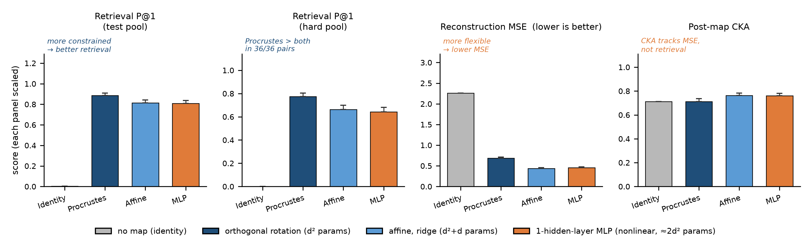
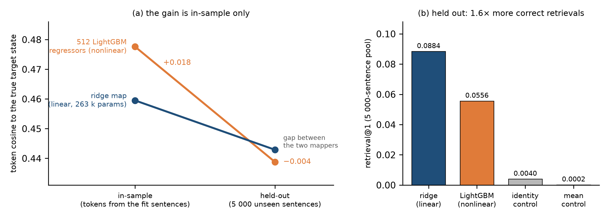

# Introduction

**One rotation is enough to make the problem look solved.** Fit a single orthogonal matrix on parallel sentences and it recovers the matching target representation 88.7 % of the time, averaged over 36 independent model pairs; with no map at all, 0.2 % [Zhou 2026]. Replace that rotation with a one-hidden-layer ReLU network of twice the parameter count, trained on the same pairs, and it lowers the squared error it is trained on (0.456 against 0.689) and raises post-map CKA (0.760 against 0.713), yet *loses the task*: 80.9 % retrieval against 88.7 %, and 64.3 % against 77.5 % once the candidate pool is enlarged [Zhou 2026, Tab. 4]. A more expressive map fits the residual better and places the representation worse. That dissociation, not the headline win, is what this paper is about.

The ordering repeats across representation families. Static word embeddings are aligned with matrices constrained to be orthogonal, an improvement that Zhao and Gilman attribute to Artetxe et al. [Zhao 2020, §2]. Contextualized encoders are bridged token-wise by orthogonal Procrustes, and aligning independently trained models that way beats aligning multilingual models that share a vocabulary [Liu 2019]. Inside LLMs, "larger models exhibit very high-quality linear alignments between corresponding concepts in different languages" [Peng 2024]; across modalities, "a single linear projection is sufficient to stitch a vision model to an LLM" [Huh 2024]; between a base model and its finetuned descendant, one linear "task matrix" approaches finetuned accuracy [O'Brien 2025]. Five settings, five tasks, one repeated finding: constrain the map.

**Figure 1.** The same 36 model pairs, the same 80/20 sentence split, four metrics (values from [Zhou 2026, Tab. 4]; error bars are the reported bootstrapped 95 % CIs). Constraint decreases left to right within each panel. Retrieval P@1 falls monotonically as the hypothesis class grows — Procrustes beats both relaxations in 36/36 pairs (paired mean Δ = +0.112) — while reconstruction MSE and post-map CKA move the other way, affine and MLP winning MSE in 36/36 pairs. The metric decides the winner.

**The residual explains the loss, and it is not a missing nonlinearity.** The error left by an orthogonal map has effective rank 147–246 at layer 8, against 43–67 for the target itself; 88–93 % of its energy lies outside the target's top-10 directions [Zhou 2026, App. F.2]. There is no low-dimensional pocket of structure for an MLP to exploit, so its extra capacity is spent where the receiving model does not read: "There is no concentrated low-dimensional structure for an Affine relaxation or a one-layer MLP to fit, which explains why neither improves retrieval over Procrustes" [Zhou 2026, App. F.2]. Linearity wins here because the mismatch is diffuse, not because the world is linear.

**Our own experiment supplies the failure mode in its sharpest form.** Bridging two frozen 60 M T5 encoders (Vietnamese source, English target) on MTet [Ngo 2019], we fitted a ridge map against 512 per-dimension LightGBM regressions on *identical* tokens. In sample, the trees improve every one of the 512 dimensions — mean per-dimension $R^2$ 0.0918 → 0.1160 — and raise token cosine by 0.018. On 5,000 sentences neither mapper saw, the ordering inverts: token cosine falls by 0.004, retrieval@1 drops from 0.0884 to 0.0556, and the LightGBM channel generates 0.51 BLEU less [Project 2026, §3.4]. The 2.4-point $R^2$ advantage is sentence-specific noise that trees memorise.

**Figure 2.** Our prior vi→en bridge under a change of split (values from [Project 2026, Tab. 3–4]). (a) Token cosine to the true target state: the nonlinear mapper leads by 0.018 when tokens come from the sentences it was fitted on, and trails by 0.004 on unseen sentences. (b) On the held-out 5,000-sentence pool the linear map retrieves the correct target 1.6× as often; the identity (0.0040) and mean (0.0002) controls are effectively at chance.

**The rule is not universal, and honesty about that sharpens the question.** In static word embeddings, a kernel (KCCA) map beats plain CCA by 6.3–20.0 points of translation accuracy on five language pairs [Zhao 2020, Tab. 1] — the one corpus study where a flexible map generalises. But its margin over the *best supervised linear pipeline* the authors reproduce (multi-step linear mappings with CSLS retrieval) shrinks to +0.7…+3.4 points, and against an *unsupervised* linear self-learning system it is −0.2 on EN–IT [Zhao 2020, Tab. 2]. The authors' own by-word decomposition is more telling still: the share of words needing a nonlinear map ranges from 24.4 % (EN–IT) to 67.1 % (EN–ZH) [Zhao 2020, Tab. 3]. Non-linearity there is a property of the *pair*, not a law of representation.

So is linearity a general rule, or an artefact of how these benchmarks are built? Three explanations survive the evidence, and they are not yet separated: (i) a *readout artefact* — cosine and rank-based retrieval reward angle preservation, and most of our benchmarks are cosine; alignment metrics "do not reliably indicate whether alignment will improve or degrade downstream performance" [Veitsman 2026]; (ii) a *capacity artefact* — an orthogonal map has $d^2$ parameters, an MLP roughly $2d^2$, so under limited supervision the constraint is a prior, and a prior looks like a law when every study uses one supervision budget (5,000 pairs in [Zhao 2020]; ~5,000 sentences in [Zhou 2026]); (iii) a *geometric* fact — independently trained models converge on a shared geometry up to rotation [Huh 2024].

**Candidates.** We considered three answerable successors. *Q1: Does the ordering replicate on an English–Vietnamese bridge?* — a replication; the 36 pairs of [Zhou 2026] already span nine languages (none Vietnamese), so this is a sanity check, not a contribution. *Q2: Which metric should select the map?* — partly answered: our own correlation between mapped-token cosine and decoder NLL is flat (+0.012) [Project 2026, Fig. 6], and [Veitsman 2026] shows the same decoupling across tasks. *Q3: How much parallel supervision does the constraint need before it stops mattering?* — untested, cheap, and decisive.

**We adopt Q3.** *Does the advantage of a constrained bridge survive as parallel supervision shrinks, and at what budget does a nonlinear map catch up?* The measurement is concrete. With two frozen T5-small-class models (6 layers, $d=512$; one Vietnamese, one English) we fit three maps — orthogonal Procrustes, ridge affine, one-hidden-layer MLP — at the depths where orthogonal retrieval peaks in a 12-layer model (layers 6–8, i.e. layers 3–5 here) [Zhou 2026, App. F.1], in both directions, on nested subsets of $n \in \{128, 512, 2\text{k}, 8\text{k}, 32\text{k}\}$ MTet sentence pairs, five seeds each, with hyper-parameters tuned only on an inner validation slice. Every map is scored on one fixed, never-touched 5,000-sentence test split by four readouts: P@1 against the test-only pool, P@1 against the pooled train+test pool, MSE, and chrF/COMET through the frozen decoder with the rank-16 LoRA readout of [Project 2026]. Both outcomes are informative. If the MLP closes the gap only when $n \gg d$, the linear advantage is a sample-complexity effect with a price tag attached; if the gap is flat in $n$, it is geometric, and the nonlinearity is fitting noise at every budget. Either way we convert a folklore regularity into a measured boundary.

**What the paper does next.** We treat the winning bridge as an interface rather than a translator, in three measured steps. *Mapping*: fit the source encoder's states into the target decoder's space and report where in depth the fit is best. *Injecting*: replace the decoder's residual stream at a chosen layer with mapped states, the intervention that transfers factual content across models [Zhou 2026] and repairs incorrect predictions in non-English inputs [Han 2026]. *Steering*: add a learned vector to the residual stream at one layer, a lightweight intervention with a documented multilingual effect [Mahmoud 2025]. Every step runs through the same frozen decoder and the same fixed readout, so the only variable is what crosses the boundary; scoring each step on the same four measures then tells us whether the metric that selects a map also predicts the text it produces.

## Figure provenance

**Route (a): measured plots from extracted tables.** No number below is invented, interpolated, or rounded beyond the source's precision. Both figures were plotted directly from these tables (matplotlib, 300 dpi); no value was rescaled or transformed.

*Figure 1 — `figures/nm-linear-vs-nonlinear.png`. Source: [Zhou 2026], Table 4, PDF p. 7 (printed p. 21817), 36 Goldfish monolingual model pairs, final layer (12), ~5,000 parallel sentences per pair, 80/20 split. Error bars = reported bootstrapped 95 % CIs (10,000 resamples); the identity row is reported without CIs.*

| method | Retrieval P@1 (test pool) | Retrieval P@1 (hard pool) | Reconstruction MSE | Post-map CKA |
|---|---|---|---|---|
| identity (no map) | 0.002 | 0.000 | 2.258 | 0.713 |
| Procrustes (orthogonal) | 0.887 ± 0.021 | 0.775 ± 0.028 | 0.689 ± 0.026 | 0.713 ± 0.023 |
| affine, ridge | 0.814 ± 0.027 | 0.663 ± 0.036 | 0.439 ± 0.017 | 0.762 ± 0.020 |
| one-hidden-layer MLP | 0.809 ± 0.029 | 0.643 ± 0.038 | 0.456 ± 0.017 | 0.760 ± 0.020 |

Paired per-pair results (not plotted): Procrustes > affine on P@1 in 36/36 pairs, paired mean Δ = +0.112; affine < Procrustes on MSE in 36/36 pairs [Zhou 2026, App. F, PDF p. 17].

*Figure 2 — `figures/nm-insample-inversion.png`. Source: [Project 2026], Table 4 (in-sample, 90 k/10 k token split from the same 12 k sentences) and Table 3 (held-out, 5,000 test sentences, 121,713 token pairs). Models: `t5-small-vietnamese` → `t5-small`, both 60 M parameters, $d=512$; metric direction vi→en.*

| panel | quantity | ridge (linear, 263 k params) | 512 LightGBM (nonlinear) |
|---|---|---|---|
| (a) | token cosine, in-sample | 0.4595 | 0.4776 |
| (a) | token cosine, held-out | 0.4429 | 0.4388 |
| (b) | retrieval@1, held-out (5,000-sentence pool) | 0.0884 | 0.0556 |

Reference controls in panel (b): identity 0.0040, dataset-mean 0.0002 (chance), both from [Project 2026, Tab. 3].

## References

- Zhou, E., Salhan, S., Arnett, C., Korhonen, A. (2026). *Cross-Lingual Alignment Without Joint Training: Do Monolingual Language Models Converge on Universal Representations?* EMNLP 2026, pp. 21811–21837. Read from `agent-work/research/text/translation/2026_-_Cross-Lingual_Alignment_Without_Joint_Training__Do_Monolingual.md`.
- Zhao, J., Gilman, A. (2020). *Non-Linearity in Mapping Based Cross-Lingual Word Embeddings.* LREC 2020, pp. 3583–3589. Read from `agent-work/research/text/translation/2020_-_Non-Linearity_in_Mapping_Based_Cross-Lingual_Word_Embeddings.md`.
- Liu, Q., McCarthy, D., Vulić, I., Korhonen, A. (2019). *Investigating Cross-lingual Alignment Methods for Contextualized Embeddings with Token-Level Evaluation.* CoNLL 2019, pp. 33–43. Read from `agent-work/research/text/translation/2019_-_Investigating_Cross-lingual_Alignment_Methods_for_Contextualize.md`.
- Peng, Q., Søgaard, A. (2024). *Concept Space Alignment in Multilingual LLMs.* EMNLP 2024, pp. 5511–5526. Read from `agent-work/research/text/References/2024_-_Concept_Space_Alignment_in_Multilingual_LLMs.md`.
- Huh, M., Cheung, B., Wang, T., Isola, P. (2024). *The Platonic Representation Hypothesis.* arXiv, 2024. Read from `agent-work/research/text/other-references/2024_-_The_Platonic_Representation_Hypothesis.md`.
- O'Brien, D., Gajulapalli, D., Nalem, P. R., Ramsey, A., Xia, E. (2025). *Task Matrices: Linear Maps for Cross-Model Finetuning Transfer across Modalities.* Preprint, 2025. Read from `agent-work/research/text/translation/2025_-_Task_Matrices__Linear_Maps_for_Cross-Model_Finetuning_Transfer.md`.
- Veitsman, Y., Liu, Y., Schütze, H. (2026). *Why Better Cross-Lingual Alignment Fails for Better Cross-Lingual Transfer: Case of Encoders.* MRL 2026, pp. 119–134. Read from `agent-work/research/text/translation/2026_-_Why_Better_Cross-Lingual_Alignment_Fails_for_Better_Cross-Lingu.md`.
- Ngo, C., Trinh, T. H., Phan, L., Tran, H., Dang, T., Nguyen, H., Nguyen, M., Luong, M.-T. (2019). *MTet: Multi-domain Translation for English and Vietnamese.* arXiv, 2019. Read from `agent-work/research/text/References/2019_-_MTet__Multi-domain_Translation_for_English_and_Vietnamese.md`.
- Han, H. et al. (2026). *Can you map it to English? The Role of Cross-Lingual Alignment in the Multilingual Performance of LLMs.* EACL 2026. Read from `agent-work/research/text/neural-mining/2026_-_Can_you_map_it_to_English__The_Role_of_Cross-Lingual_Alignment.md`.
- Mahmoud, O., Semage, B. L., Karimpanal, T. G., Rana, S. (2025). *Improving Multilingual Language Models by Aligning Representations through Steering.* arXiv, 2025. Read from `agent-work/research/text/neural-mining/2025_-_Improving_Multilingual_Language_Models_by_Aligning_Representati.md`.
- Project (2026). *Cross-Lingual Translation as Representation Mapping: A 512-Dimensional Linear Bridge Between Two 60M T5 Models* (draft ver02). Internal. Read from `research-phase01-ver02/paper.md`.
