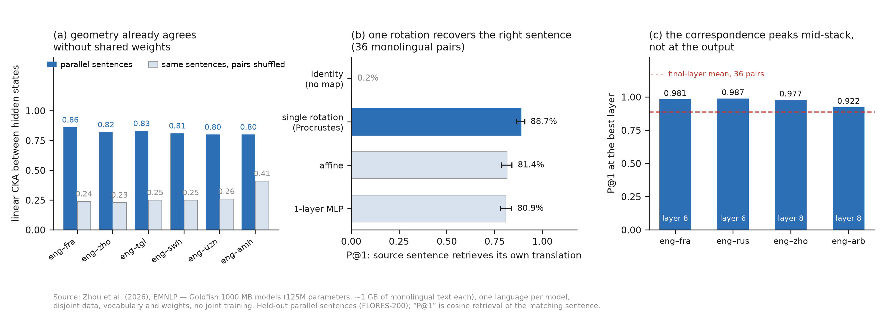

# Frozen Models, One Bridge: Is Translation a 263k-Parameter Map Between Two Independently Trained Language Models?

*Introduction draft for research-phase01-1.2. Body text only; every number is traceable (see
"Figure provenance" and "Sources of the reported results").*

---

## 1. Introduction

Two transformers are trained on disjoint corpora in different languages: no shared parameters, no
shared vocabulary, no sentence ever seen by both, no alignment objective. Feed them the same
sentence pair and compare their hidden states with linear CKA — they agree at 0.86, against 0.24
when the same sentences are paired at random [Zhou et al. 2026, Table 2]. The agreement is not one
lucky pair and not one family of models: across 36 Goldfish pairs over nine languages it averages
0.76 against a 0.18 shuffled control [Zhou et al. 2026, Table 1], and it replicates in all ten
pairs of five ~1B-parameter monolingual models built by five different research groups, at 0.71
against 0.18 [Zhou et al. 2026, §3.4, Table 3]. It is also usable. A single orthogonal rotation,
fitted once on parallel sentences, places 88.7% of source sentences nearest their true counterpart,
where the unaligned identity places 0.2% [Zhou et al. 2026, Table 4]; at the best layer that number
reaches 98.1% for English–French, 98.7% for English–Russian and 97.7% for English–Chinese [Zhou et
al. 2026, App. F.1].

**Figure 1.** The interface already exists. Three measurements from [Zhou et al. 2026] on strictly
monolingual Goldfish models (125M parameters, ~1 GB of monolingual text each, one language per
model, disjoint data, vocabulary and weights). **(a)** Hidden states of parallel sentences are far
more similar than hidden states of the same sentences paired at random — for a high-resource and
for a low-resource partner alike. **(b)** One orthogonal rotation (Procrustes), fitted once on
parallel sentences, retrieves the correct counterpart sentence for 88.7% of sources averaged over
36 language pairs, against 0.2% for the unaligned identity; more flexible maps (affine, one-layer
MLP) lower reconstruction error but retrieve *worse*. **(c)** This is not a last-layer artefact:
the best layer sits mid-stack (layers 6–8 of 12). Dotted line: the final-layer mean over the 36
pairs. Nothing in this figure generates text — that is precisely the gap this paper addresses.

The correspondence is causal, not merely correlational. Take an English residual at a mid-prompt
concept position, multiply it by the rotation, and patch it into the German model's forward pass at
the same position: the German next-token prediction follows the English content in 66–85% of
cross-fact pairs, against a 76–98% within-model ceiling [Zhou et al. 2026, pp. 8–9]. In
English-centric LLMs the same geometry surfaces as failure: non-English predictions are wrong
exactly where middle-layer states are least aligned with their English parallel, and patching the
parallel English activation flips 41.2% of the Italian failures that no control flips [Ravisankar
et al. 2026, p. 8]. Llama2-13B, with prompt-based embeddings, retrieves the correct French concept at
P@1 = 59.27% before any alignment training at all [Peng and Søgaard 2024, p. 4].

The Platonic Representation Hypothesis gives this a name: representations converge on a shared
statistical model of reality as models become more capable [Huh et al. 2024] — a claim so far
tested across vision and language, not across languages [Zhou et al. 2026, p. 1]. The multilingual
literature had the opposite prior, attributing cross-lingual alignment to shared subword
vocabularies, shared input distributions, or shared architectural parameters, that is, to joint
training [Zhou et al. 2026, §1].

So the question we start from is not rhetorical. If a model that has never seen French nevertheless
represents the French meaning of its own sentence inside a rotation of the English model's space,
what is left to learn in order to translate? Do we have to touch the models at all — fine-tune
them, adapt them, move their weights — or is translation the composition of two frozen models and
a small map between them? The two answers predict different things, which is what makes the
question experimental rather than philosophical. If the interface is enough, a map fitted on
representations, never on a translation loss, should carry whole sentences once the target decoder
can read the mapped states. If the interface is not enough, every channel built on top of it will
stay at the level of topic and lexicon however well the map fits, and the gap between "the right
sentence is nearby" and "the right sentence is written" is the measurement that matters.

Current practice says yes. End-to-end MT trains the generator on parallel data.
Representation-level work keeps the generator trainable as well: a middle-layer alignment objective
folded into task-specific fine-tuning [Liu and Niehues 2025], mid-layer CKA+REPINA regularisation
inside Aya-23 8B [Nakai et al. 2025], source–target fusion inside LoRA adapters [Borchert et al.
2025]. Even the modular alternative keeps a trained translation model in the loop: XBridge routes an
LLM's multilingual understanding through external pretrained encoder–decoder MT models and learns
only the cross-model mapping layers, explicitly "without retraining the LLM" [Bu and Feng 2026].
Bridges between frozen spaces have been learned without any paired data [Jha et al. 2025], but for
retrieval and attribute inference on static embeddings, not for producing a sentence.

**The gap.** What is missing is a *frozen* pair. The alignment evidence stops exactly where
generation would begin: [Zhou et al. 2026] score a single subword of a factual answer, state that
multi-token generation and open-ended use fall outside their design, and leave open how to train a
functional anchor-based projection (p. 10). Inside multilingual models, alignment is scored by
probing and classification, and better embedding-level alignment does not reliably mean better
downstream transfer [Veitsman et al. 2026]. To our knowledge, no published result joins two frozen
monolingual language models with a lightweight map and asks the frozen decoder to write the
translation — and none reports what that composition produces when it fails.

We test the strong form of the claim in the smallest setting that can falsify it: two 60M-parameter
T5 models, `t5-small` (English) and `t5-small-vietnamese`, both frozen except for a rank-16 LoRA on
the target decoder. Between them sits $f(h)=Wh+b$ with $W\in\mathbb{R}^{512\times512}$ — 263,168
parameters, 0.43% of one model. The map is solved in closed form by ridge on 9.28M token-aligned
representation pairs from MTet and never sees a translation loss, which separates "how much
cross-lingual information is decodable from the source states" from "how well a decoder can be
trained". The decoder is then trained on two channels with shared weights — its own encoder
(*native*) and the mapped source (*mapped*) — so the difference between them is attributable to
the map and not to the adapter. On 3,000 held-out vi→en sentences (COMET on the first 1,000),
*mapped* reaches 2.84 BLEU / 19.96 chrF / 0.4816 COMET against 0.03 / 6.09 / 0.3360 for the same
decoder with the map removed (a 95× BLEU gap), and 4.17 / 15.35 / 0.3787 for *native*. The reverse
direction reproduces the pattern with a different tokeniser and a different decoder: 3.00 BLEU and
0.4660 COMET against 0.07 and 0.2905 for identity.

The paper also reports where this fails, because the failures bound the claim rather than decorate
it. Mapped-vector injection degenerates: an adapter that copies 85.9% of sentences from its own
encoder's states emits punctuation when fed *mapped* vectors (0.37 BLEU, 95% degenerate), so the
readout is distribution-specific and "predict the vector, then copy it" is false in its strong
form. A nonlinear mapper is not the repair: 512 per-dimension gradient-boosted regressions improve
$R^2$ on all 512 dimensions in-sample (+0.024), lose that advantage on held-out sentences, and
generate worse text (−0.51 BLEU). And per-token cosine does not predict the decoder's NLL (Pearson
+0.012): the representation metrics the alignment literature reports cannot rank mappers — the same
wedge that [Veitsman et al. 2026] observe between alignment and task transfer.

**Contributions.**

1. The first direct test, to our knowledge, of translation from a *frozen* pair of independently
   trained monolingual models through a single linear map, with no translation loss during fitting
   and no gradient into either model's encoder.
2. A channel-controlled measurement of what the map contributes (mapped vs. native vs. identity,
   same decoder, same pairs, same adapter), in both directions, with paired bootstrap intervals.
3. Three falsifications with their replacements: the nonlinear-mapper hypothesis, the naive
   vector-injection readout, and the assumption that representation cosine ranks mappers — plus
   the decoder-side measurements we propose instead.
4. A reusable pipeline that fits the map from streaming second moments (9.28M token pairs in 8
   minutes on a 4 GB laptop GPU), which makes the whole design reproducible without a cluster.

---

## Figure provenance

**Route (a): measured numbers transcribed from one paper.** No curve, bar or annotation in Figure 1
is simulated; the plotting script contains no data generating step other than the literal values
below.

| Panel | Value | Metric | Language pair(s) | Source | Page |
|---|---|---|---|---|---|
| a | 0.86 / 0.24 | linear CKA, matched / shuffled (SGPT pooling, last layer) | eng–fra | Zhou et al. 2026, Table 2 | p. 5 |
| a | 0.82 / 0.23 | linear CKA, matched / shuffled | eng–zho | Zhou et al. 2026, Table 2 | p. 5 |
| a | 0.83 / 0.25 | linear CKA, matched / shuffled | eng–tgl | Zhou et al. 2026, Table 2 | p. 5 |
| a | 0.81 / 0.25 | linear CKA, matched / shuffled | eng–swh | Zhou et al. 2026, Table 2 | p. 5 |
| a | 0.80 / 0.26 | linear CKA, matched / shuffled | eng–uzn | Zhou et al. 2026, Table 2 | p. 5 |
| a | 0.80 / 0.41 | linear CKA, matched / shuffled | eng–amh | Zhou et al. 2026, Table 2 | p. 5 |
| b | 0.887 ± 0.021 | P@1 (test-only pool), 36 pairs, final layer | all 36 Goldfish pairs | Zhou et al. 2026, Table 4 | p. 7 |
| b | 0.814 ± 0.027 | P@1, affine map | all 36 pairs | Zhou et al. 2026, Table 4 | p. 7 |
| b | 0.809 ± 0.029 | P@1, one-layer MLP | all 36 pairs | Zhou et al. 2026, Table 4 | p. 7 |
| b | 0.002 | P@1, identity (no map) | all 36 pairs | Zhou et al. 2026, Table 4 | p. 7 |
| c | 0.981 (layer 8) | P@1 at the best layer, Procrustes | eng–fra | Zhou et al. 2026, App. F.1 | p. 17 |
| c | 0.987 (layer 6) | P@1 at the best layer, Procrustes | eng–rus | Zhou et al. 2026, App. F.1 | p. 17 |
| c | 0.977 (layer 8) | P@1 at the best layer, Procrustes | eng–zho | Zhou et al. 2026, App. F.1 | p. 17 |
| c | 0.922 (layer 8) | P@1 at the best layer, Procrustes | eng–arb | Zhou et al. 2026, App. F.1 | p. 17 |

Numbers quoted in the text but not plotted: 0.76 vs 0.18 (mean last-layer CKA over 36 pairs, Table
1, p. 5); 0.71 vs 0.18 over ten pairs of five ~1B models (§3.4, Table 3, p. 6); 66–85% Procrustes vs
76–98% within-model directional success rate (§5.2, pp. 8–9); 41.2% of 68.9% total flips at layer
14 (Ravisankar et al. 2026, p. 8); P@1 59.27% before alignment for French, Llama2-13B, prompt
embeddings (Peng and Søgaard 2024, pp. 3–4).

**What the figure deliberately does *not* claim.** The figure shows that two independent models
*represent* parallel sentences in alignable geometry and that a rotation can *retrieve* the right
sentence. It does not show translation: no text is generated anywhere in [Zhou et al. 2026]'s
design, and their own limitations section says so. That distance is the paper's motivation, not a
result we are borrowing.

Plot script: `agent-work\fig1_rotation_bridge.py` (matplotlib 3.11, 300 dpi, 11.2 × 4.0 in).

## Sources of the reported results

The vi→en and en→vi figures, the copy-LoRA numbers, the LightGBM comparison and the cosine/NLL
correlation in §1 are this project's own measurements, not literature values; they are taken verbatim
from `research-phase01-ver02/paper.md` (Tables 2–7) and `research-phase01-ver02/results/`.

## References

- **Borchert, Vulić, Moens, De Weerdt 2025.** *Language Fusion for Parameter-Efficient Cross-lingual
  Transfer.* ACL 2025. `agent-work\research\text\translation\2025_-_Language_Fusion_for_Parameter-Efficient_Cross-lingual_Transfer.md`
- **Bu, Feng 2026.** *Language on Demand, Knowledge at Core: Composing LLMs with Encoder-Decoder
  Translation Models for Extensible Multilinguality.* ACL 2026.
  `agent-work\research\text\translation\2026_-_Language_on_Demand,_Knowledge_at_Core__Composing_LLMs_with_Enco.md`
- **Huh, Cheung, Wang, Isola 2024.** *The Platonic Representation Hypothesis.* arXiv 2024.
  `agent-work\research\text\other-references\2024_-_The_Platonic_Representation_Hypothesis.md`
- **Jha, Zhang, Shmatikov, Morris 2025.** *Harnessing the Universal Geometry of Embeddings.* arXiv
  2025. `agent-work\research\text\other-references\2025_-_Harnessing_the_Universal_Geometry_of_Embeddings.md`
- **Liu, Niehues 2025.** *Middle-Layer Representation Alignment for Cross-Lingual Transfer in
  Fine-Tuned LLMs.* ACL 2025.
  `agent-work\research\text\neural-mining\2025_-_Middle-Layer_Representation_Alignment_for_Cross-Lingual_Transfe.md`
- **Nakai, Chikkala, Oberkircher, Jennings, Skachkova, Anikina, Alabi 2025.** *TRepLiNa: Layer-wise
  CKA+REPINA Alignment Improves Low-Resource Machine Translation in Aya-23 8B.* MMLoSo 2025
  (COLING 2025 workshop). `agent-work\research\text\neural-mining\2025_-_TRepLiNa__Layer-wise_CKA+REPINA_Alignment_Improves_Low-Resource.md`
- **Peng, Søgaard 2024.** *Concept Space Alignment in Multilingual LLMs.* EMNLP 2024.
  `agent-work\research\text\References\2024_-_Concept_Space_Alignment_in_Multilingual_LLMs.md`
- **Ravisankar, Han, Wiegreffe, Carpuat 2026.** *Can you map it to English? The Role of Cross-Lingual
  Alignment in the Multilingual Performance of LLMs.* EACL 2026.
  `agent-work\research\text\translation\2026_-_Can_you_map_it_to_English__The_Role_of_Cross-Lingual_Alignment.md`
- **Veitsman, Liu, Schütze 2026.** *Why Better Cross-Lingual Alignment Fails for Better Cross-Lingual
  Transfer: Case of Encoders.* MRL 2026 (ACL workshop).
  `agent-work\research\text\translation\2026_-_Why_Better_Cross-Lingual_Alignment_Fails_for_Better_Cross-Lingu.md`
- **Zhou, Salhan, Arnett, Korhonen 2026.** *Cross-Lingual Alignment Without Joint Training: Do
  Monolingual Language Models Converge on Universal Representations?* EMNLP 2026.
  `agent-work\research\text\translation\2026_-_Cross-Lingual_Alignment_Without_Joint_Training__Do_Monolingual.md`
<!-- Original instruction stub that this file replaced, preserved verbatim:
Find proof about language ability of monolingual LLM in the `References` folder
Create a figure to hook, to prove their capabilities

Then write one sentence for this: "If the model itself understands the languages good enough, do we need to touch them, modify them for translation" - this can be the hook
Then introduce briefly our solution
-->
