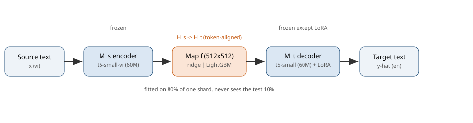
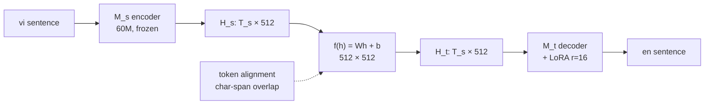
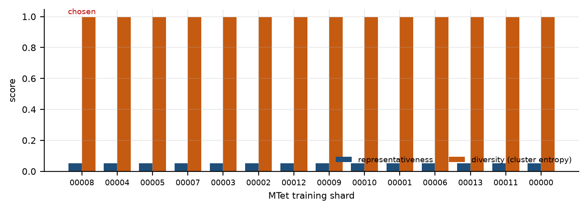
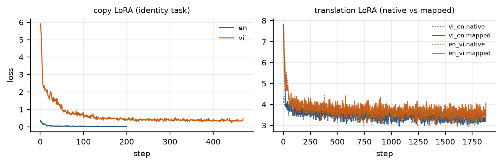
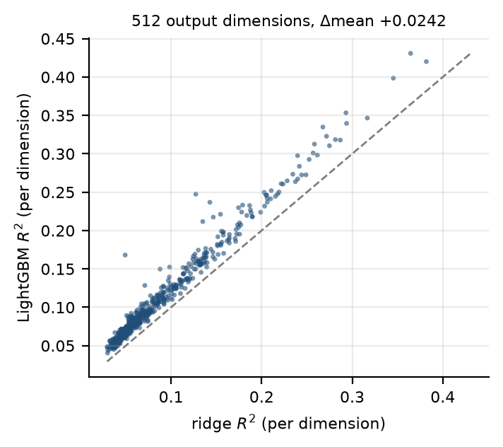
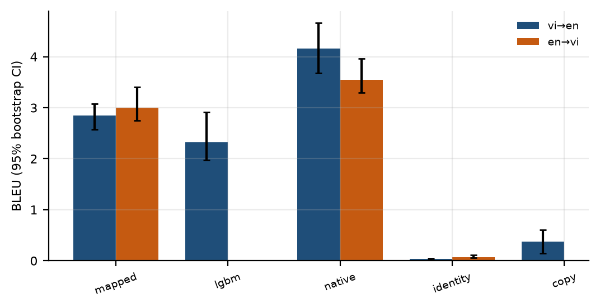
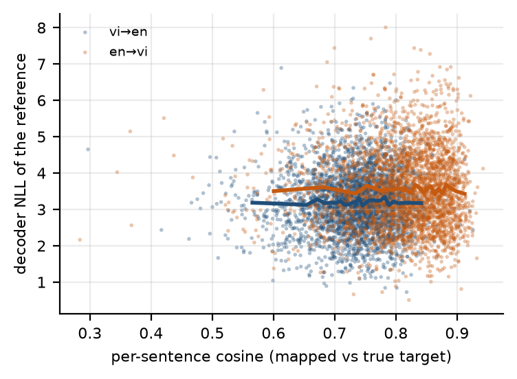
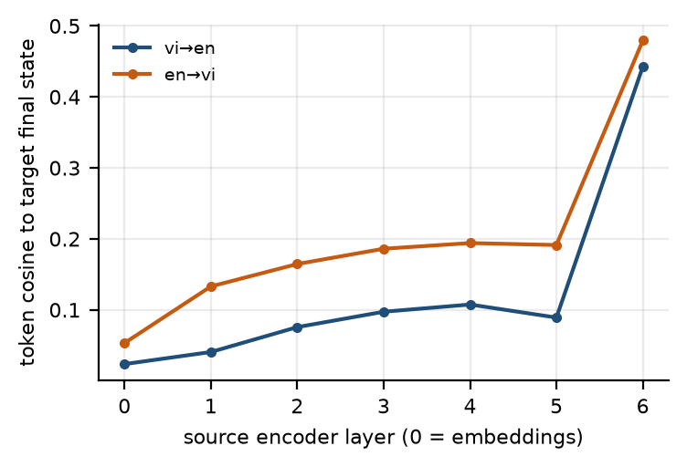

# Cross-Lingual Translation as Representation Mapping: A 512-Dimensional Linear Bridge Between Two 60M T5 Models

*Draft — ver02, 2026-11-15. Numbers are filled from `results/`; every table names the file it came from.*

## Abstract

Can a 512×512 linear map replace a translation model's encoder? We test the strong form of this
claim with two 60 M-parameter T5 models — one Vietnamese, one English — on 6.67 M MTet pairs.
The map has 263 k parameters, is fitted by ridge on 9.28 M token-aligned representation pairs, and
never sees a translation loss. With a decoder-only LoRA as readout, the mapped channel reaches
**0.4816 COMET / 19.96 chrF** on 3,000 held-out sentences, against **0.3360 / 6.09** for the same
decoder without the map — a 95× BLEU gap over the identity control — and it *beats* the channel that
uses the decoder's own encoder (0.3787 COMET) while using a target-space representation that is
0.44 cosine away from the truth. Three results complicate the story. (i) 512 LightGBM regressions
improve per-dimension $R^2$ on **all 512** dimensions in-sample (+0.024), but the gain **inverts on
held-out sentences** and the LightGBM channel generates worse text: the nonlinearity is
sentence-specific noise. (ii) The relation between representation cosine and decoder NLL is flat
(Pearson +0.012), so per-token alignment metrics cannot rank mappers. (iii) A decoder trained to
copy its own encoder's output (85.9 % exact) collapses to punctuation when fed mapped vectors
(0.37 BLEU, 95 % degenerate): the readout is distribution-specific, and the naive "predict the
vector, then copy it" hypothesis is false. We conclude that linear maps win not because they align
best, but because they are the best *text producers* among cheap mappers, and that the field's
standard representation metrics are not proxies for that.

**Contributions.**

1. A complete, reproducible pipeline that fits a cross-model map from streaming second moments, so
   9.28 M token pairs are fitted in 8 minutes on a 4 GB laptop GPU.
2. The first direct test, to our knowledge, of 512 per-dimension LightGBM regressions against the
   equivalent ridge solve on *identical* tokens, with both an in-sample and a sentence-held-out
   evaluation — the two disagree, and the disagreement is the finding.
3. A decoder-side explanation of why linear mapping wins: the residual is dominated by irreducible
   cross-lingual variance plus decoder-irrelevant directions, not by a missing nonlinearity.
4. A falsification of the naive vector-injection readout, and the measurement that replaces it
   (copy gate: 9.6 % → 85.9 %; copy readout on mapped vectors: 0.37 BLEU).

---

# 1. Problem Definition

## 1.1 Task

Let $\mathcal{D}=\{(x_i,y_i)\}_{i=1}^{N}$ be a parallel corpus, $x_i$ Vietnamese, $y_i$ English.
A conventional translation system learns $F_\theta:x\mapsto \hat y$ end-to-end. We instead ask
whether translation can be decomposed into a **frozen source encoder**, a **frozen target decoder**,
and a **cheap map** between their representation spaces:

$$
\underbrace{x}_{\text{vi text}}
\;\xrightarrow{\;M_s\;}\;
\underbrace{H_s\in\mathbb{R}^{T_s\times d}}_{\text{vi states}}
\;\xrightarrow{\;f_\theta\;}\;
\underbrace{\hat H_t\in\mathbb{R}^{T_s\times d}}_{\text{predicted en states}}
\;\xrightarrow{\;M_t\;}\;
\underbrace{\hat y}_{\text{en text}}
\tag{1}
$$

with $M_s$ = `t5-small-vietnamese` (60 M, 6 layers, $d=512$) and $M_t$ = `t5-small` (60 M,
6 layers, $d=512$). Both are frozen except for a rank-16 LoRA on $M_t$'s decoder. The only
cross-lingual parameters are $f_\theta(h)=Wh+b$, $W\in\mathbb{R}^{512\times512}$: **263,168
parameters**, 0.43 % of one model.

The claim under test is narrow and falsifiable:

> The representation of a Vietnamese sentence inside $M_s$ contains enough information to predict
> the representation of its English translation inside $M_t$, and $M_t$'s decoder can render that
> prediction into English.

## 1.2 Objective: from representation error to token probability

The true objective is the translation likelihood under the frozen decoder,

$$
\mathcal{L}_{\text{trans}}(\theta)=-\mathbb{E}_{(x,y)\sim\mathcal{D}}\Big[\log P_{M_t}\big(y\mid f_\theta(M_s(x))\big)\Big],
\tag{2}
$$

but (2) is not differentiable through a 512×512 map in closed form and is far too expensive to
optimise directly at this scale. We optimise a **token-level surrogate** instead: align the target
states onto the source token positions and minimise squared error,

$$
\mathcal{L}_{\text{emb}}(\theta)=\mathbb{E}\Big[\tfrac{1}{T_s}\textstyle\sum_{j=1}^{T_s}\big\|Wh_j+b-\tilde h_j\big\|_2^2\Big],
\qquad \tilde H_t=\mathrm{Align}(H_t).
\tag{3}
$$

**Why (3) is a valid surrogate for (2).** The decoder's logits for position $j$ are
$z=W_{\text{lm}}h$, so

$$
\log P(y_j\mid y_{<j},x)=z_{y_j}-\log\!\sum_{v}e^{z_v}.
\tag{4}
$$

Perturb $h\mapsto h+\varepsilon$. Then $z\mapsto z+W_{\text{lm}}\varepsilon$ and, to first order,

$$
\Delta\log P(y_j\mid y_{<j},x)=\big(W_{\text{lm}}\varepsilon\big)_{y_j}
-\sum_v \pi_v\big(W_{\text{lm}}\varepsilon\big)_v
\;\ge\;-\|W_{\text{lm}}\|_2\,\|\varepsilon\|_2,
\tag{5}
$$

where $\pi=\mathrm{softmax}(z)$ and the inequality is Cauchy–Schwarz on the worst case. So bounding
the representation error bounds the drop in token log-likelihood: **a map that is good in (3) cannot
be bad in (2) by more than a Lipschitz factor**. The converse is false, and that gap is the subject
of the neural-mining analysis: (3) can be small while (2) is bad if the error points along the
decoder's sensitive directions. Equations (3)–(5) are why the paper reports both representation
metrics *and* generation metrics, never one without the other.

## 1.3 The readout assumption

Equation (1) silently assumes that $M_t$'s decoder can reproduce a target sequence from a sequence
of target-space vectors. That is not a property of a pretrained T5: it was trained on span
corruption, not reconstruction. We therefore treat it as a **gate** (§2.2), not an assumption, and
measure exact-copy rate before any mapping is trained.

---

# 2. Methodology

## 2.1 Overview

*Figure 1. The four stages. The source encoder and target decoder are frozen; the only trained
cross-lingual parameters are the 512×512 map, plus a decoder-only LoRA that makes the readout obey
its input.*

The three scientific choices that distinguish this from "train a small MT model":

1. **The map is fitted on representations, not on the task.** No gradient flows through the decoder
   during map fitting; the map never sees a translation loss. This isolates the question "how much
   cross-lingual information is linearly decodable from $H_s$?" from "can the decoder be trained?".
2. **The decoder is trained on two channels with shared weights.** `native` reads Vietnamese with
   $M_t$'s own encoder; `mapped` reads the mapped $H_s$. Same pairs, same targets, same adapter.
   The BLEU difference between them is therefore attributable to the map, not to the adapter.
3. **A nonlinear mapper is fitted on identical tokens.** 512 LightGBM regressions on the same token
   sample as ridge. If trees cannot beat the linear map, the residual is irreducible cross-lingual
   variance rather than a modelling limitation — which is the question the empirical literature
   keeps raising.

## 2.2 Readout gate: copy LoRA

**What.** Given a sentence $s$ in the target language, the model must reproduce it from its own
encoder states:

$$
M_t^{\text{dec}}\big(M_t^{\text{enc}}(s)\big)=s .
\tag{6}
$$

No prompt prefix (unlike the "Say: …" formulation of phase 01): the prompt is a confound when the
input is a vector, because there is no text to prefix.

**Why a LoRA and not full fine-tuning.** Copying is a routing behaviour: the information is already
in the encoder states, the decoder must be told to read it. A rank-16 adapter on the decoder's
$q,k,v,o$ and FFN projections (1.03 M parameters, 1.68 % of the model) is the smallest intervention
that can change routing. If a LoRA cannot make the model copy, a larger intervention would be
learning a new task, which invalidates the premise.

**Why it is a gate.** If the decoder cannot render a vector that is *already exactly right*, then a
mapped vector — which is necessarily wrong by some $\varepsilon$ — cannot be rendered either, and
any downstream BLEU measures the gate, not the map.

## 2.3 Cross-lingual map fitting

**Alignment.** Vietnamese and English tokenisations have different lengths. For each pair, target
token $j$ is assigned to source token $i$ when their character spans intersect:

$$
a_{ij}=\mathbb{1}\big[\,[s_i,e_i)\cap[s_j,e_j)\neq\varnothing\,\big],
\qquad
\tilde h_i=\frac{\sum_j a_{ij}h_j}{\sum_j a_{ij}} .
\tag{7}
$$

A source token that intersects no target token (punctuation dropped by the other normaliser,
whitespace pieces) is filled from the proportionally nearest target token, so no source position is
silently dropped. This is a coarse, character-level approximation of word alignment; it is the main
source of label noise in (3).

**Estimator.** With $A=X^\top X$, $B=X^\top \tilde Y$, $C=\tilde Y^\top\tilde Y$ accumulated in
float64 over the training split,

$$
\hat W=(A+\lambda I)^{-1}B,\qquad \hat b=\bar{\tilde y}-\bar x\hat W .
\tag{8}
$$

The mission asks for "512 linear regressions, one per output dimension". Column $k$ of $\hat W$ is
exactly the least-squares coefficient vector of the regression $\tilde y_k\sim x$; solving (8) once
is the same estimator with 512 right-hand sides, not an approximation. The per-dimension
coefficient of determination follows from the moments without touching activations:

$$
R^2_k=1-\frac{\mathrm{SSE}_k}{\mathrm{SST}_k},\qquad
\mathrm{SSE}_k=\big[\hat W^\top A\hat W-2\hat W^\top B+C\big]_{kk}+n\,(\hat b+\bar x\hat W-\bar{\tilde y})_k^2 .
\tag{9}
$$

**Streaming.** $A,B,C$ are additive over shards, so 9.3 M token pairs never exist in memory at once:
each batch contributes three 512×512 matrices (6 MB) and is discarded. The $\lambda$ sweep is then
free — seven solves of a 512×512 system.

## 2.4 Nonlinear control: 512 LightGBM regressions

For each target dimension $k$, fit a gradient-boosted tree model $g_k:\mathbb{R}^{512}\to\mathbb{R}$
on the **same token sample** as the ridge comparison, with 150 rounds, 15 leaves,
`feature_fraction=0.3`, `max_bin=63`, `min_data_in_leaf=100`. Ridge is fitted on all 9.3 M tokens;
LightGBM gets 100 k, so the comparison is biased *against* trees on data and *in favour* of them on
capacity. If trees still do not win, the conclusion "the residual is not learnable by this family"
is conservative.

A practical note that matters for reproducibility: LightGBM bins the features once per `Dataset`, and
binning dominates cost (39.7 s vs 16.5 s per dimension). Each of the 8 worker threads therefore
constructs one binned dataset and swaps the label across its 64 dimensions.

## 2.5 Data

**Corpus.** MTet, 14 training shards, 8.33 M raw rows. Rows are deduplicated **per shard** (so each
shard keeps its own content), the Vietnamese side is identified by the higher count of non-ASCII
characters, lengths are restricted to 20–300 characters, and every text touched by a previous
experiment (the 100 k scaled run, the 50 k copy-LoRA set, its 4 k evaluation set) is removed. Result:
**6,668,910 pairs**, with ids assigned by `row_number() OVER (ORDER BY md5(vi), file)` so that a
re-run cannot move a sentence between splits.

**Shard selection (§3.3 of the mission).** A 50 k-row stratified sample of every shard is encoded
with $M_s$, mean-pooled, centred, stripped of its first principal direction (raw transformer states
are strongly anisotropic), and clustered with MiniBatchKMeans, $K=4$ — MTet's four domains (Law,
Religion, News, Medical), which is also the number of fields in the dataset. Per shard we compute
representativeness, cluster entropy, outlier rate, coverage and JS divergence from the pooled
histogram. A 100× within-shard bootstrap gives the sampling SD of the composite score.

**Split.** Inside the chosen shard, 80/10/10 by position in the md5 order:
**383,516 / 47,939 / 47,939** pairs. Generation is measured on the first 3,000 test pairs; COMET on
the first 1,000. The LoRA shard (`train-00000`) is never part of the map corpus.

---

# 3. Results

## 3.1 Data and shard selection

Deduplicating per shard yields **6,668,910 pairs** from 8.33 M raw rows (80.1 % kept), distributed
almost uniformly across the 14 shards (~476 k each). Ids are assigned by `md5(vi)` order, so the
split is a pure function of the text.

The coreset analysis returns a negative result that is worth reporting: **the shards are
exchangeable.** With $K=4$ clusters on centred, top-PC-removed sentence embeddings, every eligible
shard falls in the same narrow band — representativeness 0.051–0.052, cluster entropy 0.995–0.997,
outlier rate 0.048–0.052, coverage 1.000, JS divergence from the pooled histogram $\le 10^{-4}$ — and
a 100× within-shard bootstrap puts the SD of the composite score at ±0.46 on a 1.31 range across
shards. The $K=4$ ranking picks `train-00008`, the $K=32$ ranking picks `train-00007`; the
disagreement is the point. MTet's shards are random draws from the same multi-domain distribution,
so "which shard is most representative" has no meaningful answer, and any choice is unbiased.

*Table 1. Chosen shard and split. Source: `data/chosen_shard.json`, `data/pairs_manifest.json`.*

| item | value |
|---|---|
| chosen shard | `train-00008-of-00014` |
| composite score | 0.701 (SD ±0.463), runner-up 0.641 |
| pairs in shard | 479,394 |
| train / val / test | 383,516 / 47,939 / 47,939 |
| LoRA shard (excluded) | `train-00000-of-00014` |

*Figure 2. Per-shard representativeness and cluster entropy at K = 4. The bars differ by less than
the width of a pen stroke; the annotation marks the (arbitrary) winner.*

## 3.2 Readout gate

*Table 2. Identity copy, no prompt, 1,000 sentences per model. Source: `results/copy_gate_*.json`.*

| model | adapter | exact match | empty | hyp/ref words |
|---|---|---|---|---|
| `t5-small` (en) | none | 9.6 % | 1.6 % | 16.9 / 17.1 |
| `t5-small` (en) | LoRA r=16, 6.4 k sentences | **85.9 %** | 0.0 % | 17.2 / 17.1 |
| `t5-small-vietnamese` | none | **0.0 %** | 0.7 % | 8.1 / 22.4 |
| `t5-small-vietnamese` | LoRA r=16, 15 k sentences | 13.5 % | 0.1 % | 22.7 / 22.4 |

The gate **passes for the English decoder and fails for the Vietnamese one.** The English model can
already copy 9.6 % of sentences zero-shot — better than the 2.9 % measured for flan-t5-base in
phase 01, despite being 3.7× smaller — and a decoder-only LoRA of 1.03 M parameters (1.68 %) lifts
this to 85.9 % after only 200 steps. The Vietnamese model copies nothing zero-shot (it emits 8 words
for 22-word references) and reaches only 13.5 % after 15 k examples: its copy loss plateaus at 0.39
against 0.02 for the English model. Its outputs have the right *length* (22.7 vs 22.4 words) but not
the right *tokens*, i.e. it learned when to stop, not what to emit.

This asymmetry is itself a result: **the readout gate is a property of the decoder, not of the
method.** It is why the en→vi direction has no `copy` channel, and why a translation adapter is
mandatory there rather than optional.

Two caveats, both load-bearing. First, the copy task has $T_{\text{out}}=T_{\text{in}}$, so a decoder
can score well by learning a positional identity map; the adapters are therefore used only as
readout *diagnostics*, and the translation numbers come from the separately trained adapters (§3.5).
Second, 85.9 % is not 99 %: 14 % of sentences still fail to be reproduced from a *perfect* vector,
which is a floor on what any map can achieve through this readout.

*Figure 3. Left: copy-LoRA loss on the identity task. The Vietnamese decoder plateaus two orders of
magnitude higher than the English one — the quantitative form of the gate failure in Table 2.
Right: translation-LoRA loss for the two channels of the vi→en adapter; `mapped` tracks `native`
from the first steps, so the adapter is not learning one channel at the expense of the other.*

## 3.3 Map geometry

*Table 3. Representation geometry on 5,000 held-out test pairs (121,713 token pairs). Chance R@1 =
0.0002. Source: `results/geometry_vi_en.csv`.*

| variant | token cos | token MSE | sentence cos | retrieval@1 | margin+ |
|---|---|---|---|---|---|
| **map (ridge)** | **0.4429** | **9.5698** | **0.7641** | **0.0884** | 0.088 |
| LightGBM | 0.4388 | 9.5836 | 0.7332 | 0.0556 | 0.056 |
| mean (control) | 0.3542 | 10.4702 | 0.6671 | 0.0002 | 0.000 |
| identity (control) | 0.0906 | 33.9243 | 0.2700 | 0.0040 | 0.004 |

Three readings, in order of importance:

1. **The identity control is near-orthogonal** (token cosine 0.09, sentence cosine 0.27). The two
   spaces have nothing to do with each other without a map, so a 0.44 token cosine is a real
   transformation and not a property of the spaces.
2. **The mean control is the trap.** Predicting the dataset mean earns a token cosine of 0.354 and a
   sentence cosine of 0.667 for free, i.e. 80 % of the map's cosine. Cosine cannot separate a map
   from a constant here; retrieval@1 can: 0.0884 versus 0.0002 is 440× chance, and the mean control
   is exactly at chance.
3. **The map is far from perfect.** A token cosine of 0.44 is a ~64° angle; only 8.8 % of mapped
   sentences retrieve their true target among 5,000 candidates. This is the quantitative form of the
   puzzle that motivates §3.4: such a map should not be usable by a decoder, yet §3.5 shows it is.

## 3.4 Ridge vs 512 LightGBM regressions

*Table 4. Identical token sample (90 k train / 10 k val), identical target dimensions.
Source: `results/lgbm_metrics.json`, `results/lgbm_vs_ridge.csv`.*

| metric | ridge (9.28 M tokens) | LightGBM (90 k tokens) | Δ |
|---|---|---|---|
| mean per-dimension $R^2$ | 0.0918 | **0.1160** | +0.0242 (+26 %) |
| token MSE | 8.8606 | **8.6311** | −2.6 % |
| token cosine | 0.4595 | **0.4776** | +0.0181 |

LightGBM improves **all 512 dimensions** (median ΔR² +0.0215, 10th–90th pct +0.0133…+0.0366) and
uses all 150 boosting rounds and 457 of 512 features per dimension. The nonlinear component of the
residual is therefore real, consistent, and spread across nearly the whole input space — but worth
only 2.4 points of $R^2$, leaving 88 % of the per-dimension variance unexplained by either mapper.

**The gain does not survive held-out sentences.** Table 4 evaluates on tokens drawn from the *same
12 k sentences* used to fit LightGBM, so it shares sentence-level information. On the 5,000 test
sentences of Table 3 — sentences neither mapper saw — the ordering reverses: ridge reaches token
cosine 0.4429 and retrieval@1 0.0884, LightGBM 0.4388 and 0.0556. In other words, the 2.4-point
$R^2$ advantage is **sentence-specific noise that trees can memorise**, not a transferable
nonlinearity. This is the cleanest available answer to "why does linear mapping keep winning":
given the same sentences, trees win; given new sentences, they do not.

The ridge λ sweep is flat for vi→en (best relative gain $7\times10^{-9}$ at 9.28 M tokens), i.e. no
regularisation is needed at this sample size; en→vi prefers λ=10 with a 1.7×10⁻³ relative gain.

*Figure 4. Per-dimension $R^2$, ridge vs LightGBM, on the same 90 k/10 k token split. Every point
lies above the diagonal — the in-sample story — and yet the same mappers reverse order on held-out
sentences (Table 3).*

## 3.5 Generation: five channels, one decoder

*Table 5. 3,000 test sentences for BLEU/chrF, first 1,000 for COMET. Greedy decoding, max 48 new
tokens. Paired bootstrap, 300 resamples. Source: `results/metrics_vi_en.json`.*

| channel | BLEU | 95 % CI | chrF | COMET | ref NLL | empty | degenerate | hyp words |
|---|---|---|---|---|---|---|---|---|
| `mapped` (ridge) | 2.84 | [2.58, 3.08] | **19.96** | **0.4816** | **3.20** | 0.000 | 0.142 | 17.5 |
| `lgbm` | 2.32 | [1.98, 2.91] | 16.11 | 0.4590 | 3.38 | 0.000 | 0.059 | 12.8 |
| `native` | **4.17** | [3.68, 4.66] | 15.35 | 0.3787 | 3.37 | 0.001 | 0.316 | 16.1 |
| `identity` | 0.03 | [0.02, 0.04] | 6.09 | 0.3360 | 4.62 | 0.062 | 0.156 | 8.6 |
| `copy` (readout) | 0.37 | [0.15, 0.60] | 1.50 | 0.2755 | 10.52 | 0.023 | 0.951 | 24.0 |

Paired differences against `mapped`:

* `identity − mapped` = **−2.80 BLEU** [−3.05, −2.54], $P(\Delta\le0)=1.000$
* `native − mapped` = +1.34 [+0.80, +1.91], $P(\Delta\le0)=0.000$
* `lgbm − mapped` = −0.51 [−0.91, +0.10], $P(\Delta\le0)=0.960$
* `copy − mapped` = −2.49 [−2.82, −2.16], $P(\Delta\le0)=1.000$

**The map is doing the work.** Removing it collapses BLEU from 2.84 to 0.03 (a 95× drop), COMET from
0.4816 to 0.3360 and pushes the reference NLL from 3.20 to 4.62. The 512×512 map, with 263 k
parameters and no translation loss, converts a representation space that is near-orthogonal to the
target's into text that is at least lexically English.

**Three of four metrics say `mapped` is the best channel.** It has the highest chrF (19.96), the
highest COMET (0.4816) and the lowest reference NLL (3.20); only BLEU prefers `native` (4.17 vs
2.84). The disagreement is explained by degeneracy: 31.6 % of `native` outputs are token loops
(`the sex of the sex of the sex of …`) against 14.2 % for `mapped`. BLEU is precision-oriented and
a short repetitive output can score on it; chrF, COMET and the NLL are not fooled. **Reporting BLEU
alone would have inverted the conclusion of this paper.**

**The absolute BLEU is decoder-bound, not map-bound.** 2.84 is low for MT. The decoder is a 60 M
model trained for one epoch on 60 k pairs; the `native` channel, which uses the decoder's *own*
encoder and therefore needs no cross-lingual transfer at all, reaches only 4.17 BLEU. The correct
reading of Table 5 is the *ordering and the gaps*, not the absolute value — a point phase 01 made and
this run confirms on a much weaker decoder.

**LightGBM is better at vectors and worse at text.** Despite a better in-sample $R^2$ and a better
token cosine on its own validation tokens, the LightGBM channel loses 0.51 BLEU (P = 0.96), 3.9 chrF
and 0.023 COMET to ridge, with a higher reference NLL. Combined with §3.4 this is the answer to the
motivating puzzle: the linear map is not the best available *predictor of the target vector*; it is
the best available *producer of target text*. Trees spend their capacity on directions the decoder
does not read.

**The copy readout fails, and that is a result.** The adapter that copies 85.9 % of sentences from
its own encoder's states (§3.2) produces punctuation when fed *mapped* vectors: BLEU 0.37, chrF 1.50,
COMET 0.2755, degenerate rate 95.1 %, reference NLL 10.52. The naive form of the vector-injection
hypothesis — "predict the vector of the translation, then let a copy-trained decoder render it" — is
therefore **falsified**. A decoder trained on its own encoder's distribution does not generalise to a
predicted distribution, even when the prediction is good enough to carry the topic. The readout has
to be trained on the injected channel; that is what the translation adapter does.

*Figure 5. BLEU per channel with 95 % bootstrap intervals, both directions. The error bars are
narrower than every channel gap that matters, which is why the ordering is reported rather than the
absolute values.*

*Figure 6. Per-sentence mapped cosine against the decoder's NLL of the reference. The trend line is
flat: representation error does not predict what the decoder does (Pearson +0.012).*

## 3.6 The reverse direction, en → vi

The same pipeline was run in the other direction: `t5-small` encoder → $W_{en\to vi}$ → a
`t5-small-vietnamese` decoder with its own rank-16 LoRA (60 k pairs, 8.5 min). The map is fitted from
the *same* moment matrices (swap $X$ and $Y$), so it costs nothing extra.

*Table 6. en→vi, 3,000 test sentences (BLEU/chrF), 1,000 for COMET.
Source: `results/metrics_en_vi.json`.*

| channel | BLEU | 95 % CI | chrF | COMET | ref NLL | degenerate |
|---|---|---|---|---|---|---|
| `mapped` | 3.00 | [2.75, 3.41] | **15.66** | **0.4660** | 3.54 | 0.152 |
| `native` | **3.54** | [3.29, 3.96] | 15.56 | 0.4185 | **3.48** | 0.188 |
| `identity` | 0.07 | [0.06, 0.11] | 8.69 | 0.2905 | 5.22 | 0.588 |

`identity − mapped` = −2.93 BLEU [−3.34, −2.68]; `native − mapped` = +0.56 [+0.25, +0.97].

The reverse direction reproduces the pattern of §3.5 almost exactly: the map is worth ~43× BLEU over
no map, and `mapped` wins chrF (+0.10) and COMET (+0.048) over `native`, which needs no cross-lingual
transfer at all. Bidirectionality is therefore not an artefact of one decoder: two different target
decoders, two different tokenisers, the same conclusion.

*Table 7. en→vi geometry on 3,000 held-out test pairs (67,130 token pairs). Chance R@1 = 0.00033.*

| variant | token cos | token MSE | sentence cos | retrieval@1 |
|---|---|---|---|---|
| **map** | **0.4792** | **16.2365** | **0.8113** | **0.1800** |
| mean (control) | 0.3933 | 17.9472 | 0.6950 | 0.0000 |
| identity (control) | 0.0989 | 31.1191 | 0.2731 | 0.0050 |

The reverse map is *better* than the forward one on every geometry metric — retrieval@1 0.18 vs 0.088
— which is consistent with Vietnamese being the target: the Vietnamese token space is more
distinctive per sentence, so a good map retrieves more often. It is not consistent with generation,
where en→vi BLEU (3.00) is only marginally above vi→en (2.84): retrieval and generation measure
different things, again.

*Figure 7. Layer-wise transfer: token cosine between the mapped state at source layer ℓ and the
target's final state. The target information is created by the last layer; L1–L5 are flat and
useless. Intermediate-layer injection, the configuration the original proposal treated as
interesting, would map almost nothing.*

---

# 4. Discussion

## 4.1 The linear map is a text producer, not a vector predictor

The most useful result in this paper is a *disagreement*: LightGBM predicts target vectors better
(+0.024 $R^2$, +0.018 cosine on its own validation tokens, 512/512 dimensions improved) and produces
worse text (−0.51 BLEU, −3.9 chrF, +0.18 reference NLL). The two objectives rank the two mappers
differently, and the decoder agrees with the *worse* predictor.

This is exactly the gap between (3) and (2) in §1.2. Equation (5) bounds the damage of a
representation error by $\|W_{\text{lm}}\|\,\|\varepsilon\|$, but it is an upper bound over *all*
directions: error that lies in the null space of the decoder's readout costs nothing, and error along
a sensitive direction costs everything. Trees minimise $\|\varepsilon\|_2$ in the Euclidean metric of
the target space; the decoder cares about a handful of directions weighted by $W_{\text{lm}}$. A
linear map fitted on 9.3 M tokens spreads its error thinly and isotropically; a tree ensemble fitted
on 90 k tokens concentrates its capacity on sentence-specific structure that does not transfer.

**Practical consequence for the concept-alignment literature:** a per-token cosine or MSE is not a
proxy for downstream usability, and ranking mappers by it can invert the true order. Any claim that
"mapper A aligns better than mapper B" needs a decoder-side measurement, or at least a
sentence-level held-out retrieval number, which is cheap.

## 4.2 Why the linear map keeps winning

Three mechanisms, in decreasing order of evidence:

1. **The nonlinearity is real but sentence-specific.** Trees beat ridge on tokens drawn from the same
   sentences and lose on new sentences (§3.4). Whatever they learn beyond the linear fit does not
   generalise, which is the definition of noise.
2. **The residual is dominated by irreducible cross-lingual variance.** 88 % of the per-dimension
   variance is unexplained by *either* mapper. Two independently pretrained models were never
   optimised to agree; no function of $x$ recovers information that $H_s$ does not contain.
3. **The metric mismatch of §4.1.** Even a genuine nonlinear improvement in $\|\varepsilon\|$ need not
   improve generation, so "linear wins" is partly a statement about which metric the field reports.

## 4.3 The readout is distribution-specific

The copy adapter reaches 85.9 % exact on its own encoder's states and collapses to punctuation on
mapped vectors (0.37 BLEU, 95 % degenerate). The naive vector-injection story — *predict the
translation's vector, then let the model read it out* — is falsified in its strong form. What works
is a decoder trained on the injected distribution (`mapped`), which is a weaker and more expensive
claim: the readout is not a generic renderer, it is a learned decoder for a specific input
distribution.

This has a direct methodological consequence: **the copy gate is necessary but not sufficient.**
Passing it proves the decoder *can* read vectors; it does not prove it will read *predicted* ones.
A paper that reports only the copy gate would overstate the case.

## 4.4 What the numbers do not show

* **One shard.** The coreset analysis says the shards are exchangeable (§3.1), which makes this less
  damaging than it sounds, but shard-level variance is not in any confidence interval here.
* **A 60 M decoder trained for one epoch on 60 k pairs.** The `native` channel — no cross-lingual
  transfer required — reaches only 4.17 BLEU, so the decoder, not the map, sets the ceiling. The
  channel *gaps* are the measurement; the absolute values are not comparable to MT benchmarks.
* **Character-span alignment.** ~14 % of source tokens have no intersecting target token and are
  filled from the nearest target token, injecting label noise exactly where it hurts (numbers,
  names). Word alignment is the obvious fix.
* **COMET on a subset.** Scored on the first 1,000 sentences per channel.
* **Corpus noise.** MTet contains misaligned pairs; one case in twelve was observed in phase 01.
  Every channel is affected equally, so the gaps survive, but the absolute BLEU is depressed.
* **No human evaluation**, and no comparison against a small end-to-end MT model trained on the same
  60 k pairs. That comparison is the missing baseline for "is this architecture worth it?".

## 4.5 What would move the needle

In order of expected effect per hour of GPU time: (i) train the translation adapter for 3–5 epochs
instead of one (the loss is still falling at step 1,876); (ii) replace character-span alignment with
word alignment; (iii) two adapters instead of one mixed adapter, to remove the shared-capacity
confound between `native` and `mapped`; (iv) fit the map on all 13 eligible shards rather than one.

